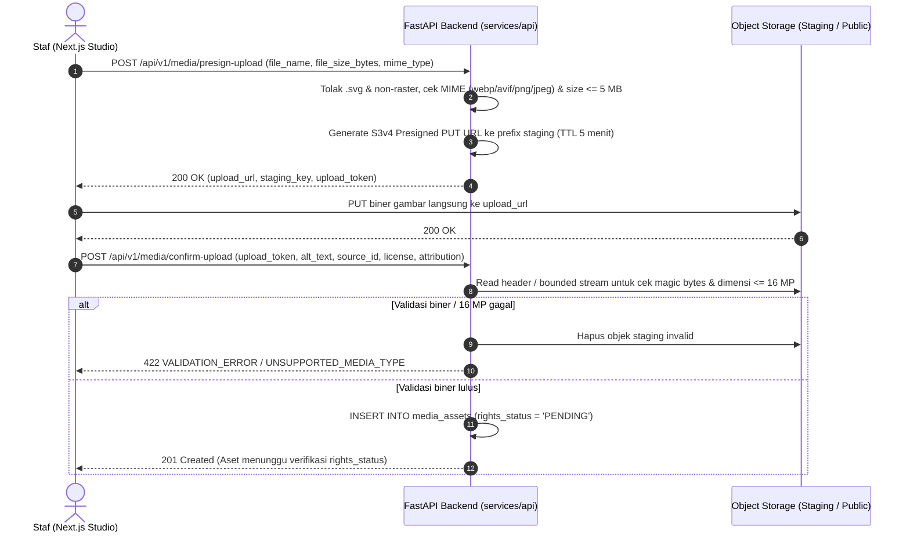

# API Architecture & Endpoint Specification: SEDP Learning Hub (Phase F)

> [!CAUTION]
> **DO NOT DELETE.** Kept by the owner for future use. **NOT PART OF THE MVP**: do not implement or plan MVP work from this file until the owner approves Phase F (see [README.md](./README.md)). If this file conflicts with `docs/prompts/` or `AGENTS.md`, those win.

| Field | Detail |
|---|---|
| **System** | SEDP Learning Hub, Phase F (Platform) |
| **Document Version** | 4.0.0-sedp |
| **Date** | 2026-11-18 |
| **Status** | Deferred draft, not approved |
| **Framework** | Python FastAPI (ASGI) + Pydantic v2 (default usulan Phase F; alternatif Next.js Route Handlers + TypeScript ORM adalah `[OWNER_DECISION]`) |
| **Base URL** | `/api/v1` |
| **Auth Protocol** | Host-Only Secure HttpOnly Cookie (`__Host-sedp_session`) + Server-Side Session Tracking |
| **Domain & Hosting** | `[OWNER_DOMAIN]`, `[OWNER_HOSTING]` |
| **Phase F Modules** | F1 Articles ("Catatan & Studi Kasus"), F2 Provenance (`/sources`, `/fact-checks`), F3 Learner Accounts (`/me*`, opt-in) |

---

## Riwayat Revisi (Revision History)

| Versi | Tanggal | Penulis / Reviewer | Bagian yang Diubah | Rincian Perubahan (Sebelum vs Sesudah) | Alasan Perubahan |
|---|---|---|---|---|---|
| 1.0.0 | 2026-10-13 | Staff Ahli Divisi MIK | Dokumen Baru | Rilis draf awal spesifikasi API arsitektur dual-engine. | Inisiasi baseline API backend. |
| 2.0.0 | 2026-10-14 | Staff Ahli MIK & Auditor | Evaluasi & Keamanan | Penambahan endpoint PIN reset, integrasi Turnstile H-1, evaluasi booking_id, standar Argon2id. | Audit keamanan relasional. |
| 2.1.0 | 2026-10-14 | Staff Ahli MIK & Implementer | Cookie & Rate Limit | Grace period refresh 10s, X-Requested-With CSRF, sliding window rate limiter. | Keputusan resmi Fase 1. |
| 2.2.0 | 2026-10-14 | Staff Ahli MIK & Auditor | BOLA & CAPTCHA | Pencabutan izin divisi ubah kelulusan, Turnstile status verification, field filtering. | Penutupan celah otorisasi. |
| 3.0.0 | 2026-10-23 | Staff Ahli MIK & Antigravity Lead | Seluruh Dokumen | **Sebelum:** Endpoint formulir dinamis (`/forms/*`, `/submissions/*`), booking jadwal wawancara (`/interviews/*`), dan evaluasi kepanitiaan.<br>**Sesudah:** Eliminasi seluruh endpoint form & interview; pemusatan endpoint pada Modul Auth (`/auth/*`), Manajemen User (`/users/*`), Taksonomi (`/categories`, `/tags`), Blog Posts Core (`/posts/*` dengan alur mandiri Author), Media Presigned URL (`/media/*`), dan Audit Logs (`/audit-logs`). Standarisasi cookie `__Host-himaif_session` dan mitigasi CSRF. | Pivot arsitektur WordPress-like Blog CMS murni, eliminasi kompleksitas modul interview, dan persiapan staging deploy. |
| 4.0.0-sedp | 2026-11-18 | SEDP Architecture Adaptation | Seluruh Dokumen | **Sebelum:** Spesifikasi API HIMA IF CMS (2 peran `SUPER_ADMIN`/`AUTHOR`, direct publishing oleh Author, `/posts`, cookie `__Host-himaif_session`, tanpa modul provenance dan learner).<br>**Sesudah:** Diadaptasi menjadi spesifikasi Phase F (Platform) SEDP Learning Hub (status deferred draft): 4 peran (`OWNER`, `AUTHOR`, `REVIEWER`, `LEARNER`), penghapusan direct publishing (`DRAFT -> IN_REVIEW -> APPROVED -> SCHEDULED | PUBLISHED -> ARCHIVED` dengan review gate `technical_ok`, `rights_ok`, `reviewer != author`, media & source `CLEARED`), penambahan grup `/articles`, `/articles/{id}/reviews`, `/sources`, `/fact-checks`, `/me`, `/me/progress`, `/me/quiz-attempts` (termasuk `DELETE /api/v1/me`), aturan batas Next.js vs FastAPI, upload raster (WebP/AVIF/PNG/JPEG maks 5 MB / 16 MP, larangan `.svg`), cookie `__Host-sedp_session`, serta domain `[OWNER_DOMAIN]`. | Penyelarasan dengan kontrak bersama `docs/future/README.md` untuk sistem kabel laut SEDP Learning Hub yang mengutamakan akurasi teknis, kepatuhan hak cipta, dan pemisahan tegas dari MVP statis. |

---

## 1. Architectural Conventions, Service Boundaries & Standards

### 1.1 Batas Layanan FastAPI vs Next.js (Next.js Boundary Rule)

Aplikasi MVP SEDP Learning Hub berada di root repositori (Next.js 16.4.x App Router, React 19, TypeScript strict, Tailwind CSS 4, pnpm 12, Node 24 Maintenance LTS / Node 26 Active LTS). Pada Phase F (ketika diaktifkan dan jika stack default FastAPI dipilih pada gerbang persetujuan):

1. **Kepemilikan Tunggal `/api/v1`**: Layanan Python FastAPI di `services/api/` adalah pemilik eksklusif seluruh rute `/api/v1/**`, diarahkan melalui reverse proxy Nginx satu origin di `infra/docker/`.
2. **Larangan Route Handler Next.js di `/api/v1`**: Aplikasi Next.js (`src/app/**`) **dilarang keras** mendefinisikan Route Handler di bawah `src/app/api/v1/**`. Pelanggaran aturan ini menciptakan *route shadowing* di luar pengawasan FastAPI RBAC, rate limiter Redis, dan sanitizer `nh3`.
3. **Batas Independensi Kurikulum MVP**:
   - Pelajaran inti (*lessons*) dan kuis tetap berformat MDX di git dan menjadi sumber kebenaran kurikulum kanonik.
   - API hanya merujuk pelajaran dan kuis lewat ID konten stabil dari frontmatter MDX (`lesson_id`, `quiz_id`).
   - Tidak ada halaman MVP yang boleh bergantung pada ketersediaan `/api/v1`. Halaman artikel publik F1 ("Catatan & Studi Kasus") wajib menampilkan *error state* yang jelas apabila API gagal dijangkau.
4. **Alternatif Stack (`[OWNER_DECISION]`)**: Jika pada gerbang Phase F pemilik memilih opsi alternatif (Next.js Route Handlers + TypeScript ORM agar satu bahasa), keputusan tersebut wajib dicatat di `docs/DECISIONS.md` sebelum implementasi dan kontrak endpoint serta skema payload pada dokumen ini tetap menjadi acuan fungsional.

---

### 1.2 Format Envelope Respons Standar & Kode Error

Seluruh respons JSON `/api/v1` mengikuti format envelope terstruktur untuk konsumsi konsisten oleh Next.js Server Components maupun klien studio (`src/app/(studio)/studio/**`):

```json
{
  "success": true,
  "data": {},
  "message": "Operasi berhasil diselesaikan",
  "meta": {
    "page": 1,
    "limit": 20,
    "total": 42,
    "total_pages": 3
  }
}
```

Format respons error (kompatibel RFC 9457):

```json
{
  "success": false,
  "error_code": "RESOURCE_NOT_FOUND",
  "message": "Artikel catatan studi kasus tidak ditemukan",
  "detail": [
    {
      "loc": ["path", "slug_or_id"],
      "msg": "Article with slug 'contoh-artikel-studi-kasus' not found",
      "type": "not_found"
    }
  ]
}
```

Daftar Kode Error Baku:
- `VALIDATION_ERROR` (`422`): Payload body, parameter path, atau query gagal melewati validasi skema Pydantic v2.
- `AUTHENTICATION_FAILED` (`401`): Kredensial salah, cookie `__Host-sedp_session` tidak ada, kedaluwarsa, atau dibatalkan oleh `auth_epoch`.
- `EMAIL_VERIFICATION_REQUIRED` (`403`): Akun `LEARNER` hasil pendaftaran mandiri belum menyelesaikan verifikasi email (`email_verified_at IS NULL`).
- `PASSWORD_CHANGE_REQUIRED` (`403`): Akun staf berstatus `must_change_password = true` dan memanggil endpoint di luar allowlist penggantian kata sandi.
- `PERMISSION_DENIED` (`403`): Pelanggaran RBAC, percobaan BOLA/IDOR, self-review, atau kegagalan guard Anti-CSRF / Origin.
- `RIGHTS_NOT_CLEARED` (`422`): Artikel atau aset media belum memenuhi `rights_status = CLEARED` pada seluruh aset/sumber tertaut.
- `REVIEW_GATE_UNMET` (`409`): Upaya publikasi/penjadwalan artikel yang belum berstatus `APPROVED` dengan `technical_ok = true`, `rights_ok = true`, dan `reviewer_id != author_id`.
- `RESOURCE_NOT_FOUND` (`404`): Entitas tidak ditemukan atau tidak boleh terlihat oleh role pemanggil (anti-enumeration).
- `RESOURCE_CONFLICT` (`409`): Slug unik bentrok, transisi status lifecycle tidak sah, kategori/sumber masih dirujuk entitas lain, atau upaya menghapus `OWNER` aktif terakhir.
- `PAYLOAD_TOO_LARGE` (`413`): Berkas media melampaui batas maksimum 5 MB atau payload JSON melampaui batas request.
- `UNSUPPORTED_MEDIA_TYPE` (`415`): Tipe berkas dilarang (termasuk penolakan mutlak `.svg`, `.pdf`, atau file non-raster).
- `RATE_LIMIT_EXCEEDED` (`429`): Ambang batas frekuensi permintaan Redis/Nginx terlampaui (menyertakan header `Retry-After`).
- `INTERNAL_SERVER_ERROR` (`500`): Galat internal server (stack trace dan detail teknis disembunyikan dari klien).

---

### 1.3 Kebijakan Rate Limit (Target Default Phase F)

Angka batas berikut merupakan **target konfigurasi awal** yang ditegakkan melalui Redis 7 *sliding window* (dengan lapisan pelindung awal di Nginx) dan dapat disesuaikan saat Phase F disetujui (`[OWNER_DECISION]`):

| Kelompok Endpoint | Target Batas Default | Kunci Pelacakan | Catatan |
|---|---|---|---|
| `POST /auth/login` | 5 req/menit | IP + target identifier | Ditambah jeda backoff pada kegagalan berulang |
| `POST /auth/register`, `POST /auth/verify-email` | 5 req/menit | Client IP | Mencegah spam registrasi & brute-force token |
| `POST /auth/resend-verification` | 3 req/15 menit | Client IP + email hash | Mengembalikan respons netral |
| `POST /auth/change-password` | 5 req/15 menit | `user_id` | Melindungi endpoint rotasi kredensial |
| `POST /media/presign-upload`, `confirm-upload` | 20 req/menit | `user_id` | Mencegah penyalahgunaan kuota object storage |
| `GET` Publik (`/articles`, `/categories`, `/tags`) | 60 req/menit | Client IP | Dilindungi cache Redis & header cache |
| `PUT/POST /me/progress*`, `/me/quiz-attempts` | 60 req/menit | `user_id` | Mendukung sinkronisasi progres wajar |
| `DELETE /me` | 3 req/jam | `user_id` | Operasi destruktif berproteksi re-autentikasi |

---

### 1.4 Header Keamanan Request & Response

Setiap request mutasi data (`POST`, `PUT`, `PATCH`, `DELETE`) dari klien Next.js **wajib menyertakan**:
1. Cookie sesi: `__Host-sedp_session` (otomatis dikirim browser pada origin `https://[OWNER_DOMAIN]` dengan `credentials: "include"`).
2. Header anti-CSRF: `X-Requested-With: XMLHttpRequest` (atau `X-CSRF-Token`, memicu preflight CORS bila ada upaya lintas origin).
3. Header `Origin` / `Referer` dan `Sec-Fetch-Site` yang valid untuk `https://[OWNER_DOMAIN]` (lihat [AUTH_AND_RBAC.md](./AUTH_AND_RBAC.md)).
4. Header konten: `Content-Type: application/json`.

Setiap response dari `/api/v1` wajib menyertakan security headers berikut (ditambah aturan global Nginx):
- `X-Content-Type-Options: nosniff`
- `X-Frame-Options: DENY`
- `Referrer-Policy: strict-origin-when-cross-origin`
- `Content-Security-Policy: default-src 'none'; frame-ancestors 'none'` (khusus respons JSON API)
- `Strict-Transport-Security: max-age=31536000; includeSubDomains` (wajib pada HTTPS produksi `[OWNER_DOMAIN]`)
- `Cache-Control: no-store` untuk seluruh endpoint `/auth/*`, `/users/*`, `/sources*`, `/fact-checks*`, `/me*`, `/audit-logs`, dan endpoint editorial non-publik.

---

## 2. Katalog Endpoint API (`/api/v1`)

Seluruh path di bawah berada di bawah prefix `/api/v1`. Ringkasan 13 kelompok API sesuai kontrak bersama:
`/auth`, `/users`, `/categories`, `/tags`, `/articles`, `/articles/{id}/reviews`, `/media`, `/sources`, `/fact-checks`, `/me`, `/me/progress`, `/me/quiz-attempts`, `/audit-logs`.

### 2.1 Modul Autentikasi (`/auth`)

| Metode | Path | Hak Akses | Deskripsi & Validasi |
|---|---|---|---|
| `POST` | `/auth/login` | Publik | Autentikasi email/username + password Argon2id. Menolak akun tidak aktif (`is_active = false`) atau `LEARNER` yang belum terverifikasi email (`403 EMAIL_VERIFICATION_REQUIRED`). Menerbitkan cookie `__Host-sedp_session`. Rate-limited. |
| `POST` | `/auth/logout` | Authenticated (semua role) | Mencabut sesi aktif di Redis dan tabel `sessions`, mencatat `LOGOUT` di `auth_audit_logs`, dan menghapus cookie `__Host-sedp_session`. |
| `POST` | `/auth/register` | Publik (khusus F3 opt-in) | Pendaftaran mandiri **khusus** peran `LEARNER` (`role` selalu dipaksa `'LEARNER'`, `must_change_password = false`, `email_verified_at = null`). Mengirim token verifikasi email SHA-256 single-use (hash disimpan di `email_verification_tokens`). Dapat dinonaktifkan lewat feature flag jika F3 belum disetujui. |
| `POST` | `/auth/verify-email` | Publik | Memvalidasi token verifikasi satu kali pakai di `email_verification_tokens`, mengisi `consumed_at = NOW()` dan `users.email_verified_at = NOW()`, lalu mencatat `EMAIL_VERIFIED` ke `auth_audit_logs`. |
| `POST` | `/auth/resend-verification` | Publik | Mengirim ulang tautan verifikasi untuk `LEARNER` belum terverifikasi dengan respons netral anti-enumeration. |
| `GET` | `/auth/me` | Authenticated (allowlist `must_change_password`) | Mengembalikan profil ringkas saat ini: `id`, `email`, `username`, `display_name`, `role` (`OWNER`, `AUTHOR`, `REVIEWER`, `LEARNER`), `must_change_password`, `email_verified_at`. |
| `POST` | `/auth/change-password` | Authenticated (allowlist `must_change_password`) | Memverifikasi password lama, memvalidasi password baru (min. 12 karakter + aturan kompleksitas), mengubah hash Argon2id, menghapus `must_change_password = false`, menaikkan `users.auth_epoch`, mencabut seluruh sesi lama, dan mencatat `PASSWORD_CHANGE`. |

---

### 2.2 Modul Manajemen Pengguna (`/users`): Khusus `OWNER`

Akun staf (`AUTHOR`, `REVIEWER`, dan `OWNER` tambahan) **hanya dapat dibuat melalui endpoint ini**, tidak pernah melalui pendaftaran publik.

| Metode | Path | Hak Akses | Deskripsi & Validasi |
|---|---|---|---|
| `GET` | `/users` | `OWNER` | Daftar seluruh pengguna, filter berdasarkan `role` (`OWNER`, `AUTHOR`, `REVIEWER`, `LEARNER`), `is_active`, pencarian nama/email, dan pagination. |
| `POST` | `/users` | `OWNER` | Membuat akun staf baru (`AUTHOR`, `REVIEWER`, atau `OWNER`) dengan `must_change_password = true` dan `email_verified_at = NOW()`. Password sementara digenerate aman atau diset `OWNER` sesuai kebijakan operasional. |
| `GET` | `/users/{id}` | `OWNER` | Mengambil detail pengguna spesifik termasuk `auth_epoch`, `is_active`, dan tanggal verifikasi. |
| `PATCH` | `/users/{id}` | `OWNER` | Memperbarui `display_name`, `role`, atau status `is_active`. Melindungi agar `OWNER` aktif terakhir tidak dapat menonaktifkan atau menurunkan perannya sendiri (`409 RESOURCE_CONFLICT`). Perubahan `role` atau `is_active = false` langsung menaikkan `auth_epoch`, menghapus seluruh baris `sessions` user tersebut di DB dan Redis, serta menulis `auth_audit_logs`. |
| `POST` | `/users/{id}/reset-password` | `OWNER` | Menetapkan kata sandi sementara baru, menyetel `must_change_password = true`, menaikkan `auth_epoch`, mencabut seluruh sesi aktif, dan mencatat `PASSWORD_RESET`. |

---

### 2.3 Modul Taksonomi: Kategori & Tag (`/categories`, `/tags`)

Tabel kontrak: `article_categories`, `article_tags`, `article_tag_links`.

| Metode | Path | Hak Akses | Deskripsi & Validasi |
|---|---|---|---|
| `GET` | `/categories` | Publik | Daftar kategori aktif beserta `article_count` khusus artikel yang tayang publik (`PUBLISHED` atau `SCHEDULED` dengan `published_at <= NOW()`), agar jumlah draf tidak bocor. Di-cache di Redis. |
| `POST` | `/categories` | `OWNER` | Membuat kategori baru (`name`, `slug` unik, `description`, `color_hex`). |
| `PUT` | `/categories/{id}` | `OWNER` | Memperbarui metadata kategori (`name`, `slug`, `description`, `color_hex`). |
| `DELETE` | `/categories/{id}` | `OWNER` | Menghapus kategori (hanya jika tidak ada baris `articles` yang merujuk kategori ini; jika masih terpakai mengembalikan `409 RESOURCE_CONFLICT`). |
| `GET` | `/tags` | Publik | Daftar tag dengan jumlah artikel publik (`article_count`). |
| `POST` | `/tags` | `OWNER`, `AUTHOR`, `REVIEWER` | Membuat tag baru (`name`, `slug`) saat menyusun atau me-review artikel jika belum tersedia. |
| `DELETE` | `/tags/{id}` | `OWNER` | Menghapus tag dari daftar global (cascade pada `article_tag_links` atau ditolak bila kebijakan melarang penghapusan tag terpakai). |

---

### 2.4 Modul Artikel Editorial (`/articles`)

Mengelola F1 Articles ("Catatan & Studi Kasus") pada tabel `articles`, `article_revisions`, `article_tag_links`, dan `article_sources`.
**Kontrak Siklus Hidup (`article_status`)**:
`DRAFT -> IN_REVIEW -> APPROVED -> SCHEDULED | PUBLISHED -> ARCHIVED`, serta `IN_REVIEW -> DRAFT` saat keputusan review adalah `CHANGES_REQUESTED`.
**Aturan Kunci**: `AUTHOR` dilarang menerbitkan atau menjadwalkan artikel secara langsung. Pengubahan konten pada artikel berstatus `APPROVED`, `SCHEDULED`, atau `PUBLISHED` wajib mengembalikan status ke `DRAFT` (atau membuat revisi yang membatalkan persetujuan sebelumnya) agar konten yang belum di-review tidak pernah tayang otomatis.

| Metode | Path | Hak Akses | Deskripsi & Validasi |
|---|---|---|---|
| `GET` | `/articles` | Publik / Auth | **Publik & `LEARNER`**: hanya artikel `status = 'PUBLISHED'` atau (`status = 'SCHEDULED'` dan `published_at <= NOW()`). Mendukung filter `category`, `tag`, full-text search `q` (`indonesian`), dan pagination.<br>**Staf**: `AUTHOR` melihat artikel miliknya (semua status) + artikel terbit; `REVIEWER` dan `OWNER` dapat memfilter seluruh status termasuk antrean `IN_REVIEW` dan `APPROVED`. |
| `GET` | `/articles/{slug_or_id}` | Publik / Auth | **Publik & `LEARNER`**: `404` bila belum tayang publik. Mengembalikan `content_html` (sanitasi `nh3`), metadata artikel, media berstatus `CLEARED` dengan atribut `license` & `attribution`, serta sitasi publik dari `sources` yang `public_reuse_allowed = true` dan `rights_status = 'CLEARED'`. Menaikkan `view_count` melalui Redis atomic `INCR`.<br>**Staf**: `AUTHOR` (artikel miliknya atau terbit), `REVIEWER` & `OWNER` (semua status), termasuk tautan `article_sources` untuk keperluan verifikasi. |
| `POST` | `/articles` | `OWNER`, `AUTHOR` | Membuat artikel baru dengan status awal **selalu dipaksa `DRAFT`** (upaya mengirim status `PUBLISHED` dari klien ditolak/diabaikan). Menyimpan AST TipTap `content_json`, mengompilasi & menyaring `content_html` via Rust `nh3` allowlist, memvalidasi URI media relatif (`/storage/public/{id}.webp`), menautkan `tag_ids` dan `source_ids`, serta membuat snapshot `article_revisions` nomor 1. |
| `PUT` | `/articles/{id}` | `OWNER`, `AUTHOR` | Memperbarui judul, ringkasan, `content_json`, kategori, tag, media sampul, dan tautan `article_sources`. **Anti-IDOR Guard**: `AUTHOR` hanya boleh menyunting artikel miliknya (`author_id == current_user.id`). Ditolak saat status `IN_REVIEW` kecuali ditarik dulu ke `DRAFT` (atau di-review `CHANGES_REQUESTED`). Jika menyunting artikel `APPROVED`/`PUBLISHED`, status otomatis kembali ke `DRAFT` agar wajib review ulang (kecuali `OWNER` hanya mengubah metadata non-substantif sesuai aturan revisi). Menambah baris baru di `article_revisions`. |
| `POST` | `/articles/{id}/submit-review` | `OWNER`, `AUTHOR` | Mengubah status `DRAFT -> IN_REVIEW`. **Anti-IDOR**: `AUTHOR` hanya pada artikel miliknya. Memvalidasi bahwa artikel memiliki judul, isi non-kosong, kategori, serta tidak menautkan media atau sumber berstatus `REJECTED`. |
| `POST` | `/articles/{id}/withdraw-review` | `OWNER`, `AUTHOR` | Menarik artikel dari `IN_REVIEW` kembali ke `DRAFT` jika penulis perlu melakukan perbaikan sebelum review selesai. |
| `PATCH` | `/articles/{id}/publish` | `OWNER` (lihat catatan `[OWNER_DECISION]`) | Mengubah status `APPROVED -> PUBLISHED` (`published_at = NOW()`). **Gerbang Rilis Wajib (dalam transaksi DB `FOR UPDATE`)**: (1) artikel berstatus `APPROVED`, (2) tersedia review terbaru yang cocok dengan revisi aktif berkeputusan `APPROVED` dengan `technical_ok = true`, `rights_ok = true`, dan `reviewer_id != article.author_id`, (3) seluruh `media_assets` tertaut (featured & inline) berstatus `rights_status = 'CLEARED'`, (4) seluruh `sources` tertaut via `article_sources` berstatus `rights_status = 'CLEARED'`. `AUTHOR` selalu ditolak `403 PERMISSION_DENIED`. Catatan `[OWNER_DECISION]`: apakah `REVIEWER` boleh mengeksekusi tombol publish untuk artikel orang lain yang sudah `APPROVED`, dan apakah `OWNER` boleh memakai override self-approval ber-audit log. |
| `PATCH` | `/articles/{id}/schedule` | `OWNER` | Mengubah status `APPROVED -> SCHEDULED` dengan `published_at > NOW()`. Menerapkan seluruh **Gerbang Rilis Wajib** yang sama seperti `/publish`. Penjadwalan berjalan *worker-free* melalui kueri SQL `published_at <= NOW()`. |
| `PATCH` | `/articles/{id}/archive` | `OWNER` | Mengubah status menjadi `ARCHIVED` agar artikel tidak lagi tampil di feed publik maupun hasil pencarian publik. |
| `DELETE` | `/articles/{id}` | `OWNER`, `AUTHOR` | `AUTHOR` hanya dapat menghapus artikel **miliknya sendiri yang masih berstatus `DRAFT`**. `OWNER` dapat mengarsipkan atau menghapus artikel sesuai kebijakan retensi (`409 RESOURCE_CONFLICT` bila ada kebijakan melarang hapus permanen artikel yang pernah terbit). |
| `GET` | `/articles/{id}/revisions` | `OWNER`, `REVIEWER`, `AUTHOR` | Melihat riwayat snapshot `article_revisions` (`AUTHOR` hanya untuk artikel miliknya). |
| `POST` | `/articles/{id}/revisions/{rev_id}/rollback` | `OWNER`, `AUTHOR` | Memulihkan `content_json` ke nomor revisi target, menyaring ulang `content_html` via `nh3`, membuat nomor revisi baru, dan mengembalikan status ke `DRAFT` (wajib melewati review ulang sebelum tayang). `AUTHOR` dibatasi hanya untuk artikel miliknya. |

---

### 2.5 Modul Review Teknis & Hak Cipta (`/articles/{id}/reviews`)

Tabel kontrak: `article_reviews` (`decision`: `review_decision {APPROVED, CHANGES_REQUESTED}`, `technical_ok` bool, `rights_ok` bool, `notes`, `reviewer_id`, `revision_number`).

| Metode | Path | Hak Akses | Deskripsi & Validasi |
|---|---|---|---|
| `GET` | `/articles/{id}/reviews` | `OWNER`, `REVIEWER`, `AUTHOR` | Mengambil riwayat keputusan review untuk artikel terkait. `AUTHOR` hanya boleh membaca review untuk artikel miliknya sendiri. |
| `POST` | `/articles/{id}/reviews` | `OWNER`, `REVIEWER` | Mengirim keputusan review (`APPROVED` atau `CHANGES_REQUESTED`) pada artikel yang berstatus `IN_REVIEW` dan merujuk `revision_number` terbaru.<br>**Aturan Larangan Self-Review**: Jika `current_user.id == article.author_id`, server wajib menolak dengan `403 PERMISSION_DENIED` (kecuali `current_user.role == 'OWNER'` dan opsi override `OWNER` diaktifkan pada `[OWNER_DECISION]` dengan `owner_override: true` + `override_reason` min. 20 karakter yang dicatat ke `auth_audit_logs`).<br>**Validasi Persetujuan (`APPROVED`)**: Wajib `technical_ok == true`, `rights_ok == true`, dan seluruh media serta sumber tertaut sudah `rights_status == 'CLEARED'`. Jika lulus, artikel bertransisi `IN_REVIEW -> APPROVED`.<br>**Validasi Perbaikan (`CHANGES_REQUESTED`)**: Wajib mengisi `notes` non-kosong; artikel bertransisi `IN_REVIEW -> DRAFT`. |

---

### 2.6 Modul Media & Upload Storage (`/media`)

Pola *Direct-to-Storage* via **AWS Signature V4 Presigned URL** ke object storage kompatibel S3 (usulan: Cloudflare R2 pada `[OWNER_HOSTING]`).

**Aturan Keamanan & Hak Cipta Media (Kontrak Bersama)**:
- **Format diizinkan**: Raster ONLY (`image/webp`, `image/avif`, `image/png`, `image/jpeg`).
- **Larangan Mutlak `.svg`**: Berkas `.svg` atau MIME `image/svg+xml` **wajib ditolak** pada upload (risiko Stored XSS). Diagram SVG terkurasi ditempatkan sebagai komponen React di repositori, bukan upload studio.
- **Larangan Dokumen Mentah**: Upload `.pdf`, arsip, atau tangkapan layar internal tidak diizinkan ke pipeline media publik.
- **Batas Ukuran & Anti-Decompression Bomb**: Maksimum **5 MB** (`5_242_880` byte) dan resolusi total maksimum **16 MP** (`width * height <= 16_000_000` piksel).
- **Gerbang Provenance**: Setiap `media_assets` membawa `source_id`, `license`, `attribution`, dan `rights_status`. Unggahan awal `AUTHOR` ditempatkan di prefix non-publik (staging) berstatus `PENDING`/`UNKNOWN` dan **tidak boleh dirender di halaman publik atau disalin ke `/storage/public/` sebelum `rights_status = 'CLEARED'`**.



| Metode | Path | Hak Akses | Deskripsi & Validasi |
|---|---|---|---|
| `POST` | `/media/presign-upload` | `OWNER`, `AUTHOR`, `REVIEWER` | Memvalidasi metadata unggahan: menolak mutlak `.svg` / `image/svg+xml`, hanya mengizinkan `image/webp`, `image/avif`, `image/png`, `image/jpeg`, batas ukuran `<= 5 MB`. Menghasilkan Presigned PUT URL berdurasi 5 menit ke prefix staging privat dengan constraint `Content-Length` dan `Content-Type`. |
| `POST` | `/media/confirm-upload` | `OWNER`, `AUTHOR`, `REVIEWER` | Mengunduh header/stream terbatas dari objek staging, memverifikasi *magic bytes* sebenarnya cocok dengan MIME (mencegah `.exe`/HTML menyamar sebagai `.jpg`), mendekode dimensi dengan batas `16_000_000` piksel (anti-decompression bomb), lalu menyimpan ke `media_assets` dengan `rights_status = 'PENDING'` (kecuali ditentukan lain oleh `REVIEWER`/`OWNER` sesuai provenance terlampir). Bila verifikasi biner gagal, objek staging langsung dihapus. |
| `GET` | `/media` | `OWNER`, `REVIEWER`, `AUTHOR` | Media Library studio. Mendukung filter `rights_status`, `source_id`, `uploaded_by`. `AUTHOR` melihat aset miliknya sendiri dan aset lain yang sudah `CLEARED`. |
| `PATCH` | `/media/{id}/rights` | `OWNER`, `REVIEWER` | Memperbarui `rights_status` (`UNKNOWN`, `PENDING`, `CLEARED`, `REJECTED`), `source_id`, `license`, `attribution`, dan `alt_text`. Ketika status menjadi `CLEARED`, backend mempromosikan/menyalin objek raster tervalidasi yang telah di-re-encode ke WebP menuju prefix publik `/storage/public/{id}.webp`. |
| `DELETE` | `/media/{id}` | `OWNER`, `AUTHOR` | Menghapus aset media dari storage dan tabel `media_assets`. `AUTHOR` hanya boleh menghapus aset miliknya yang belum dipakai artikel berstatus selain `DRAFT`. Ditolak (`409 RESOURCE_CONFLICT`) jika media sedang tertaut pada artikel `PUBLISHED` atau `SCHEDULED`. |

---

### 2.7 Modul Provenance: Register Sumber & Fact Check (`/sources`, `/fact-checks`)

Mendukung F2 Provenance pada tabel `sources`, `article_sources`, dan `fact_checks`.
**Aturan Akses & Keamanan Data**:
- Seluruh endpoint `/sources` dan `/fact-checks` bersifat **staff-only** (`OWNER`, `REVIEWER`, dan akses baca terbatas untuk `AUTHOR`). Publik dan `LEARNER` selalu ditolak (`401`/`403`).
- Operasi tulis (`POST`, `PATCH`, `DELETE`) pada `/sources` dan `/fact-checks` dibatasi ketat hanya untuk **`REVIEWER` dan `OWNER`**.
- **Larangan Kebocoran Materi Tertutup**: Kolom `private_storage_ref` (penunjuk berkas di penyimpanan privat) **tidak pernah** menghasilkan URL unduhan publik dan **dilarang** merujuk ke direktori publik `/storage/public/`. PDF asli, tangkapan layar kuliah, materi bertanda NEC "Internal Use Only", soal tes tertutup, atau data peserta tidak boleh diunggah atau disajikan secara publik.

| Metode | Path | Hak Akses | Deskripsi & Validasi |
|---|---|---|---|
| `GET` | `/sources` | `OWNER`, `REVIEWER`, `AUTHOR` (read-only) | Daftar register sumber dengan filter `source_type` (`OFFICIAL_MODULE`, `VENDOR_SLIDES`, `OWNER_NOTES`, `PUBLIC_PAPER`, `STANDARD`, `NEWS`, `WEBSITE`, `OTHER`), `trust_level` (`HIGH`, `MEDIUM`, `LOW`), `rights_status` (`UNKNOWN`, `PENDING`, `CLEARED`, `REJECTED`), `public_reuse_allowed`, dan `module_code`. `AUTHOR` hanya menerima metadata referensi untuk menautkan sitasi pada artikel. |
| `POST` | `/sources` | `OWNER`, `REVIEWER` | Menambah entri sumber baru dengan `code` (`VARCHAR(64)` unik, wajib), `title`, `source_type`, `trust_level`, `rights_status`, `public_reuse_allowed` (bool), `module_code`, `page_range`, `license`, `attribution`, dan referensi internal non-publik opsional. |
| `GET` | `/sources/{id}` | `OWNER`, `REVIEWER`, `AUTHOR` (read-only) | Detail lengkap sumber dan daftar artikel/fact-check terkait (kolom internal hanya untuk `OWNER`/`REVIEWER`). |
| `PATCH` | `/sources/{id}` | `OWNER`, `REVIEWER` | Memperbarui `rights_status`, `trust_level`, `public_reuse_allowed`, `page_range`, atau catatan lisensi. Jika sumber diturunkan dari `CLEARED` ke `REJECTED`, sistem menandai artikel tertaut agar ditinjau ulang. |
| `DELETE` | `/sources/{id}` | `OWNER` | Menghapus sumber hanya jika tidak dirujuk oleh `article_sources`, `media_assets`, atau `fact_checks` (`409 RESOURCE_CONFLICT` jika masih terikat). |
| `GET` | `/fact-checks` | `OWNER`, `REVIEWER`, `AUTHOR` (read-only) | Daftar log verifikasi fakta; mendukung filter `status` (`fact_check_status`: `UNVERIFIED`, `VERIFIED`, `DISPUTED`, `RETRACTED`), `lesson_id`, `article_id`, dan `source_id`. |
| `POST` | `/fact-checks` | `OWNER`, `REVIEWER` | Mencatat `claim_text` teknis yang diverifikasi terhadap `lesson_id` (ID pelajaran MDX kanonik) atau `article_id` (UUID artikel), merujuk `source_id`, `status`, dan `verification_notes`. Validasi wajib (strict XOR): tepat satu dari `lesson_id` atau `article_id`, tidak boleh keduanya atau kosong. |
| `GET` | `/fact-checks/{id}` | `OWNER`, `REVIEWER`, `AUTHOR` (read-only) | Detail entri log fact check. |
| `PATCH` | `/fact-checks/{id}` | `OWNER`, `REVIEWER` | Memperbarui `status` (`UNVERIFIED`, `VERIFIED`, `DISPUTED`, `RETRACTED`), `claim_text`, `verification_notes`, atau `source_id`. |
| `DELETE` | `/fact-checks/{id}` | `OWNER` | Menghapus entri fact check yang duplikat atau salah input. |

---

### 2.8 Modul Self-Service Akun & Pembelajar (`/me`, `/me/progress`, `/me/quiz-attempts`)

Mendukung F3 Learner Accounts (opt-in). **Aturan BOLA/IDOR Mutlak**: Seluruh endpoint di grup `/me*` mengambil `user_id` **secara eksklusif dari sesi server (`current_user.id`)** dan tidak pernah menerima parameter `user_id` dari path, query, maupun request body.

| Metode | Path | Hak Akses | Deskripsi & Validasi |
|---|---|---|---|
| `GET` | `/me` | Authenticated (semua role) | Mengembalikan profil minimal milik pengguna sendiri (`id`, `email`, `username`, `display_name`, `role`, `email_verified_at`, `created_at`). |
| `PATCH` | `/me` | Authenticated (semua role) | Memperbarui kolom profil non-sensitif milik sendiri (`display_name`, `username`). **Strict Field Filtering**: mengabaikan/menolak modifikasi `role`, `is_active`, `auth_epoch`, `must_change_password`, atau `email_verified_at`. |
| `DELETE` | `/me` | Authenticated (kepatuhan UU PDP) | Penghapusan akun mandiri (*self-service erasure*). Memerlukan konfirmasi kata sandi (`current_password`) dan flag konfirmasi eksplisit (`confirm_deletion: true`). Menolak `OWNER` aktif terakhir (`409 RESOURCE_CONFLICT`). Menghapus data `learner_progress`, `quiz_attempts`, `sessions`, membersihkan/menganonimkan PII di `users`, menaikkan `auth_epoch`, mencabut seluruh cookie `__Host-sedp_session`, dan mencatat peristiwa `ACCOUNT_SELF_DELETED` tanpa menyimpan PII email/nama terhapus. |
| `GET` | `/me/progress` | Authenticated (`LEARNER` & akun aktif pribadi) | Mengambil seluruh daftar `learner_progress` milik `current_user.id` (`lesson_id`, `status`: `STARTED | COMPLETED`, `updated_at`, `completed_at`). |
| `PUT` | `/me/progress/{lesson_id}` | Authenticated (`LEARNER` & akun aktif pribadi) | *Idempotent upsert* status belajar (`STARTED` atau `COMPLETED`) pada pasangan unik `(user_id, lesson_id)`. `lesson_id` divalidasi berformat ID pelajaran MDX kanonik. |
| `POST` | `/me/progress/sync` | Authenticated (`LEARNER` & akun aktif pribadi) | Menerima batch progres anonim dari `localStorage` browser saat pengguna melakukan opt-in akun; melakukan merge deterministik (`COMPLETED` tidak tertimpa balik menjadi `STARTED`). |
| `GET` | `/me/quiz-attempts` | Authenticated (`LEARNER` & akun aktif pribadi) | Mengambil riwayat `quiz_attempts` milik `current_user.id` dengan filter opsional `?quiz_id=...` dan pagination. |
| `POST` | `/me/quiz-attempts` | Authenticated (`LEARNER` & akun aktif pribadi) | Menyimpan rekaman percobaan kuis baru (`quiz_id` teks kanonik MDX, `score`, `max_score`, `duration_seconds`, metadata ringkas jawaban yang divalidasi skema). |

---

### 2.9 Modul Log Audit (`/audit-logs`): Khusus `OWNER`

| Metode | Path | Hak Akses | Deskripsi & Validasi |
|---|---|---|---|
| `GET` | `/audit-logs` | `OWNER` | Membaca jejak audit `auth_audit_logs` beserta filter `event`, `user_id`, `ip_address`, dan rentang tanggal (`from`, `to`). Mencakup peristiwa autentikasi, rotasi `auth_epoch`, penghapusan akun mandiri, dan peristiwa override editorial `OWNER` (jika fitur override disetujui pada `[OWNER_DECISION]`). |

---

## 3. Kontrak Skema Payload Kunci (Implementable Contracts)

Bagian ini mendefinisikan payload JSON/Pydantic v2 untuk alur paling kritis di Phase F agar frontend Next.js dan backend FastAPI dapat langsung diimplementasikan tanpa ambiguitas.

### 3.1 Review Submission & Publish Gate

**Submit Review (`POST /api/v1/articles/{id}/reviews`)**:
```json
{
  "revision_number": 3,
  "decision": "APPROVED",
  "technical_ok": true,
  "rights_ok": true,
  "notes": "Contoh catatan review: verifikasi teknis dan pemeriksaan lisensi media/sumber telah selesai.",
  "owner_override": false,
  "override_reason": null
}
```
Aturan validasi backend (Pydantic + service layer):
- `decision == "APPROVED"` **wajib** memiliki `technical_ok == true` dan `rights_ok == true`.
- `decision == "CHANGES_REQUESTED"` **wajib** memiliki `notes` minimal 10 karakter.
- `article.status` harus `"IN_REVIEW"` dan `revision_number` harus sama dengan revisi terbaru artikel.
- Jika `current_user.id == article.author_id`: wajib ditolak `403 PERMISSION_DENIED`, kecuali `current_user.role == "OWNER"` dan opsi `[OWNER_DECISION]` (`settings.ALLOW_OWNER_APPROVAL_OVERRIDE == true`) aktif dengan `owner_override == true` serta `override_reason` minimal 20 karakter (dicatat sebagai `OWNER_SELF_APPROVAL_OVERRIDE` di `auth_audit_logs`).

**Publish / Schedule (`PATCH /api/v1/articles/{id}/publish` atau `/schedule`)**:
```json
{
  "published_at": "2026-12-01T08:00:00+07:00"
}
```
Aturan evaluasi gerbang rilis (eksekusi atomik di dalam transaksi):
1. Kunci baris artikel dengan `SELECT ... FROM articles WHERE id = :id FOR UPDATE`.
2. Pastikan `article.status == 'APPROVED'`.
3. Pastikan terdapat baris `article_reviews` untuk revisi aktif dengan `decision == 'APPROVED'`, `technical_ok == true`, `rights_ok == true`, dan memenuhi `reviewer_id != article.author_id` (atau memiliki catatan override `OWNER` yang sah sesuai `[OWNER_DECISION]` dan sudah tercatat di audit log).
4. Pastikan seluruh `media_assets` (featured & inline) dan seluruh `sources` (via `article_sources`) memiliki `rights_status == 'CLEARED'` (gerbang hak cipta tidak pernah boleh dilewati).

### 3.2 Media Presign & Confirm Upload

**Presign Request (`POST /api/v1/media/presign-upload`)**:
```json
{
  "file_name": "contoh-diagram-sistem.webp",
  "file_size_bytes": 412890,
  "mime_type": "image/webp"
}
```
**Confirm Request (`POST /api/v1/media/confirm-upload`)**:
```json
{
  "upload_token": "eyJ...",
  "alt_text": "Contoh teks alternatif deskriptif untuk gambar diagram",
  "source_id": "3d2f1a88-54c2-4a91-b811-1c9d4e7f2011",
  "license": "[LISENSI_TERVERIFIKASI]",
  "attribution": "[ATRIBUSI_SUMBER_TERVERIFIKASI]"
}
```
Invarian backend saat `confirm-upload`:
- Tolak mutlak jika ekstensi atau *magic bytes* menunjuk ke `image/svg+xml`, HTML, PDF, atau biner non-gambar (`415 UNSUPPORTED_MEDIA_TYPE`).
- Validasi `width * height <= 16_000_000` (16 MP) dengan decoder gambar terbatas memori sebelum menyimpan ke `media_assets`.

### 3.3 Provenance (`sources` & `fact-checks`)

**Create Source (`POST /api/v1/sources`)**:
```json
{
  "code": "SRC-CONTOH-01",
  "title": "Contoh Judul Sumber Referensi",
  "source_type": "OWNER_NOTES",
  "trust_level": "HIGH",
  "rights_status": "CLEARED",
  "public_reuse_allowed": false,
  "module_code": "[KODE_MODUL]",
  "page_range": "[RENTANG_HALAMAN_TERVERIFIKASI]",
  "license": "[STATUS_LISENSI]",
  "attribution": "[ATRIBUSI_PARAFRASE_PUBLIK]",
  "private_storage_ref": "sources-private/contoh-referensi-privat.md"
}
```
Aturan validasi backend: `code` wajib diisi, unik, dan maksimal 64 karakter (`VARCHAR(64) NOT NULL UNIQUE`).

**Create Fact Check (`POST /api/v1/fact-checks`)**:
```json
{
  "lesson_id": "contoh-id-pelajaran-mdx",
  "article_id": null,
  "claim_text": "[Ringkasan klaim teknis yang diverifikasi terhadap sumber primer]",
  "status": "VERIFIED",
  "source_id": "3d2f1a88-54c2-4a91-b811-1c9d4e7f2011",
  "verification_notes": "[Catatan verifikasi dan rujukan sumber tanpa menyalin materi tertutup]"
}
```
Aturan validasi target (strict XOR): tepat satu dari `lesson_id` atau `article_id`, tidak boleh keduanya atau kosong (selaras dengan constraint `num_nonnulls(lesson_id, article_id) = 1` pada [DATABASE_SCHEMA.md](./DATABASE_SCHEMA.md)).

### 3.4 Learner Progress & Quiz Attempt (`F3`)

**Upsert Progress (`PUT /api/v1/me/progress/contoh-id-pelajaran-mdx`)**:
```json
{
  "status": "COMPLETED"
}
```
**Record Quiz Attempt (`POST /api/v1/me/quiz-attempts`)**:
```json
{
  "quiz_id": "contoh-id-kuis-mdx",
  "score": 8,
  "max_score": 10,
  "duration_seconds": 195
}
```

---

## 4. Struktur Router Backend (`services/api/`) & Kriteria Penerimaan

Tata letak router modular pada `services/api/app/api/v1/endpoints/`:
- `auth.py` (`/auth/*`)
- `users.py` (`/users/*`)
- `taxonomy.py` (`/categories/*`, `/tags/*`)
- `articles.py` (`/articles/*`, `/articles/{id}/revisions*`)
- `reviews.py` (`/articles/{id}/reviews*`)
- `media.py` (`/media/*`)
- `sources.py` (`/sources/*`)
- `fact_checks.py` (`/fact-checks/*`)
- `me.py` (`/me`, `/me/progress*`, `/me/quiz-attempts*`)
- `audit_logs.py` (`/audit-logs*`)

### Kriteria Penerimaan (Acceptance Criteria) Saat Implementasi Phase F
1. **Batas Next.js Bersih**: Nol berkas di `src/app/api/v1/**`; seluruh panggilan API dari studio dan halaman artikel mengarah ke `/api/v1` melalui single-origin Nginx proxy.
2. **Alur Review & Publikasi Terjaga**: Uji integrasi membuktikan `AUTHOR` mendapat `403` saat memanggil `PATCH /articles/{id}/publish` atau `PATCH /articles/{id}/schedule`; artikel hanya dapat terbit bila memiliki `APPROVED` review (`reviewer_id != author_id`, `technical_ok=true`, `rights_ok=true`) dan 100% media + sumber berstatus `CLEARED`.
3. **Keamanan Media Teruji**: Upload `.svg`, `.pdf`, file biner berkamuflase `.jpg`, file > 5 MB, dan gambar > 16 MP (decompression bomb) gagal dengan `413`/`415`/`422` dan tidak pernah masuk ke `/storage/public/`.
4. **Sanitasi & Privasi**: Payload HTML berbahaya di konten artikel dilucuti oleh `nh3`; `DELETE /api/v1/me` menghapus/menganonimkan data pembelajar secara bersih dan membatalkan sesi aktif saat itu juga.

Spesifikasi API ini disusun agar selaras dengan kontrak bersama Phase F di [README.md](./README.md) dan kebijakan keamanan di [AUTH_AND_RBAC.md](./AUTH_AND_RBAC.md). Sebelum diimplementasikan, seluruh keputusan terbuka (`[OWNER_DECISION]`, `[OWNER_DOMAIN]`, `[OWNER_HOSTING]`) wajib ditetapkan dan dicatat di `docs/DECISIONS.md`.
