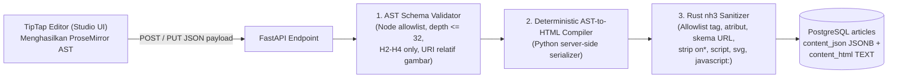
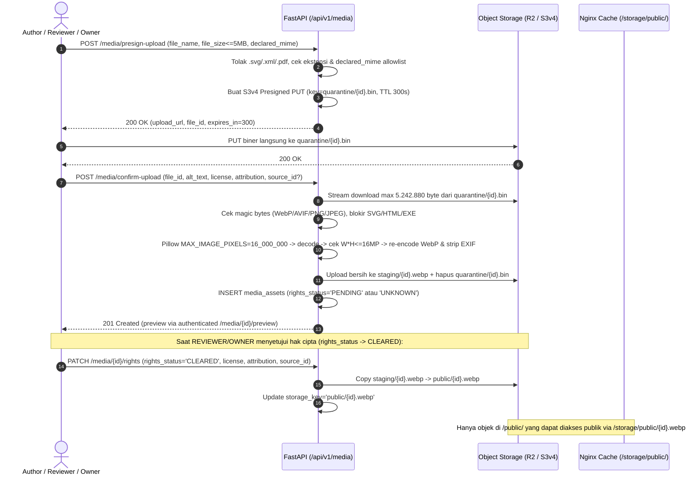

# Modul Artikel, Editor TipTap, dan Pipeline Media: SEDP Learning Hub (Phase F)

> [!CAUTION]
> **DO NOT DELETE.** Kept by the owner for future use. **NOT PART OF THE MVP**: do not implement or plan MVP work from this file until the owner approves Phase F (see [README.md](./README.md)). If this file conflicts with `docs/prompts/` or `AGENTS.md`, those win.

| Field | Detail |
|---|---|
| **System** | SEDP Learning Hub, Phase F (Platform) |
| **Document Version** | 4.0.0-sedp |
| **Date** | 2026-11-18 |
| **Status** | Deferred draft, not approved |
| **Module Scope** | F1 Articles ("Catatan & Studi Kasus") & Media Optimization Pipeline |
| **Frontend Stack** | Next.js 16.4.x stable (App Router, Turbopack default), React 19, TypeScript strict, Tailwind CSS 4, shadcn/ui, pnpm 12 (`allowBuilds` in `pnpm-workspace.yaml`), Node 26 Active LTS / Node 24 Maintenance LTS |
| **Backend Stack (Default)** | Python 3.12+, FastAPI, Pydantic v2, SQLAlchemy 2.0 async, Alembic (`services/api/`), PostgreSQL 16+, Redis 7 single instance (alternatif terbuka: Next.js Route Handlers + TypeScript ORM pada gerbang keputusan Phase F) |
| **Editor & Sanitizer** | TipTap (pin current stable at Phase F start) + Rust `nh3` HTML sanitizer (pin current stable at Phase F start) |
| **Media & Ingress** | S3-compatible object storage via SigV4 presigned URLs (Cloudflare R2 proposed) + Nginx single-origin proxy cache (`infra/docker/`) |
| **Domain & Hosting** | `[OWNER_DOMAIN]` / `[OWNER_HOSTING]` |

---

## Riwayat Revisi (Revision History)

| Versi | Tanggal | Penulis / Reviewer | Bagian yang Diubah | Rincian Perubahan (Sebelum vs Sesudah) | Alasan Perubahan |
|---|---|---|---|---|---|
| 4.0.0-sedp | 2026-11-18 | Antigravity Phase F Adaptation | Seluruh Dokumen (Dokumen Baru Gabungan) | **Sebelum:** Spesifikasi blog editorial dan optimasi gambar pada HIMA IF CMS (`BLOG_MODULE.md` v3.0.0 & `IMAGE_OPTIMIZATION_PERFORMANCE.md` v2.0.0 yang tidak dipertahankan sebagai file terpisah pada `5cbca24`), dengan alur *direct publishing* oleh penulis, tanpa gerbang lisensi/provenance, tanpa sitasi `sources.id` atau tautan `lesson_id`, serta arsitektur monorepo terpisah.<br>**Sesudah:** Disatukan dan diadaptasi menjadi `ARTICLES_MODULE.md` untuk SEDP Learning Hub Phase F (Modul F1 "Catatan & Studi Kasus"): editor TipTap berfokus *subsea engineering* (heading H2-H4, callout teknik, figure dengan atribut provenance wajib, sitasi `sources.id`, cross-link `lesson_id`, tautan glosarium, opsional node KaTeX), persistensi ganda `content_json` + `content_html` tersanitasi Rust `nh3`, state machine berjenjang (`DRAFT -> IN_REVIEW -> APPROVED -> SCHEDULED \| PUBLISHED -> ARCHIVED`) dengan `REVIEWER` & gerbang `rights_status = CLEARED`, pipeline media karantina-ke-publik dengan validasi 5 MB / 16 MP *decompression bomb* + re-encode & strip EXIF, cache Nginx SSD 5 GB (target), dan rendering Next.js 16 yang terdegradasi aman jika API mati. | Menyelaraskan modul editorial dan media dengan kontrak bersama SEDP Phase F ([README.md](./README.md)) serta menjaga kurikula inti MDX tetap statis dan independen. |

---

## 1. Tujuan Modul, Batasan MVP, dan Posisi Arsitektur

Modul **F1 Articles ("Catatan & Studi Kasus")** menambahkan lapisan publikasi editorial berbasis basis data untuk artikel kajian kasus (*cable fault write-ups*), catatan lapangan (*field notes*), analisis insiden historis, dan catatan survei kelautan yang melengkapi kurikulum inti.

### 1.1 Batasan Mutlak terhadap Kurikulum Inti (MVP Boundary)
1. **Pelajaran Inti Tetap MDX di Git**: Seluruh materi kurikulum utama (Modul 1.1, 1.2, 1.3, 1.5, serta 1.4 bila sumber tersedia) tetap berupa berkas MDX di repositori Git dan dirender secara statis tanpa menyentuh PostgreSQL atau FastAPI.
2. **Referensi Melalui ID Stabil**: Artikel di database hanya mereferensikan pelajaran dan kuis lewat ID kanonik (`lesson_id`, `quiz_id` dari frontmatter MDX), bukan menyalin isi pelajaran atau mengunci URL hardcode.
3. **Zero MVP Dependency on API**: Halaman MVP (Home, indeks belajar, pembaca pelajaran MDX, laboratorium simulasi, kuis latihan, glosarium) tidak boleh gagal atau bergantung pada ketersediaan API Phase F. Jika layanan Phase F mati, hanya rute artikel editorial yang menampilkan *explicit error state*.
4. **Rute Publik & Konsol Studio**:
   - Rute artikel publik mengikuti `docs/plans/INFORMATION_ARCHITECTURE.md` (jalur `/artikel` dan `/artikel/[slug]` di dokumen ini berstatus **usulan** sampai dikonfirmasi pada Phase 0B).
   - Konsol editorial staf ditempatkan di `src/app/(studio)/studio/**`, memakai meta `noindex, nofollow`, tidak pernah ditautkan dari navigasi publik, dan dilindungi cookie sesi `__Host-sedp_session`.
   - Aplikasi Next.js **tidak boleh** mendefinisikan route handler di bawah `/api/v1` (seluruh `/api/v1/*` dialihkan Nginx ke backend).
5. **Alternatif Backend Terbuka**: Rancangan default memakai layanan Python FastAPI di `services/api/`. Opsi alternatif berupa Next.js Route Handlers + TypeScript ORM tetap terbuka hingga gerbang persetujuan Phase F (`[OWNER_DECISION]`). Jika opsi TypeScript dipilih, kontrak JSON, skema relasional, gerbang sanitasi HTML, dan kebijakan media pada dokumen ini tetap berlaku identik.

### 1.2 Tata Letak Berkas Modul F1 pada Repositori

```text
sedp-learning-hub/                      # Root Next.js 16 app (existing MVP repo)
├── content/                            # Kurikulum MDX statis (canonical, tidak diubah Phase F)
├── src/
│   ├── app/
│   │   ├── (public)/                   # Rute publik eksisting + rute artikel F1 (usulan)
│   │   │   └── artikel/                # [USULAN] Indeks & pembaca artikel F1
│   │   │       ├── page.tsx            # Daftar artikel publik + filter kategori/tag + search
│   │   │       ├── loading.tsx         # Skeleton loading state (respects reduced-motion)
│   │   │       ├── error.tsx           # Explicit error boundary saat API tidak terjangkau
│   │   │       └── [slug]/
│   │   │           ├── page.tsx        # Detail artikel (ISR + on-demand revalidation)
│   │   │           └── not-found.tsx   # 404 artikel tidak ditemukan / belum terbit
│   │   ├── (studio)/                   # Rute staf (noindex, terisolasi dari nav publik)
│   │   │   └── studio/
│   │   │       ├── layout.tsx          # Studio shell, auth guard, role badge
│   │   │       ├── articles/
│   │   │       │   ├── page.tsx        # Daftar artikel (filter status & owner/author)
│   │   │       │   ├── new/page.tsx    # Editor TipTap artikel baru
│   │   │       │   └── [id]/
│   │   │       │       ├── edit/page.tsx      # Editor + panel provenance & riwayat revisi
│   │   │       │       └── review/page.tsx    # Antarmuka review teknis & lisensi (REVIEWER/OWNER)
│   │   │       ├── media/page.tsx      # Media Library + status clearance (`rights_status`)
│   │   │       ├── taxonomy/page.tsx   # Manajemen `article_categories` & `article_tags`
│   │   │       └── provenance/page.tsx # Tautan cepat ke `sources` & `fact_checks` (F2)
│   │   └── api/
│   │       └── internal/
│   │           └── revalidate/route.ts # Internal-only webhook (bukan `/api/v1`), proteksi HMAC/Bearer
│   ├── components/
│   │   └── editor/                     # TipTap Editor Suite (Client Components)
│   │       ├── subsea-editor.tsx       # Wrapper TipTap utama + state AST JSON
│   │       ├── editor-toolbar.tsx      # Toolbar aksesibel (keyboard navigable, ARIA)
│   │       ├── figure-dialog.tsx       # Dialog upload/pilih media + alt, caption, attribution, source
│   │       ├── citation-picker.tsx     # Pencarian & sisip sitasi dari `/api/v1/sources`
│   │       ├── lesson-link-picker.tsx  # Pemilih `lesson_id` dari manifest MDX lokal
│   │       ├── glossary-picker.tsx     # Pemilih istilah glosarium
│   │       ├── formula-dialog.tsx      # [Opsional] Editor LaTeX KaTeX dengan preview aman
│   │       └── extensions/             # Custom TipTap Node & Mark definitions
│   │           ├── engineering-callout.ts
│   │           ├── subsea-figure.ts
│   │           ├── citation-ref.ts
│   │           ├── lesson-link.ts
│   │           ├── glossary-ref.ts
│   │           └── math-nodes.ts       # [Opsional] mathInline & mathBlock
│   └── features/
│       └── articles/
│           ├── api-client.ts           # Typed fetch wrapper ke `/api/v1` (dengan timeout & fallback)
│           ├── article-renderer.tsx    # Renderer `content_html` + hidrasi formula/tautan lokal
│           ├── article-states.tsx      # Komponen Empty, Loading, dan Error eksplisit
│           └── seo.ts                  # `generateMetadata`, JSON-LD aman, reading time
├── services/
│   └── api/                            # FastAPI Backend Service (default Phase F)
│       ├── alembic/versions/
│       │   ├── 0001_auth_core.py
│       │   ├── 0002_editorial.py       # Taxonomy, articles, revisions, reviews, media_assets
│       │   ├── 0003_provenance.py      # sources, article_sources, fact_checks + FK media->sources
│       │   └── 0004_learner.py
│       └── app/
│           ├── api/v1/endpoints/
│           │   ├── articles.py         # CRUD, submit-review, publish, schedule, archive, revisions
│           │   ├── reviews.py          # `/articles/{id}/reviews`
│           │   ├── categories.py       # `/categories`
│           │   ├── tags.py             # `/tags`
│           │   └── media.py            # `/media` presign, confirm, preview, rights (magic bytes, 16 MP, strip EXIF)
│           ├── core/
│           │   ├── sanitizer.py        # Validator AST JSONB + kompilator HTML + Rust `nh3`
│           │   └── media_guard.py      # Pillow decompression bomb check, magic bytes, re-encode
│           └── services/
│               ├── article_service.py  # State machine, review & clearance gates, revisioning
│               ├── storage_service.py  # S3v4 presigned URL (quarantine & public key management)
│               └── revalidate_hook.py  # Trigger internal Next.js on-demand revalidation
└── infra/
    └── docker/
        ├── compose.yml
        └── nginx/conf.d/default.conf   # Ingress satu origin, `/storage/public/` cache 5 GB SSD
```

Catatan toolchain build Next.js 16.4.x:
- `next lint` telah dihapus pada Next.js 16; skrip lint menggunakan CLI `eslint` langsung (Turbopack aktif sebagai bundler default).
- Konfigurasi `pnpm` 12 menggunakan `allowBuilds` di `pnpm-workspace.yaml` bila ada dependensi native (misalnya modul parser/image helper lokal saat build).

---

## 2. Spesifikasi Editor TipTap untuk Artikel Teknik Bawah Laut

Editor menggunakan **TipTap** (pin current stable at Phase F start, terverifikasi kompatibel dengan React 19) berbasis skema ProseMirror yang ketat. Penulis tidak menyusun HTML mentah, melainkan menyusun **dokumen terstruktur** yang menghasilkan AST JSONB kanonik.

### 2.1 Daftar Node & Mark yang Diizinkan

| Kategori | Node / Mark TipTap | Aturan Struktur & Atribut Wajib | Tujuan Teknik & Kurikulum |
|---|---|---|---|
| **Heading** | `heading` | **Hanya level `2`, `3`, `4` (`H2`-`H4`)**. `H1` dilarang di dalam body karena judul halaman memakai `<h1>` tunggal. | Menjaga hierarki aksesibilitas WCAG 2.2 AA dan generasi TOC otomatis. |
| **Teks & Tipografi** | `paragraph`, `bold`, `italic`, `code`, `subscript`, `superscript`, `blockquote`, `horizontalRule` | Inline style CSS (`style="..."`), warna font acak, dan ukuran font manual dinonaktifkan. `sub`/`sup` aktif untuk notasi satuan ($\text{SiO}_2$, $10^{-9}$, dBm). | Konsistensi desain "Immersive Ocean" dan keterbacaan rumus/satuan di badan teks. |
| **Daftar** | `bulletList`, `orderedList`, `listItem` | Kedalaman bersarang dibatasi maksimal 4 level di validator AST. | Penjabaran langkah survei kelautan, prosedur isolasi fault PFE, dan checklist. |
| **Tabel Teknik** | `table`, `tableRow`, `tableHeader`, `tableCell` | Baris header (`tableHeader`) wajib tersedia untuk tabel data; sel mendukung `colspan` & `rowspan` terbatas. | Perbandingan jenis kabel (LW, LWP, SA, DA), metrik modulasi koheren, dan tabel parameter link budget. |
| **Blok Kode** | `codeBlock` (Lowlight / syntax highlighter, pin current stable at Phase F start) | Atribut `language` dibatasi pada daftar aman (`python`, `typescript`, `sql`, `bash`, `json`, `text`). | Cuplikan skrip kalkulasi attenuasi, pembacaan jejak COTDR, atau contoh kueri telemetri. |
| **Callout Teknik** | `engineeringCallout` (Custom Node) | Atribut `variant`: `note` \| `assumption` \| `safety` \| `warning` \| `case_fact`, dan `title` opsional (maks 120 karakter). | Membedakan fakta studi kasus, asumsi model aproksimasi edukatif, dan catatan keselamatan tegangan tinggi PFE. |
| **Figur Gambar** | `subseaFigure` (Custom Node) | **Wajib terisi semua**: `mediaAssetId` (UUID), `src` (`/storage/public/{id}.webp`), `alt` (10-255 karakter), `caption` (non-kosong), `attribution` (non-kosong), `sourceId` (UUID `sources.id`) atau `sourceUrl` (`https://`/`http://`) + `sourceLabel`, `width`, `height`. | Menjamin setiap diagram/foto lapangan memiliki deskripsi aksesibel, kredit hak cipta, sumber referensi, dan dimensi anti-CLS. |
| **Sitasi Sumber** | `citationRef` (Custom Inline Node) | `sourceId` (UUID mengacu `sources.id`), `locator` opsional (misal nama seksi/bab atau nomor gambar yang terverifikasi, dilarang mengarang nomor halaman). | Mengaitkan klaim teknis dan insiden kabel ke entri teraudit di `sources` dan daftar pustaka akhir artikel. |
| **Cross-Link Pelajaran** | `lessonLink` (Custom Mark) | `lessonId` (text, mengacu ID kanonik frontmatter MDX, misal `1.3-architecture-wet-dry-plant`), `anchor` opsional, `quizId` opsional. | Menautkan artikel studi kasus ke pelajaran kurikulum inti tanpa memecah tautan saat routing berubah. |
| **Tautan Glosarium** | `glossaryRef` (Custom Mark) | `termId` (slug/ID istilah glosarium kanonik, misal `pfe`, `cotdr`, `slte`, `branching-unit`). | Memberikan akses cepat ke definisi istilah bawah laut bagi pembaca baru maupun praktisi. |
| **Formula KaTeX** *(Opsional)* | `mathInline`, `mathBlock` (Custom Node) | Atribut `latex` (string maks 2.000 karakter). Diaktifkan bila artikel memerlukan notasi matematika (misal Shannon capacity, power budget, PFE voltage profile). | Menampilkan persamaan teknik secara tajam tanpa mengunggah gambar atau menyisipkan HTML mentah. |

### 2.2 Aturan Keamanan Khusus Node Editor
1. **KaTeX Safety Mode**: Baik pratinjau di Studio maupun rendering publik wajib memanggil KaTeX dengan opsi `trust: false` dan `strict: "warn"`. Perintah berisiko seperti `\href{javascript:...}`, `\htmlClass`, `\htmlStyle`, atau makro rekursif tak terbatas (`maxExpand: 1000`) ditolak.
2. **Penguncian Link & Paste**:
   - Paste HTML eksternal dari Word/Google Docs/browser lain dinormalisasi oleh aturan `transformPastedHTML` TipTap agar `style`, `class`, `<font>`, `<span>` tak dikenal, dan `<svg>` langsung dibuang sebelum masuk ke state ProseMirror.
   - Drag-and-drop atau paste gambar biner di dalam editor tidak boleh menghasilkan URI `data:image/...` permanen di AST; editor mencegat event paste/drop dan mengarahkannya ke dialog upload terkelola (`/api/v1/media/presign-upload` + metadata provenance wajib).
   - Tautan eksternal hanya mengizinkan skema `https://` dan `http://` (atau `mailto:` untuk kontak resmi bila relevan). Skema `javascript:`, `data:`, dan `vbscript:` ditolak pada level UI dan server.
3. **Larangan Mutlak Gambar atau Dokumen Tertutup**: Panel picker figur dan sitasi menampilkan peringatan eksplisit agar penulis tidak mengunggah salinan mentah PDF, tangkapan layar kuliah, materi bertanda "Internal Use Only", soal ujian tertutup, atau data peserta pelatihan.

---

## 3. Persistensi Ganda dan Sanitasi HTML Sisi Server (`nh3`)

Artikel disimpan dalam dua representasi sinkron di tabel `articles` (`content_json` dan `content_html`) untuk menyeimbangkan integritas skema, kemampuan re-edit, dan performa rendering SSR/ISR.



### 3.1 Kontrak Alur Kompilasi Sisi Server
- **Klien tidak dipercaya mengirimkan `content_html` final**: Klien mengirimkan `content_json` (objek AST TipTap maksimal 512 KB terkompresi/payload HTTP).
- Backend melakukan 3 tahap berurutan sebelum menulis ke `articles` dan `article_revisions`:
  1. **Validasi AST JSONB (`ast_validator.py`)**: Memastikan kedalaman node `<= 32`, hanya tipe node/mark pada Tabel 2.1, heading hanya level 2..4, seluruh `src` pada `subseaFigure` mematuhi pola UUIDv4 huruf kecil `^/storage/public/[0-9a-f-]{36}\.webp$` (ditolak langsung dengan `422 VALIDATION_ERROR` bila melanggar), serta mengekstrak daftar `mediaAssetId`, `sourceId`, dan `lessonId` untuk validasi relasional.
  2. **Kompilasi AST ke HTML Mentah (`ast_compiler.py`)**: Mengubah `content_json` menjadi HTML semantik (misal `<figure data-media-id="..." data-source-id="...">`, `<th scope="col">`, `<div data-callout="safety" data-callout-title="...">`, `<span data-math-inline="true" data-latex="...">`).
  3. **Sanitasi Final dengan Rust `nh3` (`sanitizer.py`)**: Menjalankan `nh3.clean(...)` sebagai lapisan pertahanan mendalam (*defense-in-depth*) terhadap segala HTML hasil kompilasi (atau hasil rollback revisi lama) untuk memusnahkan potensi *Stored XSS*.

### 3.2 Konfigurasi Eksplisit Allowlist Rust `nh3`

Implementasi referensi pada `services/api/app/core/sanitizer.py` (pin `nh3` current stable at Phase F start):

```python
import re
import nh3

ALLOWED_TAGS: set[str] = {
    "h2", "h3", "h4",
    "p", "br", "hr",
    "strong", "em", "code", "pre", "blockquote",
    "ul", "ol", "li",
    "sub", "sup",
    "a", "cite",
    "figure", "figcaption", "img",
    "table", "thead", "tbody", "tr", "th", "td",
    "div", "span",
}

ALLOWED_ATTRIBUTES: dict[str, set[str]] = {
    "h2": {"id"},
    "h3": {"id"},
    "h4": {"id"},
    "a": {"href", "title", "data-lesson-id", "data-glossary-term", "data-source-id"},
    "cite": {"id", "data-source-id", "data-locator"},
    "figure": {"data-media-id", "data-source-id"},
    "img": {"src", "alt", "width", "height", "loading", "decoding", "data-media-id"},
    "code": {"class"},
    "th": {"colspan", "rowspan", "scope"},
    "td": {"colspan", "rowspan"},
    "div": {"data-callout", "data-callout-title", "data-math-block", "data-latex"},
    "span": {"data-math-inline", "data-latex"},
}

ALLOWED_URL_SCHEMES: set[str] = {"https", "http", "mailto"}

RELATIVE_MEDIA_RE = re.compile(r"^/storage/public/[0-9a-f]{8}-[0-9a-f]{4}-4[0-9a-f]{3}-[89ab][0-9a-f]{3}-[0-9a-f]{12}\.webp$")
LANG_CLASS_RE = re.compile(r"^language-(python|typescript|sql|bash|json|text)$")
CALLOUT_VARIANTS = {"note", "assumption", "safety", "warning", "case_fact"}


def filter_safe_attribute(tag: str, attr: str, value: str) -> str | None:
    """Strict attribute-value guard executed inside nh3.clean()."""
    if tag == "img" and attr == "src":
        # Blokir total URL eksternal, data: URI, maupun path non-WebP
        return value if RELATIVE_MEDIA_RE.fullmatch(value) else None
    if tag == "code" and attr == "class":
        return value if LANG_CLASS_RE.fullmatch(value) else None
    if tag == "div" and attr == "data-callout":
        return value if value in CALLOUT_VARIANTS else None
    if tag in {"th", "td"} and attr == "scope":
        return value if value in {"col", "row"} else None
    return value


def sanitize_article_html(raw_html: str) -> str:
    """
    Membersihkan HTML artikel secara ketat menggunakan Rust nh3:
    - Menghapus <script>, <style>, <iframe>, <svg>, <object>, <form> beserta isinya.
    - Menolak seluruh atribut on* (onclick, onerror, onload, dll.) dan style inline.
    - Menolak URL javascript:, vbscript:, dan data:.
    - Memaksa rel="noopener noreferrer" pada seluruh elemen <a>.
    """
    return nh3.clean(
        raw_html,
        tags=ALLOWED_TAGS,
        attributes=ALLOWED_ATTRIBUTES,
        url_schemes=ALLOWED_URL_SCHEMES,
        clean_content_tags={"script", "style", "svg", "math"},
        link_rel="noopener noreferrer",
        attribute_filter=filter_safe_attribute,
        strip_comments=True,
    )
```

> [!IMPORTANT]
> **Mengapa `svg` dan `script` masuk ke `clean_content_tags`?** Selain dihapus tag-nya, seluruh isi teks di dalam `<script>`, `<style>`, atau `<svg>` juga dibuang agar tidak meninggalkan sisa teks payload di halaman artikel.

---

## 4. Siklus Hidup Artikel, Review Gates, Penjadwalan Bebas Worker, dan Revisi

Berbeda dengan CMS blog umum yang membolehkan penulis langsung menayangkan tulisan (*direct publishing*), SEDP Learning Hub mewajibkan verifikasi akurasi teknis kelautan/optik serta kejelasan hak cipta sebelum konten dapat diakses publik.

### 4.1 State Machine (`article_status`)

```mermaid
stateDiagram-v2
    [*] --> DRAFT: AUTHOR atau OWNER membuat artikel

    DRAFT --> IN_REVIEW: Submit review\n(pre-flight AST, alt, caption, citation lengkap)
    IN_REVIEW --> DRAFT: CHANGES_REQUESTED oleh REVIEWER/OWNER\natau penarikan oleh AUTHOR
    IN_REVIEW --> APPROVED: APPROVED oleh REVIEWER/OWNER\n(reviewer != author, technical_ok=true,\nrights_ok=true, media & sources CLEARED)

    APPROVED --> DRAFT: Artikel disunting ulang atau rollback\n(approval lama otomatis gugur)
    APPROVED --> SCHEDULED: OWNER menjadwalkan published_at > NOW()\n(validasi ulang semua aset/sumber CLEARED)
    APPROVED --> PUBLISHED: OWNER menerbitkan langsung (published_at = NOW())\n(validasi ulang semua aset/sumber CLEARED)

    SCHEDULED --> PUBLISHED: Otomatis saat published_at <= NOW()\n(kueri worker-free; opsional materialisasi cron)
    SCHEDULED --> DRAFT: OWNER membatalkan jadwal untuk revisi
    PUBLISHED --> ARCHIVED: OWNER mengarsipkan artikel
    SCHEDULED --> ARCHIVED: OWNER mengarsipkan artikel terjadwal
    ARCHIVED --> DRAFT: OWNER membuka kembali untuk revisi baru
```



### 4.2 Matriks Wewenang Siklus Editorial (RBAC & Anti-IDOR)

| Aksi / Transisi | Endpoint (`/api/v1/...`) | `OWNER` | `AUTHOR` | `REVIEWER` | `LEARNER` | Syarat Guard Wajib |
|---|---|---|---|---|---|---|
| Buat Draf (`DRAFT`) | `POST /articles` | Ya | Ya | Tidak (403) | Tidak (403) | Validasi AST + `nh3`, status awal wajib `DRAFT` |
| Edit Draf (`PUT`) | `PUT /articles/{id}` | Ya | Hanya milik sendiri | Tidak (403) | Tidak (403) | Anti-IDOR (`author_id == current_user.id`). Jika status sebelumnya `APPROVED`/`SCHEDULED`/`PUBLISHED`, transisi kembali ke `DRAFT` dan set `approved_review_id = NULL` (atau wajib salinan revisi) agar tidak melewati review. |
| Ajukan Review (`DRAFT -> IN_REVIEW`) | `POST /articles/{id}/submit-review` | Ya | Hanya milik sendiri | Tidak (403) | Tidak (403) | Setiap `subseaFigure` punya `alt`, `caption`, `attribution`, `source`; mengisi `submitted_for_review_at` |
| Tarik Review (`IN_REVIEW -> DRAFT`) | `POST /articles/{id}/withdraw-review` | Ya | Hanya milik sendiri | Tidak (403) | Tidak (403) | Mengembalikan status ke `DRAFT` sebelum review selesai |
| Catat Review (`APPROVED` / `CHANGES_REQUESTED`) | `POST /articles/{id}/reviews` | Ya (kecuali karya sendiri*) | Tidak (403) | Ya (kecuali karya sendiri) | Tidak (403) | **`reviewer_id != article_author_id`** (composite FK ke `articles(id, author_id)`). Jika `APPROVED`: wajib `technical_ok = true`, `rights_ok = true`, semua media & source `CLEARED`. Jika `CHANGES_REQUESTED`: wajib `notes` non-kosong. |
| Terbitkan (`APPROVED -> PUBLISHED`) | `PATCH /articles/{id}/publish` | Ya | **Ditolak (403)** | **Ditolak (403)** | Tidak (403) | `articles.approved_review_id` merujuk baris `article_reviews` `APPROVED` untuk revisi terkini (`revision_id`), semua `media_assets` & `sources` bertanda `CLEARED` |
| Jadwalkan (`APPROVED -> SCHEDULED`) | `PATCH /articles/{id}/schedule` | Ya | **Ditolak (403)** | **Ditolak (403)** | Tidak (403) | Sama seperti publish + `published_at > NOW()` |
| Arsipkan (`-> ARCHIVED`) | `PATCH /articles/{id}/archive` | Ya | **Ditolak (403)** | **Ditolak (403)** | Tidak (403) | Mengisi `archived_at`, mengeluarkan artikel dari feed publik & memicu revalidasi ISR |
| Lihat Riwayat Revisi | `GET /articles/{id}/revisions` | Ya | Hanya milik sendiri | Ya | Tidak (403) | Read-only audit snapshot AST + ringkasan perubahan |
| Rollback ke Revisi N | `POST /articles/{id}/revisions/{rev_id}/rollback` | Ya | Hanya milik sendiri | Tidak (403) | Tidak (403) | Membuat revisi baru `N+1` dan mengatur status menjadi `DRAFT` untuk review ulang |

*\*Catatan Override `OWNER`*: Sesuai Open Decision #5 di [README.md](./README.md) (`[OWNER_DECISION]`), bila pemilik menyetujui mekanisme darurat *self-approval override* bagi `OWNER`, permintaan review harus menyertakan payload API `owner_override = true` serta `override_reason` non-kosong, menandai `is_owner_override = true` di `article_reviews`, dan menulis peristiwa audit `OWNER_SELF_APPROVAL_OVERRIDE` ke `auth_audit_logs`. Bila opsi ini tidak diaktifkan, `OWNER` tunduk pada larangan *self-approval* yang sama dengan `REVIEWER`.

### 4.3 Skema Database Relasional (`0002_editorial` & Keterkaitan `0003_provenance`)

> [!NOTE]
> **[DATABASE_SCHEMA.md](./DATABASE_SCHEMA.md)** adalah satu-satunya sumber kebenaran (*single DDL source of truth*) untuk seluruh `ENUM`, tabel, kolom, *CHECK constraint*, indeks, dan *trigger* PostgreSQL 16+ pada Phase F. Dokumen ini tidak menduplikasi blok `CREATE TABLE` agar tidak terjadi divergensi skema.

Ringkasan entitas editorial dan keterkaitannya pada revisi Alembic `0002_editorial` dan `0003_provenance` (lihat DDL lengkap di [DATABASE_SCHEMA.md](./DATABASE_SCHEMA.md)):

| Tabel | Revisi Alembic | Kolom & Kontrak Kunci untuk Modul F1 |
|---|---|---|
| `article_categories` | `0002_editorial` | `id` (UUIDv4 PK), `name`, `slug`, `description`, `color_hex` (`CHAR(7)`, default `'#0EA5E9'`), `sort_order`, `article_count`, `created_at`, `updated_at`. |
| `article_tags` | `0002_editorial` | `id`, `name` (`VARCHAR(50)`), `slug` (`VARCHAR(60)`), `article_count`, `created_at`. |
| `media_assets` | `0002_editorial` (+ FK `0003_provenance`) | `storage_key` (`UNIQUE`, prefix `staging/{id}.webp` atau `public/{id}.webp`), `mime_type` (hanya raster WebP/AVIF/PNG/JPEG), `file_size_bytes` (`<= 5242880` / 5 MB), `width` & `height` (sisi maks `8192` px dengan `width::BIGINT * height::BIGINT <= 16000000` / 16 MP), `sha256_hex`, `alt_text`, `rights_status` (`UNKNOWN`, `PENDING`, `CLEARED`, `REJECTED`), `license`, `attribution`, `source_id` (`UUID` nullable di `0002_editorial`, FK `fk_media_assets_source -> sources(id)` ditambahkan di `0003_provenance`), `rejection_reason` (wajib terisi saat `rights_status = 'REJECTED'`), `uploaded_by`, `reviewed_by`, `reviewed_at`. |
| `articles` | `0002_editorial` | `title`, `slug`, `excerpt`, `content_json` (TipTap AST JSONB), `content_html` (sanitasi `nh3`), `featured_image_id`, `author_id`, `category_id`, `related_module_code` (kaitan opsional ke kode modul kurikulum MDX seperti `'1.3'`; cross-link `lesson_id` granular berada di dalam `content_json`), `status` (`article_status`), `approved_review_id` (FK tertunda ke `article_reviews(id)`, wajib non-null untuk `APPROVED`/`SCHEDULED`/`PUBLISHED`), `current_revision_number`, `submitted_for_review_at`, `published_at`, `archived_at`, `meta_title`, `meta_description`, `reading_time_minutes`, `view_count`, `uq_articles_id_author` (`UNIQUE (id, author_id)`), serta trigger `trg_articles_publish_gate` (`fn_enforce_article_publish_gate()`). |
| `article_tag_links` | `0002_editorial` | Relasi *many-to-many* `(article_id, tag_id)` composite PK. |
| `article_revisions` | `0002_editorial` | `id`, `article_id`, `editor_id` (`users(id)`), `revision_number` (`UNIQUE (article_id, revision_number)`), `title`, `excerpt`, `content_json`, `change_summary`, `created_at` (`content_html` selalu dikompilasi dan disanitasi ulang dari `content_json` saat rollback). |
| `article_reviews` | `0002_editorial` | `id`, `article_id`, `article_author_id` (composite FK `(article_id, article_author_id) -> articles(id, author_id)`), `reviewer_id`, `revision_id` (`article_revisions(id)`), `decision` (`review_decision`), `technical_ok`, `rights_ok`, `is_owner_override` (dipetakan dari payload API `owner_override`), `override_reason`, `notes` (wajib non-kosong saat `CHANGES_REQUESTED`), `created_at`, serta `chk_review_separation_of_duties`. |
| `sources`, `article_sources`, `fact_checks` | `0003_provenance` | Dikelola modul F2: `sources` (`code VARCHAR(64) NOT NULL UNIQUE`, `rights_status`, `public_reuse_allowed`, `module_code`, `page_range`), `article_sources` (`article_id`, `source_id`, `citation_note`, `sort_order`, `created_by`, `created_at`), dan `fact_checks` (`claim_text`, `verification_notes`, `status`, serta target XOR ketat `num_nonnulls(lesson_id, article_id) = 1`). |

### 4.4 Verifikasi Gerbang Publikasi (Server-Side Gate Check)
Sebelum `PATCH /api/v1/articles/{id}/publish` atau `PATCH /api/v1/articles/{id}/schedule` mengembalikan `200 OK`:
1. Status artikel saat ini wajib `APPROVED`.
2. `articles.approved_review_id` merujuk pada baris `article_reviews` yang sah untuk artikel tersebut (revisi terkini via `revision_id`) dengan `decision = 'APPROVED'`, `technical_ok = true`, `rights_ok = true`, dan `reviewer_id != article_author_id` (atau `is_owner_override = true` dengan `override_reason` non-kosong jika diizinkan `[OWNER_DECISION]`).
3. Seluruh aset gambar (`featured_image_id` dan setiap `mediaAssetId` yang diekstrak dari `content_json`) berstatus `media_assets.rights_status = 'CLEARED'` serta memiliki `license` dan `attribution` terisi.
4. Seluruh sumber yang ditautkan pada `article_sources` maupun `citationRef` di `content_json` memiliki `sources.rights_status = 'CLEARED'`. Apabila konten memuat kutipan langsung atau materi derivatif, `sources.public_reuse_allowed` wajib `true`.
5. Tidak ada entri pada `fact_checks` yang mengacu ke `article_id` ini dengan status `DISPUTED` atau `RETRACTED`. Jika ada, server menolak publikasi dengan `409 RESOURCE_CONFLICT` (`UNRESOLVED_FACT_CHECK`) sampai diperbaiki dan direview ulang.

### 4.5 Penjadwalan Tayang Bebas Background Worker
Arsitektur tidak memakai Celery Worker/Beat maupun antrean terdistribusi:
1. Kueri publik pada `GET /api/v1/articles` dan `GET /api/v1/articles/{slug_or_id}` hanya mengembalikan baris dengan kondisi:
   ```sql
   SELECT *
   FROM articles
   WHERE (
       status = 'PUBLISHED'
       OR (status = 'SCHEDULED' AND published_at <= NOW())
   )
     AND published_at IS NOT NULL
   ORDER BY published_at DESC;
   ```
2. **Konsistensi Cache Tanpa Worker**:
   - Cache daftar artikel di Redis menggunakan TTL pendek (target maksimal 60 detik), atau menghitung sisa detik menuju `MIN(published_at)` artikel `SCHEDULED` terdekat agar artikel tidak terlambat muncul melebihi jendela 60 detik.
   - Next.js ISR memakai `revalidate: 60` pada halaman daftar dan detail artikel, ditambah pemicu *on-demand revalidation* saat `OWNER` menerbitkan/mengarsipkan/mengubah artikel secara langsung.
   - Opsional: tugas cron ringan (misal setiap 5 menit atau harian) dapat mematerialisasi baris `SCHEDULED` yang lewat waktu menjadi `PUBLISHED` dan memicu webhook `/api/internal/revalidate`, namun kebenaran penayangan tidak bergantung pada cron tersebut.

### 4.6 Riwayat Revisi dan Rollback Aman
- Setiap panggilan `PUT /api/v1/articles/{id}` secara atomik dalam satu transaksi database:
  1. Memperbarui baris `articles` (`title`, `excerpt`, `content_json`, `content_html`, `current_revision_number = current_revision_number + 1`).
  2. Menyisipkan snapshot revisi (`revision_number`, `title`, `excerpt`, `content_json`, `change_summary`, `editor_id`) ke `article_revisions`.
  3. Bila status artikel saat disunting adalah `APPROVED` atau `SCHEDULED` (atau revisi lanjutan), status dikembalikan ke `DRAFT` dan `approved_review_id` disetel `NULL` agar suntingan baru tidak pernah mengudara tanpa review ulang. Untuk artikel `PUBLISHED`, penyuntingan oleh `AUTHOR` dilarang (harus lewat alur clone/unpublish oleh `OWNER` atau transisi ke `DRAFT`), sehingga isi publik yang sedang tayang tetap terjamin telah lolos review.
- Rollback (`POST /api/v1/articles/{id}/revisions/{rev_id}/rollback`):
  1. Tidak pernah menghapus baris `article_revisions` yang sudah ada.
  2. Membaca `content_json` dari revisi target, memvalidasi ulang AST serta menjalankan ulang `sanitize_article_html()` dengan aturan `nh3` terkini untuk memperbarui `articles.content_html`.
  3. Membuat **revisi baru** (`current_revision_number + 1`) dengan `change_summary = "Rollback ke revisi #{target_revision_number}"`, mengatur `status = 'DRAFT'`, dan mengosongkan `approved_review_id = NULL` agar wajib melewati review ulang sebelum publikasi.

### 4.7 Ringkasan Endpoint API Modul F1 & Media (`/api/v1`)

Seluruh router FastAPI untuk modul ini berada pada direktori `services/api/app/api/v1/endpoints/`. Seluruh endpoint mutasi (`POST`, `PUT`, `PATCH`, `DELETE`) mewajibkan cookie sesi Host-Only `__Host-sedp_session`, header `X-Requested-With: XMLHttpRequest`, `Content-Type: application/json`, dan pengecekan `Sec-Fetch-Site` untuk mencegah CSRF.

| Grup | Metode & Path | Hak Akses | Ringkasan Kontrak |
|---|---|---|---|
| **Categories** | `GET /api/v1/categories` | Publik | Daftar kategori (`article_categories`) beserta jumlah artikel terbit. |
| **Categories** | `POST /api/v1/categories`, `PUT /api/v1/categories/{id}`, `DELETE /api/v1/categories/{id}` | `OWNER` | Kelola taksonomi global; `DELETE` ditolak (`409`) bila masih memiliki artikel. |
| **Tags** | `GET /api/v1/tags`, `POST /api/v1/tags` | `GET`: Publik, `POST`: `OWNER`, `AUTHOR`, `REVIEWER` | Pencarian & penambahan tag granular (`article_tags`). |
| **Articles** | `GET /api/v1/articles` | Publik / Staff | Publik hanya melihat `PUBLISHED` atau `SCHEDULED` dengan `published_at <= NOW()` (filter kategori, tag, pencarian FTS bahasa Indonesia, paginasi). Staff terautentikasi melihat cakupan status sesuai role (`AUTHOR` melihat miliknya sendiri). |
| **Articles** | `GET /api/v1/articles/{slug_or_id}` | Publik / Staff | Detail artikel beserta `content_html`, metadata SEO, daftar sumber (`article_sources`), serta `content_json` bagi staff di Studio. |
| **Articles** | `POST /api/v1/articles`, `PUT /api/v1/articles/{id}`, `DELETE /api/v1/articles/{id}` | `OWNER`, `AUTHOR` (milik sendiri) | Buat/edit/hapus draf dengan validasi AST + `nh3` + anti-IDOR. |
| **Reviews** | `GET /api/v1/articles/{id}/reviews`, `POST /api/v1/articles/{id}/reviews` | `OWNER`, `REVIEWER` (baca juga `AUTHOR` pemilik) | Catat `APPROVED` / `CHANGES_REQUESTED` dengan checklist `technical_ok` & `rights_ok`. |
| **Media** | `POST /api/v1/media/presign-upload`, `POST /api/v1/media/confirm-upload`, `GET /api/v1/media`, `GET /api/v1/media/{id}/preview`, `PATCH /api/v1/media/{id}/rights`, `DELETE /api/v1/media/{id}` | Staff sesuai RBAC | Upload S3v4 karantina, verifikasi raster 5 MB / 16 MP (sisi maks `8192` px) & strip EXIF, pratinjau studio, keputusan hak cipta `CLEARED`/`REJECTED` (`REVIEWER`/`OWNER`, wajib `rejection_reason` jika ditolak), dan hapus aset yang tidak terpakai. |

---

## 5. Pipeline Media dan Performa (Penggabungan Eks Spesifikasi Optimasi Gambar)

Pipeline media dirancang agar server API tetap ringan (zero direct large-upload proxy ke Python/Node), kebal terhadap eksploitasi SVG dan *decompression bomb*, serta menjaga aset di balik status provenance `CLEARED`.

### 5.1 Alur Upload Bertahap: Presigned S3v4 Quarantine -> Validasi Server -> Public WebP



Mengapa memakai prefix dua tahap (`quarantine/` -> `staging/` -> `public/`)?
1. **Memisahkan upload besar dari thread API**: Browser mengunggah biner langsung ke R2 menggunakan Presigned PUT SigV4 (`Content-Length` dibatasi pada kondisi signature). Server Next.js dan worker FastAPI tidak menahan koneksi upload lambat.
2. **Zero Trust terhadap File Klien**: Selama masih di `quarantine/`, file tidak pernah diakses publik. Saat `confirm-upload`, FastAPI memeriksa **magic bytes**, membuktikan piksel asli tidak melampaui **16 MP**, melakukan **re-encode raster penuh ke WebP**, dan membuang seluruh metadata EXIF/GPS/XMP/payload polyglot.
3. **Kerahasiaan Aset Non-Cleared**: Aset yang belum `CLEARED` (masih `UNKNOWN`, `PENDING`, atau `REJECTED`) disimpan pada prefix `staging/` sehingga **secara teknis tidak mungkin diakses** lewat `/storage/public/{id}.webp` meskipun UUID-nya ditebak. Pratinjau di Studio UI menggunakan endpoint terautentikasi `/api/v1/media/{id}/preview` (presigned GET berdurasi pendek 60 detik khusus pemilik/reviewer/owner).

### 5.2 Batas Keamanan Media & Validasi Dekompresi Bom

| Parameter Validasi | Kebijakan Baku | Penanganan Penolakan |
|---|---|---|
| **Format Input Diizinkan** | **Raster only**: WebP (`image/webp`), AVIF (`image/avif`), PNG (`image/png`), JPEG (`image/jpeg`) | Magic bytes tidak cocok -> `422 VALIDATION_ERROR` + hapus objek karantina |
| **Larangan `.svg` Mutlak** | **Dilarang 100%** di upload media (mencegah Stored XSS via inline script/SMIL di SVG). Diagram vektor terkurasi dibuat sebagai komponen React/TSX di repositori, bukan upload CMS. | Ekstensi `.svg`, `image/svg+xml`, atau deteksi prefix `<svg`/`<?xml` -> `422 VALIDATION_ERROR` |
| **Larangan Dokumen Tertutup** | Dilarang mengunggah PDF, DOCX, ZIP, atau materi bertanda internal. | Ditolak pada `presign-upload` dan `confirm-upload` (`422`) |
| **Ukuran Berkas Maksimum** | **5 MB** (`5_242_880` byte), diuji sebelum presign dan saat stream download di `confirm-upload` | Melebihi `5_242_880` byte -> potong stream & tolak `422` / `413` |
| **Resolusi Maksimum (Anti-Decompression Bomb)** | **16 MP** (`width * height <= 16_000_000`) dan batas sisi `<= 8192 px`. `PIL.Image.MAX_IMAGE_PIXELS = 16_000_000` dengan `warnings.simplefilter("error", Image.DecompressionBombWarning)`. | `DecompressionBombError` / dimensi melebihi batas -> `422 VALIDATION_ERROR` |
| **Batas Konkurensi Decode** | Semaphore sisi backend (mis. maksimal 2 decode gambar bersamaan per worker) untuk mencegah lonjakan RAM VPS. | Permintaan antre ringan atau `503` dengan `Retry-After` bila penuh |
| **Re-encode & Strip EXIF** | Re-encode ke format WebP kanonik (konversi ke `RGB`/`RGBA` sRGB, kualitas target ~82-85), buang EXIF, GPS, kamera, komentar, dan chunk non-pixel. | Menghancurkan potensi XSS/polyglot serta melindungi privasi lokasi pengunggah |

Contoh implementasi referensi guard pada `services/api/app/core/media_guard.py` (pin `pillow` dan `pillow-avif-plugin` atau dukungan AVIF native Pillow current stable at Phase F start):

```python
import io
import warnings
from PIL import Image, ImageOps

MAX_FILE_BYTES = 5 * 1024 * 1024  # 5 MB
MAX_PIXELS = 16_000_000           # 16 MP (Anti-decompression bomb)
MAX_EDGE_PX = 8192

Image.MAX_IMAGE_PIXELS = MAX_PIXELS
warnings.simplefilter("error", Image.DecompressionBombWarning)


def detect_allowed_raster_mime(head: bytes) -> str | None:
    """Deteksi magic bytes raster; menolak SVG (termasuk BOM/uppercase), HTML, PDF, dan biner lain."""
    trimmed = head.lstrip(b"\xef\xbb\xbf \t\r\n").lower()
    if trimmed.startswith((b"<svg", b"<?xml", b"<!doctype", b"<html")):
        return None
    if len(head) >= 12 and head[:4] == b"RIFF" and head[8:12] == b"WEBP":
        return "image/webp"
    if head.startswith(b"\x89PNG\r\n\x1a\n"):
        return "image/png"
    if head.startswith(b"\xff\xd8\xff"):
        return "image/jpeg"
    if len(head) >= 12 and head[4:8] == b"ftyp" and head[8:12] in {b"avif", b"avis"}:
        return "image/avif"
    return None


def validate_and_reencode_webp(raw_bytes: bytes) -> tuple[bytes, str, int, int]:
    """
    Validasi ukuran, magic bytes, batas 16 MP (statik single-frame) lalu re-encode ke WebP bersih tanpa EXIF.
    Mengembalikan (webp_bytes, original_mime, width, height).
    """
    if len(raw_bytes) == 0 or len(raw_bytes) > MAX_FILE_BYTES:
        raise ValueError("File size must be between 1 byte and 5 MB")

    original_mime = detect_allowed_raster_mime(raw_bytes[:64])
    if original_mime is None:
        raise ValueError("Unsupported or forbidden binary format (raster WebP/AVIF/PNG/JPEG only)")

    with Image.open(io.BytesIO(raw_bytes)) as img:
        img.verify()

    with Image.open(io.BytesIO(raw_bytes)) as img:
        if getattr(img, "n_frames", 1) > 1:
            raise ValueError("Animated multi-frame images are not permitted")
        img = ImageOps.exif_transpose(img)
        width, height = img.size
        if width <= 0 or height <= 0 or width > MAX_EDGE_PX or height > MAX_EDGE_PX:
            raise ValueError("Image dimensions exceed 8192 px per side")
        if width * height > MAX_PIXELS:
            raise ValueError("Image resolution exceeds 16 MP limit")

        target_mode = "RGBA" if img.mode in {"RGBA", "LA", "P"} else "RGB"
        converted = img.convert(target_mode)
        out = io.BytesIO()
        # Tidak meneruskan info["exif"] maupun info["xmp"] agar metadata pribadi terhapus total
        converted.save(out, format="WEBP", quality=84, method=4)
        return out.getvalue(), original_mime, width, height
```

### 5.3 Kontrak Relative URI & Nginx Local SSD Proxy Cache
- **Kontrak Relative URI**: Seluruh artikel dan endpoint API **wajib** menyimpan serta mengembalikan gambar menggunakan path relatif `/storage/public/{id}.webp`. Penyimpanan domain penuh seperti `https://[OWNER_DOMAIN]/storage/public/...` atau URL mentah `https://*.r2.dev/...` dilarang agar migrasi hosting atau perubahan domain di `[OWNER_HOSTING]` berlangsung tanpa migrasi string di database.
- **Konfigurasi Nginx Single-Origin Cache** (`infra/docker/nginx/conf.d/default.conf`):

```nginx
# Target alokasi cache lokal SSD: 5 GB (menyesuaikan kapasitas disk [OWNER_HOSTING])
proxy_cache_path /var/cache/nginx/r2_media levels=1:2 keys_zone=r2_cache:20m max_size=5g inactive=30d use_temp_path=off;
# Target rate limit presign upload media: 20 req/menit (20r/m)
limit_req_zone $binary_remote_addr zone=media_presign_limit:10m rate=20r/m;

server {
    # ... konfigurasi TLS & server_name [OWNER_DOMAIN] ...

    # Hanya meneruskan prefix publik `/public/` di bucket R2; `quarantine/` dan `staging/` tidak terekspos
    location ~ ^/storage/public/([0-9a-f-]+\.webp)$ {
        proxy_pass https://${R2_PUBLIC_BUCKET_HOST}/public/$1;
        proxy_set_header Host ${R2_PUBLIC_BUCKET_HOST};
        proxy_ssl_server_name on;

        proxy_cache r2_cache;
        proxy_cache_valid 200 30d;
        proxy_cache_valid 404 1m;
        proxy_cache_use_stale error timeout updating http_500 http_502 http_503 http_504;
        proxy_cache_lock on;

        add_header X-Cache-Status $upstream_cache_status;
        add_header Cache-Control "public, max-age=31536000, immutable";
        add_header X-Content-Type-Options "nosniff" always;
        add_header Content-Security-Policy "default-src 'none'; sandbox" always;

        proxy_hide_header Set-Cookie;
        proxy_ignore_headers Set-Cookie;
    }

    # Menolak akses publik ke webhook internal Next.js (hanya dapat diakses pada jaringan internal Docker oleh sedp_api)
    location ^~ /api/internal/ {
        deny all;
        return 404;
    }

    # Target rate limit presign upload media: 20 req/menit
    location = /api/v1/media/presign-upload {
        limit_req zone=media_presign_limit;
        limit_req_status 429;
        proxy_pass http://api_upstream;
        # ... proxy headers ...
    }

    # Seluruh API kontrak Phase F diteruskan ke FastAPI
    location /api/v1/ {
        proxy_pass http://api_upstream;
        # ... proxy headers ...
    }
}
```

### 5.4 Target Performa Media & Halaman Artikel
Seluruh angka di bawah adalah **target rancangan (*targets*)** yang harus diuji setelah implementasi Phase F (bukan hasil pengukuran saat ini):
- **Ukuran Cache Nginx SSD**: `5 GB` (`max_size=5g`).
- **Target Cache Hit Ratio**: `>= 90%` untuk pembacaan ulang aset gambar artikel populer (`X-Cache-Status: HIT`).
- **Target Latensi Cache Hit Nginx**: `< 15 ms` pada node proxy lokal (`[OWNER_HOSTING]`).
- **Target Core Web Vitals Halaman Artikel**:
  - LCP: `< 2.5 s` (target aspirasional `< 1.5 s` pada koneksi broadband dengan gambar cover eager + `fetchPriority="high"`).
  - CLS: `< 0.1` (terjamin karena atribut `width` dan `height` eksplisit tersimpan di `media_assets` dan dirender pada ``).

---

## 6. Rendering Publik Next.js 16, Degradasi Tahan Gagal, SEO, dan Aksesibilitas

### 6.1 Strategi Caching ISR & On-Demand Revalidation
- **Rendering Publik (App Router, React 19, Next.js 16.4.x)**:
  - Rute daftar artikel (`/artikel`, usulan) dan detail artikel (`/artikel/[slug]`, usulan) dijalankan sebagai React Server Components yang mengambil data dari `INTERNAL_BACKEND_URL` dengan opsi `next: { revalidate: 60, tags: ["articles", "article:" + slug] }`.
  - Jendela `revalidate: 60` menjamin artikel `SCHEDULED` otomatis muncul paling lambat ~1 menit setelah `published_at <= NOW()` tanpa background worker.
  - Saat `OWNER` melakukan aksi `publish`, `archive`, atau memperbarui kategori, layanan FastAPI (`sedp_api`) menembak endpoint internal Next.js (`src/app/api/internal/revalidate/route.ts` melalui jaringan internal Docker ke `POST http://web:3000/api/internal/revalidate` dengan header rahasia `Authorization: Bearer ${INTERNAL_REVALIDATE_SECRET}`) yang memanggil `revalidateTag(...)`. Route ini diblokir Nginx dari akses publik (`location ^~ /api/internal/ { deny all; return 404; }`), sehingga hanya dapat dijangkau `sedp_api` pada jaringan internal Docker dan aturan **Next.js tidak pernah mendefinisikan route handler di bawah `/api/v1`** tetap terjaga.

### 6.2 Degradasi Eksplisit: Empty, Loading, dan Error States
Demi prinsip **tidak ada halaman MVP yang boleh terganggu oleh kegagalan API Phase F**:

1. **Isolasi Fetching**: Pemanggilan API Phase F menggunakan `AbortSignal.timeout(3000)` (target timeout 3 detik) di `src/features/articles/api-client.ts`, serta **hanya** dipanggil di dalam rute modul F1 atau komponen opsional terisolasi dengan `ErrorBoundary` / penanganan hasil terstruktur `{ status: "ok" | "empty" | "not_found" | "error" }`.
2. **Loading State (`loading.tsx`)**: Menampilkan kerangka (*skeleton*) yang cocok dengan grid kartu artikel dan kolom bacaan; animasi pulse dibungkus utilitas Tailwind `motion-safe:animate-pulse` agar menghormati `prefers-reduced-motion`.
3. **Empty State**: Ketika daftar artikel terbit masih kosong (`total === 0`) atau filter kategori/tag tidak memiliki hasil, tampilkan pesan jelas berbahasa Indonesia beserta tombol atur ulang filter dan tautan ke kurikulum MDX utama.
4. **Error State (API Unreachable / HTTP 5xx / Timeout)**:
   - Tampilkan kartu peringatan informatif dengan peran aksesibel (`role="status"` atau `role="alert"` sesuai konteks) yang menjelaskan bahwa layanan Catatan & Studi Kasus sedang mengalami gangguan sementara, menyediakan tombol **Coba Lagi** (`router.refresh()`), serta tombol navigasi langsung ke pelajaran MDX statis yang tetap berjalan 100% luring/statis.
   - **Dilarang** menampilkan data palsu atau melempar *unhandled exception* yang merusak shell navigasi utama situs.
5. **Sitemap & Robots Fallback**: `sitemap.ts` mencoba mengambil daftar slug terbit dari API dengan timeout singkat; jika API gagal dijangkau (misal saat build offline atau gangguan sementara), `sitemap.ts` tetap sukses mengembalikan seluruh URL kurikulum MDX statis tanpa menggagalkan `next build`.

### 6.3 SEO, Metadata, dan Disclaimer Edukatif
- **`generateMetadata()`** pada halaman detail artikel menghasilkan:
  - `title`: `{meta_title || title} | SEDP Learning Hub`
  - `description`: `meta_description || excerpt`
  - `alternates.canonical`: `https://[OWNER_DOMAIN]/artikel/${slug}` (mengikuti pola rute IA final)
  - `openGraph`: `type: "article"`, `publishedTime`, `modifiedTime`, `section` (nama kategori), `images` (hanya diisi jika `featured_image` ada dan berstatus `rights_status = CLEARED`).
- **JSON-LD (`TechArticle`)**: Disisipkan sebagai `<script type="application/ld+json">` dengan sanitasi karakter `<` -> `\u003c` agar tidak dapat memutus tag script.
- **Independensi & Transparansi Sumber**: Setiap halaman detail artikel menampilkan:
  - Ringkasan daftar referensi terstruktur (`article_sources`) pada bagian akhir artikel yang sinkron dengan sitasi `[1]`, `[2]` di dalam teks.
  - Catatan penafian standar di footer artikel bahwa konten merupakan sumber belajar independen (bukan produk resmi penyelenggara pelatihan, institusi pendidikan, operator telekomunikasi, maupun vendor sistem kabel bawah laut mana pun) dan angka simulasi/model bersifat aproksimasi edukatif bila relevan.

### 6.4 Persyaratan Aksesibilitas WCAG 2.2 AA
1. **Hierarki Heading Ketat**: Satu elemen `<h1>` (judul artikel) pada layout halaman; seluruh isi artikel hanya memakai `<h2>` sampai `<h4>`. Studio editor menampilkan peringatan visual bila penulis melompati level heading (misal `H2` langsung ke `H4`).
2. **Teks Alternatif & Figur**: Setiap gambar artikel wajib memiliki `alt` deskriptif dan pasangan `<figure>`/`<figcaption>` yang menyertakan atribusi lisensi serta tautan sumber.
3. **Kontras & Token "Immersive Ocean"**: Warna teks body, blockquote, callout, badge kategori, serta indikator `:focus-visible` mengikuti token desain Tailwind 4 pada MVP dengan rasio kontras minimum **4.5:1** untuk teks normal dan **3:1** untuk teks besar serta komponen UI/fokus.
4. **Navigasi Keyboard & Screen Reader**:
   - Toolbar editor TipTap dan seluruh dialog modal (Figure, Sitasi, Link Pelajaran) dapat dioperasikan penuh via keyboard (`Tab`, `Enter`, `Esc`, panah) dengan `aria-label` yang jelas.
   - Halaman pembaca publik menyediakan *Skip to content*, daftar isi (`<nav aria-label="Daftar isi artikel">`) berbasis heading `H2`-`H3`, serta tabel dengan `<thead>` dan `<th scope="col">`.
   - Elemen `citationRef` memiliki teks aksesibel (misal `aria-label="Referensi 1: ..."`) dan tautan balik dari daftar pustaka ke paragraf sumber.
5. **Gerakan Terkendali (`prefers-reduced-motion`)**: Transisi halus, skeleton loading, dan sorotan anchor sitasi dinonaktifkan atau diganti perpindahan instan ketika pengguna mengaktifkan preferensi pengurangan gerak.

---

## 7. Kriteria Penerimaan Modul F1 (Acceptance Criteria)

Implementasi Modul F1 dinyatakan lulus gerbang kualitas Phase F apabila seluruh kriteria berikut terverifikasi:

1. **Integritas Kurikulum MVP**:
   - Mematikan container/proses backend API menyebabkan halaman MVP (Home, pelajaran MDX, simulasi, glosarium) tetap lulus smoke test dengan HTTP `200`, sedangkan rute artikel publik menampilkan *explicit error state* tanpa error crash global.
   - Tidak ada route handler Next.js di bawah `/api/v1`.
2. **Keamanan Sanitasi & AST TipTap**:
   - Pengujian otomatis membuktikan payload XSS (`<script>alert(1)</script>`, ``, `<svg onload=alert(1)>`, `<a href="javascript:alert(1)">`, `data:text/html`) dibersihkan 100% oleh `sanitize_article_html()` maupun saat dikirim melalui `content_json`.
   - Heading `H1` dan URL gambar eksternal pada `content_json` ditolak oleh validator AST backend (`422`).
   - KaTeX (jika diaktifkan) terkonfigurasi dengan `trust: false` dan lolos uji injeksi `\href{javascript:...}`.
3. **Alur Review, RBAC & Anti-IDOR**:
   - Akun `AUTHOR` menerima `403` saat mencoba memanggil `/publish`, `/schedule`, `/archive`, atau `/reviews`, dan menerima `403` saat mencoba memodifikasi artikel `AUTHOR` lain.
   - Akun `REVIEWER` menerima `403` saat mencoba menyetujui (`APPROVED`) artikel karyanya sendiri.
   - Publikasi ditolak (`409` / `422`) apabila `technical_ok` atau `rights_ok` bernilai `false`, apabila ada media/source dengan `rights_status != 'CLEARED'`, atau apabila masih terdapat `fact_checks` berstatus `DISPUTED`/`RETRACTED`.
   - Bila `OWNER` self-approval override diaktifkan melalui `[OWNER_DECISION]`, permintaan review memakai payload `owner_override = true` dan `override_reason` non-kosong, serta aksinya tercatat di `article_reviews` (`is_owner_override = true`) dan `auth_audit_logs` (`event = 'OWNER_SELF_APPROVAL_OVERRIDE'`).
4. **Penjadwalan Bebas Worker & Revisi**:
   - Artikel berstatus `SCHEDULED` dengan `published_at` di masa depan tidak muncul di `GET /api/v1/articles` publik (mengembalikan `404` saat diakses lewat slug publik), dan otomatis tampil setelah `NOW() >= published_at` tanpa worker Celery.
   - Rollback ke revisi sebelumnya selalu menciptakan baris revisi baru (`N+1`), tidak menghapus riwayat, menjalankan ulang `nh3.clean()`, dan mengembalikan status artikel ke `DRAFT`.
5. **Keamanan & Cache Pipeline Media**:
   - Upload berkas `.svg`, file teks ber-ekstensi palsu `.jpg`, berkas `> 5 MB`, dan gambar bomb dekompresi `> 16 MP` atau sisi `> 8192 px` ditolak dengan `422` pada pengujian unit & integrasi.
   - Berkas WebP hasil re-encode terbukti tidak mengandung metadata EXIF/GPS saat diinspeksi.
   - Gambar dengan `rights_status != 'CLEARED'` tidak tersedia di `/storage/public/{id}.webp`.
   - Pemuatan ulang gambar yang sudah `CLEARED` melalui Nginx mengembalikan header `X-Cache-Status: HIT` dan `X-Content-Type-Options: nosniff`.
6. **Aksesibilitas & SEO**:
   - Pemeriksaan otomatis Playwright + axe-core pada halaman daftar dan detail artikel (dalam kondisi normal, empty, dan API-error) menghasilkan **0 pelanggaran kritis/serius** WCAG 2.2 AA.
   - Audit Lighthouse pada halaman detail artikel mencapai target metrik yang ditetapkan saat gerbang Phase F dibuka (seluruh metrik diukur secara empiris sebelum rilis produksi, bukan diasumsikan).
