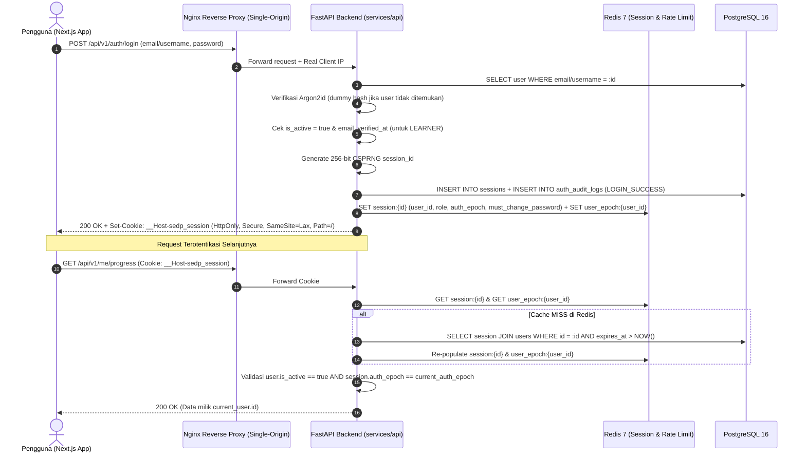

# Authentication & Role-Based Access Control (RBAC): SEDP Learning Hub (Phase F)

> [!CAUTION]
> **DO NOT DELETE.** Kept by the owner for future use. **NOT PART OF THE MVP**: do not implement or plan MVP work from this file until the owner approves Phase F (see [README.md](./README.md)). If this file conflicts with `docs/prompts/` or `AGENTS.md`, those win.

| Field | Detail |
|---|---|
| **System** | SEDP Learning Hub, Phase F (Platform) |
| **Document Version** | 4.0.0-sedp |
| **Date** | 2026-11-18 |
| **Status** | Deferred draft, not approved |
| **Auth Mechanism** | Email/Username + Argon2id Hash (OWASP) + 256-bit CSPRNG Server-Side Session ID |
| **Session Tracking** | Host-Only HttpOnly Cookie (`__Host-sedp_session`) + Redis 7 Cache + PostgreSQL 16 `sessions` |
| **Domain & Hosting** | `[OWNER_DOMAIN]`, `[OWNER_HOSTING]` |
| **Stack Notes** | Backend FastAPI + SQLAlchemy 2.0 Async (`services/api/`); Next.js 16.4.x (`src/app/(studio)/studio/**`) |

---

## Riwayat Revisi (Revision History)

| Versi | Tanggal | Penulis / Reviewer | Bagian yang Diubah | Rincian Perubahan (Sebelum vs Sesudah) | Alasan Perubahan |
|---|---|---|---|---|---|
| 1.0.0 | 2026-10-13 | Staff Ahli Divisi MIK | Dokumen Baru | Baseline spesifikasi autentikasi pseudo-email dan RBAC 3-role. | Inisiasi dokumen awal. |
| 2.0.0 | 2026-10-14 | Staff Ahli MIK & Auditor | Kriptografi & IDOR | ES256 dual JWT, Argon2id, rotasi refresh token, eliminasi IDOR multi-divisi. | Remediasi audit keamanan Area 1. |
| 2.1.0 | 2026-10-14 | Staff Ahli MIK & Implementer | Grace Period & Rate Limit | Grace period rotasi token 10 detik, user:epoch Redis Cache-Aside, sliding window rate limit. | Keputusan resmi Fase 1. |
| 2.2.0 | 2026-10-14 | Staff Ahli MIK & Auditor | Matriks RBAC | Pencabutan izin staf divisi ubah kelulusan, adaptasi SQLAlchemy 2.0 Async guard. | Penutupan celah BOLA. |
| 3.0.0 | 2026-10-23 | Staff Ahli MIK & Antigravity Lead | Seluruh Dokumen | **Sebelum:** RBAC 3-role kepanitiaan (`SUPER_ADMIN`, `FORM_MASTER`, `DIVISION_STAFF`), pseudo-email domain internal, proteksi PIN pelamar.<br>**Sesudah:** Rampingkan ke 2 role murni Blog CMS (`SUPER_ADMIN` dan `AUTHOR`), adopsi Alur Mandiri (*Direct Publishing* untuk Author), pengamanan cookie sesi Host-Only (`__Host-himaif_session`), proteksi anti-CSRF khusus sibling subdomain kampus eTLD+1, serta penyatuan session tracking ke 1 instance Redis ramping. | Penyesuaian pivot WordPress-like Blog CMS, eliminasi modul rekrutmen, dan hardening keamanan subdomain universitas. |
| 4.0.0-sedp | 2026-11-18 | SEDP Architecture Adaptation | Seluruh Dokumen | **Sebelum:** Model 2 peran HIMA IF CMS (`SUPER_ADMIN`, `AUTHOR` dengan *Direct Publishing*), cookie `__Host-himaif_session`, dan proteksi CSRF berbasis sibling subdomain kampus Telkom University.<br>**Sesudah:** Model 4 peran sesuai kontrak SEDP Phase F (`OWNER`, `AUTHOR`, `REVIEWER`, `LEARNER`), penghapusan total *Direct Publishing* bagi `AUTHOR`, pemisahan provisioning staf (`must_change_password`) vs pendaftaran opt-in `LEARNER` dengan verifikasi email, cookie `__Host-sedp_session`, guard Same-Site `Origin`/`Referer` + `Sec-Fetch-Site` + custom header untuk `[OWNER_DOMAIN]`, keselarasan kode error `PASSWORD_CHANGE_REQUIRED`, serta pencabutan instan via `users.auth_epoch`. | Adaptasi menjadi spesifikasi Phase F (Platform) SEDP Learning Hub agar selaras dengan `docs/future/README.md`, kontrol kualitas teknis/lisensi, dan privasi pembelajar (UU PDP). |

---

## 1. Arsitektur Peran & Matriks Otorisasi (RBAC 4 Peran)

Kontrak bersama Phase F menetapkan tepat **4 peran** dalam enum PostgreSQL `user_role {OWNER, AUTHOR, REVIEWER, LEARNER}`. Seluruh otorisasi ditegakkan di sisi backend (`services/api/`); routing di Next.js (`src/app/(studio)/studio/**`) hanya berperan sebagai *UX guard* dan bukan batas keamanan.

### 1.1 Definisi Peran (Roles)

1. **`OWNER`**:
   - Pemegang otoritas penuh atas platform Phase F: manajemen akun staf dan pembelajar (`/users/*`), taksonomi (`/categories`, `/tags`), pengaturan sistem, dan pembacaan log audit (`/audit-logs`).
   - Dapat mengelola, me-review, menerbitkan (`PUBLISHED`), menjadwalkan (`SCHEDULED`), mengarsipkan (`ARCHIVED`), dan menghapus artikel siapa pun sesuai aturan gerbang rilis.
   - **Batasan Self-Approval**: Secara default, `OWNER` tetap mengikuti aturan pemisahan penulis dan peninjau (`reviewer_id != author_id`). Penyetujuan karya sendiri hanya dapat dilakukan melalui mekanisme *audit-logged override* jika diizinkan pada keputusan pemilik (`[OWNER_DECISION]`).

2. **`AUTHOR`**:
   - Membuat draf dan menyunting artikel miliknya sendiri (`author_id == current_user.id`), mengunggah media miliknya (`uploaded_by == current_user.id`), membuat tag baru, membaca register sumber dan log fact check untuk keperluan sitasi, serta mengajukan artikel ke tahap review (`DRAFT -> IN_REVIEW`).
   - **Penghapusan Total Direct Publishing**: Berbeda dari versi sebelumnya, **`AUTHOR` dilarang keras menerbitkan (`PUBLISHED`) atau menjadwalkan (`SCHEDULED`) artikel secara langsung**. Akurasi rekayasa sistem kabel laut serta kepatuhan lisensi aset/sumber merupakan *release blocker* yang wajib lolos peninjauan independen.
   - **Anti-IDOR / Anti-BOLA Guard**: Seluruh upaya membaca draf, menyunting, mengajukan review, menggulung balik revisi, atau menghapus artikel/media milik pengguna lain wajib ditolak dengan `403 PERMISSION_DENIED`.

3. **`REVIEWER`**:
   - Bertanggung jawab atas peninjauan teknis (`technical_ok`) dan verifikasi hak cipta/lisensi (`rights_ok`) pada artikel karya penulis lain melalui `POST /api/v1/articles/{id}/reviews` (`APPROVED` atau `CHANGES_REQUESTED`).
   - Mengelola register sumber (`/sources`), memperbarui status hak cipta aset media (`PATCH /api/v1/media/{id}/rights`), dan mengelola log fact check (`/fact-checks`) untuk artikel maupun pelajaran MDX (`lesson_id`).
   - **Larangan Self-Review**: `REVIEWER` tidak boleh menilai atau menyetujui artikel yang ditulis oleh dirinya sendiri (`reviewer_id != article.author_id`), ditolak keras dengan `403 PERMISSION_DENIED`.
   - Tidak memiliki akses manajemen akun (`/users`), manajemen kategori global (`/categories` mutasi), maupun `/audit-logs`.

4. **`LEARNER`** (Opt-in F3):
   - Peran opsional untuk pembelajar yang memilih membuat akun agar dapat menyinkronkan progres pelajaran MDX (`/me/progress`) dan riwayat kuis (`/me/quiz-attempts`) lintas perangkat.
   - **Zero Studio Access**: Tidak memiliki akses sama sekali ke `src/app/(studio)/studio/**` maupun endpoint staf (`/users`, `/media`, `/sources`, `/fact-checks`, `/articles` non-publik, `/audit-logs`).
   - **Privasi & Kontrol Diri**: Hanya dapat membaca dan memperbarui profilnya sendiri (`/me`), progres dan kuis miliknya sendiri, serta menghapus akunnya sendiri (`DELETE /api/v1/me`).
   - **Invarian MVP**: Pengunjung anonim tanpa akun `LEARNER` tetap dapat membaca seluruh kurikulum MDX serta artikel terbit dan menyimpan progres lokal di browser tanpa hambatan.

---

### 1.2 Matriks Hak Akses (Permissions Matrix)

| Modul / Tindakan | Endpoint API (`/api/v1`) | `OWNER` | `AUTHOR` | `REVIEWER` | `LEARNER` | Keterangan & Aturan Guard |
|---|---|:---:|:---:|:---:|:---:|---|
| **Auth: Login** | `POST /auth/login` | Ya | Ya | Ya | Ya | Publik (rate-limited). `LEARNER` wajib sudah verifikasi email. |
| **Auth: Registrasi Mandiri** | `POST /auth/register` | - | - | - | Ya (Publik) | Selalu membuat role `LEARNER`. Staf tidak bisa daftar mandiri. |
| **Auth: Verifikasi Email** | `POST /auth/verify-email` | - | - | - | Ya (Publik) | Mengonsumsi token SHA-256 single-use. |
| **Auth: Logout & Profil Sesi** | `POST /auth/logout`, `GET /auth/me` | Ya | Ya | Ya | Ya | Lolos allowlist `must_change_password`. |
| **Auth: Ganti Password** | `POST /auth/change-password` | Ya | Ya | Ya | Ya | Min. 12 karakter; menaikkan `auth_epoch` & hapus flag `must_change`. |
| **Users: Kelola Semua Akun** | `GET,POST /users`, `GET,PATCH /users/{id}`, `POST /users/{id}/reset-password` | Ya | Ditolak (403) | Ditolak (403) | Ditolak (403) | Khusus `OWNER`. Pembuatan staf set `must_change_password=true`. |
| **Taksonomi: Kategori (Baca)** | `GET /categories` | Ya | Ya | Ya | Ya | Publik; hanya hitung artikel tayang publik. |
| **Taksonomi: Kategori (Tulis)** | `POST,PUT,DELETE /categories*` | Ya | Ditolak (403) | Ditolak (403) | Ditolak (403) | Khusus `OWNER`. |
| **Taksonomi: Tag (Baca / Buat)** | `GET /tags` / `POST /tags` | Ya / Ya | Ya / Ya | Ya / Ya | Ya / Ditolak | `DELETE /tags/{id}` khusus `OWNER`. |
| **Artikel: Daftar & Baca Publik** | `GET /articles`, `GET /articles/{slug_or_id}` | Ya (Semua) | Ya (Milik + Terbit) | Ya (Semua studio) | Ya (Terbit saja) | Non-staf hanya melihat `PUBLISHED` atau `SCHEDULED <= NOW()`. |
| **Artikel: Buat & Edit Sendiri** | `POST /articles`, `PUT /articles/{id}` | Ya | Ya (Milik sendiri) | Ditolak (403) | Ditolak (403) | `POST` selalu awal `DRAFT`. `AUTHOR` dibatasi `author_id == current_user.id`. |
| **Artikel: Edit Karya Orang Lain** | `PUT /articles/{id}` | Ya | Ditolak (403) | Ditolak (403) | Ditolak (403) | Anti-IDOR guard; edit artikel `APPROVED` mereset ke `DRAFT`. |
| **Artikel: Submit / Withdraw Review** | `POST /articles/{id}/submit-review`, `withdraw-review` | Ya | Ya (Milik sendiri) | Ditolak (403) | Ditolak (403) | Transisi `DRAFT <-> IN_REVIEW`. |
| **Artikel: Kirim Keputusan Review** | `POST /articles/{id}/reviews` | Ya (Non-own*) | Ditolak (403) | Ya (Non-own) | Ditolak (403) | `reviewer_id != author_id` wajib; `*` override `OWNER` butuh `[OWNER_DECISION]` + audit log. |
| **Artikel: Baca Riwayat Review** | `GET /articles/{id}/reviews` | Ya | Ya (Milik sendiri) | Ya | Ditolak (403) | `AUTHOR` tidak boleh mengintip catatan review draf penulis lain. |
| **Artikel: Terbitkan / Jadwalkan** | `PATCH /articles/{id}/publish`, `/schedule` | Ya | **Ditolak (403)** | Ditolak (403)** | Ditolak (403) | **Direct publishing dihapus.** Wajib `APPROVED`, `technical_ok`, `rights_ok`, media & sumber `CLEARED`. `**` delegasi ke `REVIEWER` adalah `[OWNER_DECISION]`. |
| **Artikel: Arsipkan** | `PATCH /articles/{id}/archive` | Ya | Ditolak (403) | Ditolak (403) | Ditolak (403) | Menurunkan artikel dari feed publik. |
| **Artikel: Hapus & Rollback Revisi** | `DELETE /articles/{id}`, `POST .../rollback` | Ya | Ya (Milik sendiri*) | Ditolak (403) | Ditolak (403) | `*AUTHOR` hapus hanya saat `DRAFT`; rollback mengembalikan ke `DRAFT`. |
| **Media: Upload Presign & Confirm** | `POST /media/presign-upload`, `confirm-upload` | Ya | Ya | Ya | Ditolak (403) | Raster only (WebP/AVIF/PNG/JPEG), <= 5 MB, <= 16 MP, tolak `.svg`. |
| **Media: Verifikasi Hak Cipta** | `PATCH /media/{id}/rights` | Ya | Ditolak (403) | Ya | Ditolak (403) | Hanya `REVIEWER`/`OWNER` yang dapat menyetel `rights_status = CLEARED`. |
| **Media: Hapus Aset** | `DELETE /media/{id}` | Ya | Ya (Milik sendiri) | Ditolak (403) | Ditolak (403) | Ditolak `409` jika dipakai artikel `PUBLISHED`/`SCHEDULED`. |
| **Provenance: Sumber & Fact Check** | `GET /sources*`, `GET /fact-checks*` | Ya | Ya (Read-only) | Ya | Ditolak (403) | `AUTHOR` hanya baca metadata sitasi, tanpa akses berkas privat. |
| **Provenance: Kelola Sumber & FC** | `POST,PATCH /sources*`, `/fact-checks*` | Ya | Ditolak (403) | Ya | Ditolak (403) | `DELETE` khusus `OWNER`. |
| **Self-Service: Profil & Hapus Akun** | `GET,PATCH,DELETE /me` | Ya | Ya | Ya | Ya | Terikat `current_user.id`; `DELETE` butuh password & konfirmasi. |
| **Self-Service: Progres & Kuis** | `GET,PUT,POST /me/progress*`, `/me/quiz-attempts` | Ya | Ya | Ya | Ya | Terikat `current_user.id` dari sesi, bukan payload klien. |
| **Audit: Lihat Audit Logs** | `GET /audit-logs` | Ya | Ditolak (403) | Ditolak (403) | Ditolak (403) | Khusus `OWNER`. |

### 1.3 Implementasi Guard RBAC & Anti-IDOR di FastAPI (`services/api/`)

```python
# services/api/app/core/permissions.py
from fastapi import Depends, HTTPException, status
from app.models.enums import UserRole
from app.models.user import User
from app.models.article import Article
from app.core.auth_deps import get_current_active_user


def require_roles(*allowed_roles: UserRole):
    async def _guard(current_user: User = Depends(get_current_active_user)) -> User:
        if current_user.role not in allowed_roles:
            raise HTTPException(
                status_code=status.HTTP_403_FORBIDDEN,
                detail="Insufficient role permissions",
            )
        return current_user

    return _guard


def assert_article_write_access(article: Article, current_user: User) -> None:
    if current_user.role == UserRole.OWNER:
        return
    if current_user.role == UserRole.AUTHOR and article.author_id == current_user.id:
        return
    raise HTTPException(
        status_code=status.HTTP_403_FORBIDDEN,
        detail="You do not have permission to modify this article",
    )


def assert_not_self_review(
    article: Article,
    current_user: User,
    owner_override: bool,
    allow_owner_override: bool,
) -> None:
    if article.author_id != current_user.id:
        return
    if current_user.role == UserRole.OWNER and allow_owner_override and owner_override:
        return
    raise HTTPException(
        status_code=status.HTTP_403_FORBIDDEN,
        detail="Self-approval is forbidden without an authorized owner override",
    )
```

---

## 2. Manajemen Sesi, Cookie `__Host-sedp_session`, & Perlindungan CSRF

### 2.1 Arsitektur Server-Side Session Tracking

Sistem menggunakan session tracking berbasis **Token Acak Kriptografis 256-bit (CSPRNG)** (`secrets.token_hex(32)` menghasilkan 64 karakter hex) yang disimpan secara persisten di PostgreSQL (`sessions`) dan di-cache di Redis 7:



---

### 2.2 Spesifikasi Cookie: `__Host-sedp_session`

Cookie sesi mengikat secara ketat pada origin `[OWNER_DOMAIN]` menggunakan standar browser prefix `__Host-`:

> [!IMPORTANT]
> **Aturan Baku Cookie Sesi Phase F:**
> 1. **Nama Cookie**: `__Host-sedp_session` (persis sesuai kontrak bersama).
> 2. **Atribut `Domain` WAJIB DITIADAKAN (`None`)**: Cookie dikunci secara *host-only* ke hostname tunggal `[OWNER_DOMAIN]`, mencegah *cookie tossing* dari subdomain pihak ketiga atau host seinduk apabila domain berada di bawah skema subdomain bersama.
> 3. **Atribut `HttpOnly = true`**: Melindungi token sesi dari pembacaan via `document.cookie`.
> 4. **Atribut `Secure = true`**: Browser hanya mengirim cookie melalui koneksi HTTPS terenkripsi.
> 5. **Atribut `SameSite = "Lax"`**: Memblokir pengiriman cookie pada request POST lintas-situs sembari menjaga navigasi GET langsung ke `[OWNER_DOMAIN]`.
> 6. **Atribut `Path = "/"`**: Syarat wajib spesifikasi prefix `__Host-`.

```python
# services/api/app/core/auth_cookie.py
from fastapi import Response
from app.core.config import settings

SESSION_COOKIE_NAME = "__Host-sedp_session"


def issue_session_cookie(
    response: Response,
    session_id: str,
    max_age_seconds: int | None = None,
) -> None:
    ttl = max_age_seconds or settings.SESSION_TTL_SECONDS  # Usulan default: 7 hari (604800s), [OWNER_DECISION]
    response.set_cookie(
        key=SESSION_COOKIE_NAME,
        value=session_id,
        httponly=True,
        secure=True,         # Wajib True untuk prefix __Host-
        samesite="lax",
        path="/",
        domain=None,         # Dilarang menyetel Domain agar murni host-only
        max_age=ttl,
    )


def clear_session_cookie(response: Response) -> None:
    response.delete_cookie(
        key=SESSION_COOKIE_NAME,
        path="/",
        domain=None,
        secure=True,
        httponly=True,
        samesite="lax",
    )
```

*Catatan pengembangan lokal*: Prefix `__Host-` mensyaratkan `Secure=True` sehingga di lingkungan lokal pengembang disarankan memakai TLS lokal (misalnya reverse proxy HTTPS lokal) agar perilaku browser di dev identik dengan produksi.

---

### 2.3 Perlindungan Same-Site `Origin`/`Referer` & Anti-CSRF untuk `[OWNER_DOMAIN]`

Seluruh aplikasi berjalan pada arsitektur *single-origin* di `https://[OWNER_DOMAIN]` (`/` ke Next.js, `/api/v1` ke FastAPI via Nginx). Untuk mencegah serangan *Cross-Site Request Forgery* (CSRF), termasuk kemungkinan request dari sibling subdomain apabila `[OWNER_DOMAIN]` kelak berupa subdomain, backend menerapkan **4 lapis pertahanan serentak**:

1. **Validasi Ketat `Origin` dan Fallback `Referer`**:
   - Setiap request mutasi (`POST`, `PUT`, `PATCH`, `DELETE`) ke `/api/v1/*` diperiksa header `Origin`-nya.
   - Bila `Origin` ada, nilainya harus sama persis dengan `https://[OWNER_DOMAIN]` (atau daftar `ALLOWED_ORIGINS` yang terkonfigurasi).
   - Bila `Origin` tidak dikirim oleh browser tertentu pada request same-origin, server memeriksa `Referer` dan memastikan skema + host + port cocok persis dengan `https://[OWNER_DOMAIN]`. Jika keduanya tidak ada atau tidak cocok, request ditolak dengan `403 PERMISSION_DENIED`.
2. **Validasi Header `Sec-Fetch-Site`**:
   - Jika header `Sec-Fetch-Site` dikirim browser modern, hanya nilai `"same-origin"` atau `"none"` yang diizinkan pada request mutasi. Nilai `"cross-site"` dan `"same-site"` ditolak `403 PERMISSION_DENIED`.
3. **Kewajiban Custom Header Anti-CSRF (`X-Requested-With`)**:
   - Browser melarang skrip lintas origin mengirim header kustom tanpa lolos CORS preflight, dan pengiriman `<form>` HTML polos tidak dapat menyisipkan header kustom. Klien Next.js wajib mengirim `X-Requested-With: XMLHttpRequest` (atau `X-CSRF-Token`) pada setiap mutasi.
4. **Strict CORS Allowlist**:
   - FastAPI `CORSMiddleware` dikonfigurasi dengan `allow_origins=["https://[OWNER_DOMAIN]"]`, `allow_credentials=True`, dan daftar method/header eksplisit (dilarang menggunakan wildcard `"*"`).

```python
# services/api/app/core/csrf_guard.py
from urllib.parse import urlparse
from fastapi import Request, status
from fastapi.responses import JSONResponse
from starlette.middleware.base import BaseHTTPMiddleware

MUTATING_METHODS = {"POST", "PUT", "PATCH", "DELETE"}
ALLOWED_SEC_FETCH_SITES = {"same-origin", "none"}


class OriginAndCSRFMiddleware(BaseHTTPMiddleware):
    def __init__(self, app, allowed_origins: list[str]):
        super().__init__(app)
        self.allowed_origins = {origin.rstrip("/") for origin in allowed_origins}

    def _extract_origin_from_referer(self, referer: str) -> str | None:
        parsed = urlparse(referer)
        if not parsed.scheme or not parsed.netloc:
            return None
        return f"{parsed.scheme}://{parsed.netloc}"

    async def dispatch(self, request: Request, call_next):
        if request.method in MUTATING_METHODS and request.url.path.startswith("/api/v1"):
            sec_fetch_site = request.headers.get("sec-fetch-site")
            if sec_fetch_site and sec_fetch_site.lower() not in ALLOWED_SEC_FETCH_SITES:
                return JSONResponse(
                    status_code=status.HTTP_403_FORBIDDEN,
                    content={
                        "success": False,
                        "error_code": "PERMISSION_DENIED",
                        "message": "Permintaan lintas situs ditolak oleh kebijakan CSRF.",
                        "detail": [],
                    },
                )

            origin = request.headers.get("origin")
            referer = request.headers.get("referer")
            request_origin = (
                origin.rstrip("/")
                if origin
                else (self._extract_origin_from_referer(referer) if referer else None)
            )
            if not request_origin or request_origin not in self.allowed_origins:
                return JSONResponse(
                    status_code=status.HTTP_403_FORBIDDEN,
                    content={
                        "success": False,
                        "error_code": "PERMISSION_DENIED",
                        "message": "Header Origin atau Referer tidak valid untuk domain resmi.",
                        "detail": [],
                    },
                )

            if not request.headers.get("x-requested-with"):
                return JSONResponse(
                    status_code=status.HTTP_403_FORBIDDEN,
                    content={
                        "success": False,
                        "error_code": "PERMISSION_DENIED",
                        "message": "Header anti-CSRF X-Requested-With wajib disertakan.",
                        "detail": [],
                    },
                )

        return await call_next(request)
```

---

## 3. Kebijakan Kredensial, Provisioning Staf vs Signup `LEARNER`

### 3.1 Parameter Hashing Argon2id Standar OWASP

Seluruh kata sandi di-hash sebelum disimpan ke `users.password_hash` menggunakan pustaka `argon2-cffi` (pin versi stabil saat Phase F dimulai) dengan baseline parameter OWASP Password Storage:
- **Memory Cost ($m$)**: `19456` KiB (19 MiB)
- **Time Cost ($t$)**: `2` iterasi
- **Parallelism ($p$)**: `1` thread
- **Salt Acak**: `16` byte CSPRNG unik per password
- **Hash Length**: `32` byte

```python
# services/api/app/core/password.py
from argon2 import PasswordHasher
from argon2.exceptions import VerifyMismatchError

password_hasher = PasswordHasher(
    time_cost=2,
    memory_cost=19456,
    parallelism=1,
    hash_len=32,
    salt_len=16,
)

# Dummy hash precomputed saat startup untuk menjaga waktu respons konstan saat user tidak ditemukan
DUMMY_ARGON2_HASH = password_hasher.hash("dummy-timing-equalizer-sedp-phase-f")


def verify_password_constant_time(stored_hash: str | None, plain_password: str) -> bool:
    target_hash = stored_hash or DUMMY_ARGON2_HASH
    try:
        verified = password_hasher.verify(target_hash, plain_password)
        return bool(stored_hash and verified)
    except VerifyMismatchError:
        return False
```

### 3.2 Aturan Kata Sandi & `must_change_password` (Akun Staf Buatan `OWNER`)

1. **Panjang & Batas**: Minimal **12 karakter** dan maksimal **128 karakter** (mencegah DoS pemrosesan hash panjang berlebih), wajib mengandung kombinasi huruf besar, huruf kecil, angka, dan simbol.
2. **Provisioning Eksklusif oleh `OWNER`**: Akun `AUTHOR`, `REVIEWER`, dan `OWNER` tambahan **tidak dapat mendaftar sendiri** melalui `/auth/register`. Pembuatan hanya dilakukan oleh `OWNER` via `POST /api/v1/users` (atau CLI seed awal untuk `OWNER` pertama) dengan menyetel `must_change_password = true` dan `email_verified_at = NOW()`.
3. **Middleware / Dependency Lockout `must_change_password`**:
   Selama `must_change_password = true`, pengguna **hanya diizinkan** mengakses allowlist berikut:
   - `GET /api/v1/auth/me`
   - `POST /api/v1/auth/change-password`
   - `POST /api/v1/auth/logout`
   Seluruh endpoint lain wajib ditolak dengan `HTTP 403 Forbidden` dan `error_code: "PASSWORD_CHANGE_REQUIRED"`.

### 3.3 Pendaftaran Mandiri `LEARNER` (Opt-In F3) & Verifikasi Email

Pendaftaran publik hanya aktif jika modul F3 disetujui pada gerbang Phase F (`FEATURE_LEARNER_SIGNUP_ENABLED`, default `false`).

1. **Pemisahan Ketat dari Provisioning Staf**:
   - `POST /api/v1/auth/register` **selalu mengabaikan** field `role` bila disisipkan di payload dan menetapkan secara keras `role = UserRole.LEARNER`, `must_change_password = false`, `email_verified_at = None`, `is_active = true`.
   - Tidak ada jalur publik yang dapat membuat akun `AUTHOR`, `REVIEWER`, atau `OWNER`.
2. **Alur Verifikasi Email**:
   - Server menghasilkan token acak 256-bit (`secrets.token_urlsafe(32)`), menyimpan **hash SHA-256** token tersebut pada kolom `token_hash` (`CHAR(64) UNIQUE NOT NULL`) beserta `expires_at` (usulan: 24 jam, `[OWNER_DECISION]`) di tabel `email_verification_tokens` (migrasi `0001_auth_core` pada [DATABASE_SCHEMA.md](./DATABASE_SCHEMA.md)), lalu mengirim tautan `https://[OWNER_DOMAIN]/verifikasi-email?token=...` via penyedia email transaksional (`[OWNER_DECISION]`).
   - Selama `email_verified_at IS NULL`, panggilan `POST /api/v1/auth/login` untuk `LEARNER` ditolak dengan `403 EMAIL_VERIFICATION_REQUIRED` tanpa menerbitkan cookie sesi.
   - `POST /api/v1/auth/verify-email` memvalidasi `token_hash` yang belum kedaluwarsa dan `consumed_at IS NULL` dalam waktu konstan, mengisi `users.email_verified_at = NOW()` serta `email_verification_tokens.consumed_at = NOW()` (*single-use*), dan mencatat `EMAIL_VERIFIED` di `auth_audit_logs`.
   - Endpoint registrasi dan kirim ulang verifikasi memakai respons netral agar tidak membocorkan apakah alamat email sudah terdaftar sebagai akun staf maupun pembelajar.
3. **Minimasi Data & UU PDP (UU No. 27/2022)**:
   - Data akun `LEARNER` diminimalkan hanya pada email, username, nama tampilan (`display_name`), hash password, progres pelajaran (`learner_progress`), dan riwayat kuis (`quiz_attempts`).
   - Pembelajar dapat menghapus akun dan data belajarnya sendiri kapan saja melalui `DELETE /api/v1/me` setelah memasukkan ulang kata sandi aktif.
   - Kebijakan masa retensi log audit serta pembersihan akun `LEARNER` belum terverifikasi (misalnya usulan 7 hari untuk pendaftaran kedaluwarsa) berstatus `[OWNER_DECISION]` sampai disetujui pemilik.

---

## 4. Mekanisme Pencabutan Sesi Instan (*Instant Revocation*) via `users.auth_epoch`

Setiap akun di tabel `users` memiliki kolom integer `auth_epoch` (default `1`). Mekanisme ini menjamin sesi yang telah dicabut tidak pernah dapat dipakai ulang di permintaan berikutnya (*fail-closed*), sekalipun salinan sesi sempat tersimpan di cache Redis.

### 4.1 Peristiwa Pemicu Kenaikan `auth_epoch`
1. Pengguna mengubah kata sandi sendiri (`POST /api/v1/auth/change-password`).
2. `OWNER` mereset kata sandi akun staf (`POST /api/v1/users/{id}/reset-password`).
3. `OWNER` mengubah `role` akun pengguna (`PATCH /api/v1/users/{id}`).
4. `OWNER` menonaktifkan akun (`is_active = false`).
5. Pengguna menghapus akunnya sendiri (`DELETE /api/v1/me`) atau memicu pencabutan seluruh perangkat.

### 4.2 Urutan Eksekusi Atomik & Verifikasi Fail-Closed

```python
# services/api/app/core/revocation.py
from uuid import UUID
from sqlalchemy import delete, update
from sqlalchemy.ext.asyncio import AsyncSession
from redis.asyncio import Redis
from app.models.user import User
from app.models.session import Session


async def revoke_all_user_sessions(
    db: AsyncSession,
    redis: Redis,
    user_id: UUID,
) -> int:
    # 1. Naikkan auth_epoch secara atomik di PostgreSQL
    stmt = (
        update(User)
        .where(User.id == user_id)
        .values(auth_epoch=User.auth_epoch + 1)
        .returning(User.auth_epoch)
    )
    new_epoch = (await db.execute(stmt)).scalar_one()

    # 2. Hapus seluruh baris sesi persisten di PostgreSQL
    await db.execute(delete(Session).where(Session.user_id == user_id))

    # 3. Hapus seluruh cache sesi pengguna di Redis dan segarkan user_epoch
    user_sessions_key = f"user_sessions:{user_id}"
    session_ids = await redis.smembers(user_sessions_key)
    pipe = redis.pipeline()
    for sid in session_ids:
        sid_str = sid.decode() if isinstance(sid, bytes) else sid
        pipe.delete(f"session:{sid_str}")
    pipe.delete(user_sessions_key)
    pipe.set(f"user_epoch:{user_id}", str(new_epoch), ex=60 * 60 * 24 * 7)
    await pipe.execute()

    return new_epoch
```

Pada setiap request terotentikasi berikutnya, dependensi `get_current_active_user` melakukan pengecekan *fail-closed*:
1. Membaca `session:{session_id}` dari Redis (fallback ke PostgreSQL `sessions` JOIN `users` bila cache miss; target operasi cache Redis berlatensi rendah).
2. Membandingkan `session_payload["auth_epoch"]` dengan `user_epoch:{user_id}` di Redis (atau `users.auth_epoch` di DB bila kunci epoch tidak ada di Redis) serta memastikan `is_active == True`.
3. Jika `session_payload["auth_epoch"] != current_auth_epoch` atau akun nonaktif: hapus segera kunci `session:{session_id}`, hapus cookie `__Host-sedp_session`, catat peristiwa `SESSION_REVOKED` di `auth_audit_logs`, dan kembalikan `401 AUTHENTICATION_FAILED`.

---

## 5. Log Audit Keamanan (`auth_audit_logs`) & Kriteria Penerimaan

### 5.1 Daftar Peristiwa Audit Wajib

Selain peristiwa autentikasi dasar (`LOGIN_SUCCESS`, `LOGIN_FAILED`, `LOGOUT`, `PASSWORD_CHANGE`, `PASSWORD_RESET`, `ROLE_CHANGE`, `ACCOUNT_DISABLED`, `SESSION_REVOKED`, `AUTH_TOKEN_REUSE_DETECTED`), Phase F menambahkan pelacakan peristiwa berikut ke kolom `auth_audit_logs.event` (`VARCHAR(64) NOT NULL` dengan constraint CHECK huruf kapital `^[A-Z0-9_]+$` pada migrasi `0001_auth_core` sesuai [DATABASE_SCHEMA.md](./DATABASE_SCHEMA.md), bukan enum PostgreSQL):
- `EMAIL_VERIFIED` dan `LEARNER_REGISTERED` (tanpa menyimpan token mentah).
- `ACCOUNT_SELF_DELETED` (mencatat `user_id` atau hash non-PII sesuai keputusan retensi `[OWNER_DECISION]`, tanpa menyimpan email/nama yang dihapus).
- `OWNER_SELF_APPROVAL_OVERRIDE` (wajib tercatat jika `[OWNER_DECISION]` mengizinkan `OWNER` menyetujui/menerbitkan karyanya sendiri, menyertakan `article_id` dan `override_reason` pada kolom `metadata` JSONB).

### 5.2 Kriteria Penerimaan Pengujian Keamanan (Acceptance Criteria)

1. **Penolakan Direct Publishing**: Uji integrasi membuktikan akun `AUTHOR` menerima `403 PERMISSION_DENIED` saat memanggil `PATCH /api/v1/articles/{id}/publish`, `PATCH /api/v1/articles/{id}/schedule`, maupun `POST /api/v1/articles/{id}/reviews`; payload `status: "PUBLISHED"` pada `POST /api/v1/articles` tidak pernah menghasilkan artikel langsung terbit.
2. **Pemisahan Penulis & Peninjau**: Akun `REVIEWER` menerima `403 PERMISSION_DENIED` saat mencoba me-review artikel karyanya sendiri (`author_id == current_user.id`).
3. **Isolasi `LEARNER` & Anti-BOLA**: Akun `LEARNER` menerima `403 PERMISSION_DENIED` di seluruh endpoint studio (`/users`, `/media`, `/sources`, `/fact-checks`, `/audit-logs`) dan tidak dapat membaca atau memodifikasi progres/kuis pengguna lain.
4. **Penegakan `must_change_password`**: Staf baru buatan `OWNER` diblokir dengan `403 PASSWORD_CHANGE_REQUIRED` pada seluruh endpoint kecuali `/auth/me`, `/auth/change-password`, dan `/auth/logout`.
5. **Verifikasi Email `LEARNER`**: Akun `LEARNER` belum terverifikasi ditolak dengan `403 EMAIL_VERIFICATION_REQUIRED` saat login dan tidak menerima cookie `__Host-sedp_session`.
6. **Validasi Cookie & CSRF**: Cookie login memiliki atribut exact `HttpOnly`, `Secure`, `SameSite=Lax`, `Path=/`, tanpa `Domain`. Request mutasi dari origin selain `https://[OWNER_DOMAIN]`, dengan `Sec-Fetch-Site: cross-site`/`same-site`, atau tanpa header `X-Requested-With` ditolak dengan `403 PERMISSION_DENIED`.
7. **Pencabutan Instan `auth_epoch`**: Sesaat setelah `users.auth_epoch` dinaikkan (melalui ganti password, reset password, ubah role, nonaktifkan akun, atau `DELETE /api/v1/me`), cookie `__Host-sedp_session` lama langsung ditolak `401 AUTHENTICATION_FAILED` pada permintaan berikutnya.

Dokumen ini menjadi dasar implementasi keamanan API pada [API_DESIGN.md](./API_DESIGN.md) dan selaras dengan kontrak bersama di [README.md](./README.md). Seluruh item `[OWNER_DECISION]` dan `[OWNER_DOMAIN]` wajib diputuskan dan dicatat di `docs/DECISIONS.md` sebelum Phase F dimulai.
