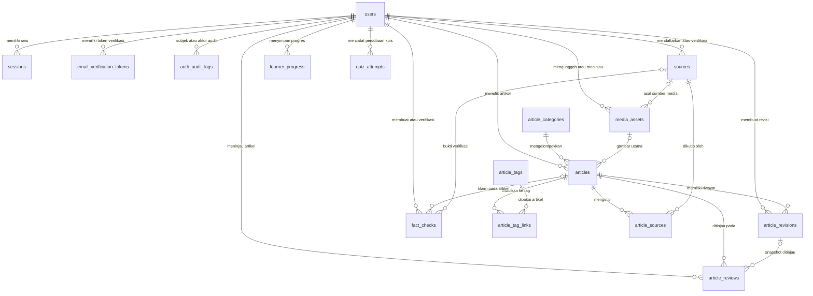

# Database Architecture & Schema Specification: SEDP Learning Hub, Phase F (Platform)

> [!CAUTION]
> **DO NOT DELETE.** Kept by the owner for future use. **NOT PART OF THE MVP**: do not implement or plan MVP work from this file until the owner approves Phase F (see [README.md](./README.md)). If this file conflicts with `docs/prompts/` or `AGENTS.md`, those win.

| Field | Detail |
|---|---|
| **System** | SEDP Learning Hub, Phase F (Platform) |
| **Document Version** | 4.0.0-sedp |
| **Date** | 2026-11-18 |
| **Status** | Deferred draft, not approved |
| **Engine** | PostgreSQL 16+ |
| **Access Model** | SQLAlchemy 2.0 (Async) + Alembic Migrations (alternatif terbuka di Phase F gate: Next.js Route Handlers + TypeScript ORM dengan skema PostgreSQL identik) |
| **Key Convention** | RFC 4122 UUIDv4 Primary Keys (`gen_random_uuid()`) pada seluruh tabel entitas; tabel relasi *many-to-many* memakai *composite primary key* |

---

## Riwayat Revisi (Revision History)

| Versi | Tanggal | Penulis / Reviewer | Bagian yang Diubah | Rincian Perubahan (Sebelum vs Sesudah) | Alasan Perubahan |
|---|---|---|---|---|---|
| 1.0.0 | 2026-10-13 | Staff Ahli Divisi MIK | Dokumen Baru | Baseline perancangan skema database awal. | Inisiasi arsitektur database. |
| 2.0.0 | 2026-10-14 | Staff Ahli MIK & Auditor | Evaluasi & Enkripsi | Penambahan relasi interview per baris, enkripsi AES-256 PIN pelamar, CHECK constraints. | Hardening keamanan modul wawancara. |
| 2.1.0 | 2026-10-14 | Staff Ahli MIK & Auditor | Migrasi Alembic | Penetapan 3 revisi logis Alembic untuk 18 tabel. | Pembagian migrasi database Fase 1. |
| 2.2.0 | 2026-10-14 | Staff Ahli MIK & Auditor | Konsistensi Tabel | Koreksi enum audit log, penambahan accepted_division_id, active_days uppercase. | Eliminasi desinkronisasi nama kolom & audit. |
| 3.0.0 | 2026-10-23 | Staff Ahli MIK & Antigravity Lead | Seluruh Dokumen | **Sebelum:** 18 tabel kompleks mencakup formulir dinamis & interview booking.<br>**Sesudah:** 7 tabel murni Blog CMS (`users`, `sessions`, `auth_audit_logs`, `blog_categories`, `blog_tags`, `blog_post_tags`, `blog_posts`, `blog_post_revisions`, `media_assets`), migrasi TipTap AST JSONB (`content_json`) & sanitized HTML (`content_html`), migrasi Alembic dirampingkan menjadi 2 tahap. | Pivot organisasi: eliminasi modul interview & form, memusatkan sistem sebagai engine blogging modern sekelas WordPress. |
| 4.0.0-sedp | 2026-11-18 | Phase F Spec Adaptation | Seluruh Dokumen | **Sebelum:** Skema 9 tabel Blog CMS HIMA IF (v3.0.0) dalam 2 revisi Alembic, 2 peran admin/penulis dengan publikasi langsung, tanpa modul provenance maupun akun pembelajar.<br>**Sesudah:** Skema 16 tabel (15 tabel domain inti + tabel bantu `email_verification_tokens`) & 8 enum untuk SEDP Learning Hub Phase F (F1 Articles, F2 Provenance, F3 Learner Accounts) dalam 4 revisi Alembic (`0001_auth_core` s.d. `0004_learner`), RBAC `OWNER`/`AUTHOR`/`REVIEWER`/`LEARNER`, alur review wajib + provenance `rights_status`, kaitan ke ID stabil MDX (`lesson_id`, `quiz_id`), cookie `__Host-sedp_session`, usulan retensi UU PDP (`[OWNER_DECISION]`), dan penjadwalan tanpa worker. | Adaptasi spesifikasi menjadi Phase F (deferred draft, belum disetujui) bagi SEDP Learning Hub sesuai kontrak bersama di [README.md](./README.md). |

---

## 1. Ringkasan Skema, Batas Produk & Peta Revisi Alembic

Skema database ini hanya berlaku apabila owner secara tertulis menyetujui **Phase F (Platform)** setelah MVP statis beroperasi (lihat gerbang keputusan di [README.md](./README.md)). Seluruh pelajaran kurikulum inti tetap berupa berkas MDX di repositori git (`content/`), sehingga database tidak pernah menggantikan MDX dan **tidak boleh menjadi dependensi halaman MVP**. Database hanya mereferensikan pelajaran dan kuis lewat ID stabilnya (`lesson_id`, `quiz_id` pada frontmatter MDX).

Skema mencakup **8 PostgreSQL `ENUM`** dan **16 tabel** (15 tabel domain pada [README.md](./README.md) ditambah tabel bantu autentikasi `email_verification_tokens`) yang dieksekusi berurutan dalam **4 revisi Alembic** di `services/api/alembic/versions/`:

1. **`0001_auth_core`**: `user_role` enum; tabel `users` (termasuk `email_verified_at`), `sessions`, `email_verification_tokens`, `auth_audit_logs`, serta fungsi pemicu `fn_set_updated_at()`.
2. **`0002_editorial`**: `article_status`, `review_decision`, `rights_status` enums; tabel `article_categories`, `article_tags`, `media_assets` (kolom `source_id` dibuat nullable terlebih dahulu), `articles`, `article_tag_links`, `article_revisions`, `article_reviews`, serta *foreign key* tertunda `articles.approved_review_id` dan pemicu *publish gate*.
3. **`0003_provenance`**: `source_type`, `trust_level`, `fact_check_status` enums; tabel `sources`, *foreign key* tertunda `media_assets.source_id -> sources.id`, serta tabel `article_sources` dan `fact_checks`.
4. **`0004_learner`**: `progress_status` enum; tabel `learner_progress` dan `quiz_attempts` untuk modul opsional F3 (sinkronisasi progres dan riwayat kuis pembelajar).

### Daftar Enum Kanonik

| No | Nama Enum | Revisi | Nilai Kanonik | Kegunaan |
|---|---|---|---|---|
| 1 | `user_role` | `0001_auth_core` | `'OWNER'`, `'AUTHOR'`, `'REVIEWER'`, `'LEARNER'` | Kontrol akses berbasis peran (RBAC) |
| 2 | `article_status` | `0002_editorial` | `'DRAFT'`, `'IN_REVIEW'`, `'APPROVED'`, `'SCHEDULED'`, `'PUBLISHED'`, `'ARCHIVED'` | Siklus hidup editorial artikel |
| 3 | `review_decision` | `0002_editorial` | `'APPROVED'`, `'CHANGES_REQUESTED'` | Keputusan peninjauan teknis & hak cipta |
| 4 | `rights_status` | `0002_editorial` | `'UNKNOWN'`, `'PENDING'`, `'CLEARED'`, `'REJECTED'` | Status izin publik media dan sumber |
| 5 | `source_type` | `0003_provenance` | `'OFFICIAL_MODULE'`, `'VENDOR_SLIDES'`, `'OWNER_NOTES'`, `'PUBLIC_PAPER'`, `'STANDARD'`, `'NEWS'`, `'WEBSITE'`, `'OTHER'` | Klasifikasi asal sumber rujukan |
| 6 | `trust_level` | `0003_provenance` | `'HIGH'`, `'MEDIUM'`, `'LOW'` | Tingkat kepercayaan teknis sumber |
| 7 | `fact_check_status` | `0003_provenance` | `'UNVERIFIED'`, `'VERIFIED'`, `'DISPUTED'`, `'RETRACTED'` | Status verifikasi klaim teknis |
| 8 | `progress_status` | `0004_learner` | `'STARTED'`, `'COMPLETED'` | Progres baca pelajaran oleh `LEARNER` |

### Daftar Tabel Kanonik

| No | Nama Tabel | Revisi Alembic | Modul | Tanggung Jawab Utama | Jumlah Kolom |
|---|---|---|---:|---|---:|
| 1 | `users` | `0001_auth_core` | Auth | Identitas pengguna (`OWNER`, `AUTHOR`, `REVIEWER`, `LEARNER`), hash Argon2id, `email_verified_at`, `auth_epoch` | 13 |
| 2 | `sessions` | `0001_auth_core` | Auth | Sesi server-side berbasis SHA-256 token cookie `__Host-sedp_session` dan pencabutan instan | 10 |
| 3 | `email_verification_tokens` | `0001_auth_core` | Auth (Helper) | Token verifikasi email sekali pakai (hash SHA-256) untuk pendaftaran `LEARNER` modul F3 | 6 |
| 4 | `auth_audit_logs` | `0001_auth_core` | Audit | Jejak audit autentikasi, rotasi peran, penghapusan akun, dan override persetujuan `OWNER` | 8 |
| 5 | `article_categories` | `0002_editorial` | F1 Editorial | Kategori topik studi kasus/catatan lapangan, slug, dan aksen visual | 9 |
| 6 | `article_tags` | `0002_editorial` | F1 Editorial | Tag granular navigasi artikel dan pengindeksan topik | 5 |
| 7 | `media_assets` | `0002_editorial` | F1 Media | Aset raster terverifikasi di S3/R2 (WebP/AVIF/PNG/JPEG, maks 5 MB & 16 MP) + kolom provenance | 20 |
| 8 | `articles` | `0002_editorial` | F1 Editorial | Entitas artikel utama (`content_json` TipTap AST + `content_html` sanitasi `nh3`), jadwal tayang | 22 |
| 9 | `article_tag_links` | `0002_editorial` | F1 Editorial | Tabel relasi *many-to-many* antara `articles` dan `article_tags` | 3 |
| 10 | `article_revisions` | `0002_editorial` | F1 Editorial | Riwayat snapshot perubahan artikel untuk diff audit dan rollback editorial | 9 |
| 11 | `article_reviews` | `0002_editorial` | F1 Editorial | Catatan review (`technical_ok`, `rights_ok`) dengan pemisahan tugas penulis vs reviewer | 12 |
| 12 | `sources` | `0003_provenance` | F2 Provenance | Register sumber internal/publik (staf only), status lisensi, `public_reuse_allowed` | 24 |
| 13 | `article_sources` | `0003_provenance` | F2 Provenance | Tautan sitasi *many-to-many* antara `articles` dan `sources` | 6 |
| 14 | `fact_checks` | `0003_provenance` | F2 Provenance | Log verifikasi klaim teknis untuk `lesson_id` (MDX) atau `article_id` (DB) | 13 |
| 15 | `learner_progress` | `0004_learner` | F3 Learner | Sinkronisasi progres pelajaran MDX opsional per akun (`(user_id, lesson_id)` unik) | 10 |
| 16 | `quiz_attempts` | `0004_learner` | F3 Learner | Riwayat percobaan kuis latihan (`quiz_id` teks, skor non-negatif) | 12 |

---

## 2. Entity Relationship Diagram (ERD)



---

## 3. Prasyarat Database & Fungsi Helper Bersama

Seluruh DDL mengasumsikan **PostgreSQL 16+** dengan fungsi bawaan `gen_random_uuid()` dan `num_nonnulls()`. Tidak diperlukan ekstensi eksternal untuk kunci utama UUIDv4. Pada revisi `0001_auth_core`, buat satu fungsi pemicu bersama untuk memelihara kolom `updated_at` secara konsisten di semua tabel yang memilikinya:

```sql
CREATE OR REPLACE FUNCTION fn_set_updated_at()
RETURNS TRIGGER
LANGUAGE plpgsql
AS $$
BEGIN
    NEW.updated_at = NOW();
    RETURN NEW;
END;
$$;
```

---

## 4. Spesifikasi Rinci Tabel & PostgreSQL 16+ DDL

### 4.1 Revisi `0001_auth_core`: Auth, Pengguna, Sesi & Audit

#### Enum `user_role` & Tabel `users`
Menyimpan identitas pengguna platform. Peran default selalu `'LEARNER'` (prinsip *least privilege* untuk mencegah *mass-assignment*). Nama tampilan memakai `display_name` alih-alih nama legal lengkap guna meminimalkan data pribadi sesuai prinsip UU PDP. Kolom `username` wajib bagi staf (`OWNER`, `AUTHOR`, `REVIEWER`) untuk profil editorial, sedangkan bagi `LEARNER` bersifat opsional (nullable). Kolom `email_verified_at` wajib diverifikasi saat pendaftaran mandiri `LEARNER` pada modul F3, sedangkan akun staf langsung ditandai terverifikasi saat onboarding.

```sql
CREATE TYPE user_role AS ENUM ('OWNER', 'AUTHOR', 'REVIEWER', 'LEARNER');

CREATE TABLE users (
    id UUID PRIMARY KEY DEFAULT gen_random_uuid(),
    email VARCHAR(255) NOT NULL,
    username VARCHAR(50),
    password_hash VARCHAR(255) NOT NULL,
    display_name VARCHAR(100) NOT NULL,
    avatar_url VARCHAR(500),
    role user_role NOT NULL DEFAULT 'LEARNER',
    must_change_password BOOLEAN NOT NULL DEFAULT FALSE,
    is_active BOOLEAN NOT NULL DEFAULT TRUE,
    email_verified_at TIMESTAMPTZ NULL, -- Required for F3 learner signup verification; staff accounts set verified on onboarding
    auth_epoch INTEGER NOT NULL DEFAULT 1,
    created_at TIMESTAMPTZ NOT NULL DEFAULT NOW(),
    updated_at TIMESTAMPTZ NOT NULL DEFAULT NOW(),

    CONSTRAINT chk_users_email_normalized CHECK (
        email = LOWER(btrim(email)) AND btrim(email) <> ''
    ),
    CONSTRAINT chk_users_display_name_nonempty CHECK (btrim(display_name) <> ''),
    CONSTRAINT chk_users_staff_requires_username CHECK (
        role = 'LEARNER' OR (username IS NOT NULL AND username ~ '^[a-z0-9_]{3,50}$')
    ),
    CONSTRAINT chk_users_username_format CHECK (
        username IS NULL OR username ~ '^[a-z0-9_]{3,50}$'
    ),
    CONSTRAINT chk_users_auth_epoch_positive CHECK (auth_epoch >= 1)
);

-- Unik case-insensitive untuk email dan username
CREATE UNIQUE INDEX uq_users_email_lower ON users (LOWER(email));
CREATE UNIQUE INDEX uq_users_username_lower ON users (LOWER(username))
    WHERE username IS NOT NULL;
CREATE INDEX idx_users_role_active ON users (role, is_active);

CREATE TRIGGER trg_users_updated_at
    BEFORE UPDATE ON users
    FOR EACH ROW EXECUTE FUNCTION fn_set_updated_at();
```

#### Tabel `sessions`
Menyimpan sesi server-side yang terhubung dengan cookie `__Host-sedp_session` (`Secure`, `HttpOnly`, `SameSite=Lax`, `Path=/`, tanpa `Domain`). Kunci utama tetap memakai UUIDv4 (`gen_random_uuid()`), sedangkan token mentah 256-bit pada cookie tidak pernah disimpan mentah di database: hanya hash SHA-256 (`token_hash`) yang disimpan sebagai *defense-in-depth*. Nilai `auth_epoch` disimpan pada baris sesi agar validasi terhadap `users.auth_epoch` tetap bekerja akurat bahkan ketika cache Redis sedang dingin.

```sql
CREATE TABLE sessions (
    id UUID PRIMARY KEY DEFAULT gen_random_uuid(),
    token_hash CHAR(64) NOT NULL UNIQUE,
    user_id UUID NOT NULL REFERENCES users(id) ON DELETE CASCADE,
    auth_epoch INTEGER NOT NULL,
    user_agent VARCHAR(500),
    ip_address INET NOT NULL,
    expires_at TIMESTAMPTZ NOT NULL,
    revoked_at TIMESTAMPTZ,
    created_at TIMESTAMPTZ NOT NULL DEFAULT NOW(),
    last_active_at TIMESTAMPTZ NOT NULL DEFAULT NOW(),

    CONSTRAINT chk_sessions_token_hash_hex CHECK (token_hash ~ '^[0-9a-f]{64}$'),
    CONSTRAINT chk_sessions_epoch_positive CHECK (auth_epoch >= 1),
    CONSTRAINT chk_sessions_expiry_after_create CHECK (expires_at > created_at)
);

CREATE INDEX idx_sessions_active_user ON sessions (user_id, expires_at)
    WHERE revoked_at IS NULL;
CREATE INDEX idx_sessions_expires_at ON sessions (expires_at);
```

#### Tabel `email_verification_tokens`
Menyimpan token verifikasi email sekali pakai untuk pendaftaran mandiri `LEARNER` (modul F3) sebelum mengisi `users.email_verified_at`. Seperti tabel `sessions`, hanya hash SHA-256 (`token_hash`) yang disimpan di database, sedangkan token mentah dikirim lewat tautan email verifikasi. Penghapusan pengguna otomatis membersihkan seluruh token terkait melalui `ON DELETE CASCADE`.

```sql
CREATE TABLE email_verification_tokens (
    id UUID PRIMARY KEY DEFAULT gen_random_uuid(),
    user_id UUID NOT NULL REFERENCES users(id) ON DELETE CASCADE,
    token_hash CHAR(64) NOT NULL UNIQUE,
    expires_at TIMESTAMPTZ NOT NULL,
    consumed_at TIMESTAMPTZ NULL,
    created_at TIMESTAMPTZ NOT NULL DEFAULT NOW(),

    CONSTRAINT chk_email_verification_tokens_hash_hex CHECK (token_hash ~ '^[0-9a-f]{64}$'),
    CONSTRAINT chk_email_verification_tokens_expiry_after_create CHECK (expires_at > created_at)
);

CREATE INDEX idx_email_verification_tokens_user_expires
    ON email_verification_tokens (user_id, expires_at);
CREATE INDEX idx_email_verification_tokens_expires_at
    ON email_verification_tokens (expires_at);
```

#### Tabel `auth_audit_logs`
Merekam peristiwa keamanan, perubahan peran, penghapusan akun (`DELETE /api/v1/me`), dan penggunaan override persetujuan mandiri oleh `OWNER`. Kolom `event` memakai `VARCHAR(64)` dengan kendala format huruf kapital agar daftar peristiwa mudah diperluas tanpa perlu migrasi tipe enum baru. Nilai kanonik awal yang disarankan: `LOGIN_SUCCESS`, `LOGIN_FAILED`, `LOGOUT`, `REGISTER`, `PASSWORD_CHANGE`, `PASSWORD_RESET`, `ROLE_CHANGE`, `ACCOUNT_DISABLED`, `ACCOUNT_SELF_DELETED`, `SESSION_REVOKED`, `AUTH_TOKEN_REUSE_DETECTED`, `OWNER_SELF_APPROVAL_OVERRIDE`.

```sql
CREATE TABLE auth_audit_logs (
    id UUID PRIMARY KEY DEFAULT gen_random_uuid(),
    user_id UUID REFERENCES users(id) ON DELETE SET NULL,
    actor_id UUID REFERENCES users(id) ON DELETE SET NULL,
    event VARCHAR(64) NOT NULL,
    ip_address INET,
    user_agent VARCHAR(500),
    metadata JSONB NOT NULL DEFAULT '{}'::jsonb,
    created_at TIMESTAMPTZ NOT NULL DEFAULT NOW(),

    CONSTRAINT chk_auth_audit_event_format CHECK (event ~ '^[A-Z][A-Z0-9_]{1,63}$')
);

CREATE INDEX idx_auth_audit_user_event ON auth_audit_logs (user_id, event, created_at DESC);
CREATE INDEX idx_auth_audit_event_created ON auth_audit_logs (event, created_at DESC);
CREATE INDEX idx_auth_audit_created_at ON auth_audit_logs (created_at DESC);
```

> [!IMPORTANT]
> Jangan pernah menyimpan kata sandi, token cookie mentah, atau payload PII sensitif di dalam `auth_audit_logs.metadata`. Ketika akun `LEARNER` dihapus, `user_id` otomatis menjadi `NULL` (`ON DELETE SET NULL`) dan layanan penghapusan membersihkan data pengenal pribadi di `metadata` serta IP/UA sesuai jadwal retensi.

---

### 4.2 Revisi `0002_editorial`: Taksonomi, Media, Artikel, Revisi & Review

#### Enums `article_status`, `review_decision`, `rights_status`

```sql
CREATE TYPE article_status AS ENUM (
    'DRAFT',
    'IN_REVIEW',
    'APPROVED',
    'SCHEDULED',
    'PUBLISHED',
    'ARCHIVED'
);

CREATE TYPE review_decision AS ENUM ('APPROVED', 'CHANGES_REQUESTED');

CREATE TYPE rights_status AS ENUM ('UNKNOWN', 'PENDING', 'CLEARED', 'REJECTED');
```

#### Tabel `article_categories` & Tabel `article_tags`
Taksonomi artikel editorial ("Catatan & Studi Kasus"). Kolom `article_count` adalah penghitung terdenominalisasi untuk artikel yang benar-benar tampil di publik dan dijaga non-negatif melalui `CHECK`.

```sql
CREATE TABLE article_categories (
    id UUID PRIMARY KEY DEFAULT gen_random_uuid(),
    name VARCHAR(100) NOT NULL UNIQUE,
    slug VARCHAR(120) NOT NULL UNIQUE,
    description TEXT NOT NULL DEFAULT '',
    color_hex CHAR(7) NOT NULL DEFAULT '#0EA5E9',
    sort_order INTEGER NOT NULL DEFAULT 0,
    article_count INTEGER NOT NULL DEFAULT 0,
    created_at TIMESTAMPTZ NOT NULL DEFAULT NOW(),
    updated_at TIMESTAMPTZ NOT NULL DEFAULT NOW(),

    CONSTRAINT chk_categories_slug_format CHECK (slug ~ '^[a-z0-9]+(?:-[a-z0-9]+)*$'),
    CONSTRAINT chk_categories_color_hex CHECK (color_hex ~ '^#[0-9A-Fa-f]{6}$'),
    CONSTRAINT chk_categories_sort_nonneg CHECK (sort_order >= 0),
    CONSTRAINT chk_categories_count_nonneg CHECK (article_count >= 0)
);

CREATE TRIGGER trg_article_categories_updated_at
    BEFORE UPDATE ON article_categories
    FOR EACH ROW EXECUTE FUNCTION fn_set_updated_at();

CREATE TABLE article_tags (
    id UUID PRIMARY KEY DEFAULT gen_random_uuid(),
    name VARCHAR(50) NOT NULL UNIQUE,
    slug VARCHAR(60) NOT NULL UNIQUE,
    article_count INTEGER NOT NULL DEFAULT 0,
    created_at TIMESTAMPTZ NOT NULL DEFAULT NOW(),

    CONSTRAINT chk_tags_slug_format CHECK (slug ~ '^[a-z0-9]+(?:-[a-z0-9]+)*$'),
    CONSTRAINT chk_tags_count_nonneg CHECK (article_count >= 0)
);
```

#### Tabel `media_assets`
Katalog berkas gambar pada object storage S3-compatible (usulan awal: Cloudflare R2) melalui *presigned upload URL*. Aturan keamanan media diberlakukan langsung di level DB:
- Hanya raster yang diizinkan (`image/webp`, `image/avif`, `image/png`, `image/jpeg`). **Unggahan SVG dilarang keras** (mencegah *stored XSS*); diagram SVG buatan sendiri dikelola sebagai komponen kode di repositori git, bukan unggahan media.
- Ukuran berkas maksimum **5 MB** (`5.242.880` byte).
- Batas dimensi *decompression bomb* maksimum **16 MP** (`16.000.000` piksel) dengan batas sisi maksimum `8192` px. Perhitungan memakai cast `BIGINT` agar tidak terjadi integer overflow.
- Wajib membawa metadata provenance (`rights_status`, `license`, `attribution`, `source_id`). Hanya aset berstatus `'CLEARED'` yang boleh dirender di halaman publik.
- Kolom `source_id` dibuat sebagai `UUID` nullable pada `0002_editorial`, lalu *foreign key* ke `sources(id)` ditambahkan pada `0003_provenance` tepat setelah tabel `sources` dibuat.

```sql
CREATE TABLE media_assets (
    id UUID PRIMARY KEY DEFAULT gen_random_uuid(),
    file_name VARCHAR(255) NOT NULL,
    original_name VARCHAR(255) NOT NULL,
    storage_key VARCHAR(500) NOT NULL UNIQUE,
    mime_type VARCHAR(50) NOT NULL,
    file_size_bytes INTEGER NOT NULL,
    width INTEGER,
    height INTEGER,
    sha256_hex CHAR(64),
    alt_text VARCHAR(255) NOT NULL DEFAULT '',

    -- Provenance & Rights Gate
    rights_status rights_status NOT NULL DEFAULT 'UNKNOWN',
    license VARCHAR(120) NOT NULL DEFAULT '',
    attribution VARCHAR(500) NOT NULL DEFAULT '',
    source_id UUID, -- FK ke sources(id) ditambahkan pada revisi 0003_provenance
    rejection_reason TEXT,

    uploaded_by UUID REFERENCES users(id) ON DELETE SET NULL,
    reviewed_by UUID REFERENCES users(id) ON DELETE SET NULL,
    reviewed_at TIMESTAMPTZ,
    created_at TIMESTAMPTZ NOT NULL DEFAULT NOW(),
    updated_at TIMESTAMPTZ NOT NULL DEFAULT NOW(),

    CONSTRAINT chk_media_raster_only CHECK (
        mime_type IN ('image/webp', 'image/avif', 'image/png', 'image/jpeg')
    ),
    CONSTRAINT chk_media_max_5mb CHECK (
        file_size_bytes > 0 AND file_size_bytes <= 5242880
    ),
    CONSTRAINT chk_media_max_16mp CHECK (
        (width IS NULL AND height IS NULL)
        OR (
            width BETWEEN 1 AND 8192
            AND height BETWEEN 1 AND 8192
            AND (width::BIGINT * height::BIGINT) <= 16000000
        )
    ),
    CONSTRAINT chk_media_sha256_hex CHECK (
        sha256_hex IS NULL OR sha256_hex ~ '^[0-9a-f]{64}$'
    ),
    CONSTRAINT chk_media_cleared_requires_provenance CHECK (
        rights_status <> 'CLEARED'
        OR (
            width IS NOT NULL
            AND height IS NOT NULL
            AND btrim(license) <> ''
            AND btrim(attribution) <> ''
        )
    ),
    CONSTRAINT chk_media_rejected_requires_reason CHECK (
        rights_status <> 'REJECTED'
        OR (rejection_reason IS NOT NULL AND btrim(rejection_reason) <> '')
    )
);

CREATE INDEX idx_media_uploaded_by ON media_assets (uploaded_by, created_at DESC);
CREATE INDEX idx_media_rights_status ON media_assets (rights_status, created_at DESC);
CREATE INDEX idx_media_cleared_picker ON media_assets (created_at DESC)
    WHERE rights_status = 'CLEARED';
CREATE INDEX idx_media_source_id ON media_assets (source_id)
    WHERE source_id IS NOT NULL;

CREATE TRIGGER trg_media_assets_updated_at
    BEFORE UPDATE ON media_assets
    FOR EACH ROW EXECUTE FUNCTION fn_set_updated_at();
```

#### Tabel `articles`
Entitas utama artikel editorial ("Catatan & Studi Kasus"). Menggabungkan dua representasi konten:
- `content_json` (`JSONB`): AST ProseMirror kanonik dari editor TipTap untuk penyuntingan terstruktur tanpa injeksi skrip.
- `content_html` (`TEXT`): hasil kompilasi HTML yang telah disanitasi server-side dengan *allowlist* `nh3` untuk rendering SSR cepat.

Penegakan aturan alur kerja:
- Tidak ada publikasi langsung oleh `AUTHOR`. Status `'APPROVED'`, `'SCHEDULED'`, dan `'PUBLISHED'` mewajibkan `approved_review_id IS NOT NULL` yang merujuk pada entri review tervalidasi (`technical_ok = TRUE` dan `rights_ok = TRUE`).
- `UNIQUE (id, author_id)` pada `articles` memungkinkan tabel `article_reviews` memverifikasi bahwa peninjau bukan penulis artikel lewat *composite foreign key* dan `CHECK` constraint murni.
- Pencarian teks penuh mengindeks `title` dan `excerpt` dengan konfigurasi `'indonesian'` via indeks GIN (sengaja tidak mengindeks AST `content_json` mentah untuk mencegah pembengkakan indeks GIN dari nama node JSON).

```sql
CREATE TABLE articles (
    id UUID PRIMARY KEY DEFAULT gen_random_uuid(),
    title VARCHAR(255) NOT NULL,
    slug VARCHAR(280) NOT NULL UNIQUE,
    excerpt TEXT NOT NULL DEFAULT '',

    -- Konten Ganda: AST Kanonik + Sanitized HTML
    content_json JSONB NOT NULL DEFAULT '{}'::jsonb,
    content_html TEXT NOT NULL DEFAULT '',

    featured_image_id UUID REFERENCES media_assets(id) ON DELETE SET NULL,
    author_id UUID NOT NULL REFERENCES users(id) ON DELETE RESTRICT,
    category_id UUID NOT NULL REFERENCES article_categories(id) ON DELETE RESTRICT,
    related_module_code VARCHAR(32), -- Opsional: kaitan longgar ke kode modul MDX (misal '1.3')

    status article_status NOT NULL DEFAULT 'DRAFT',
    approved_review_id UUID, -- FK ke article_reviews(id) ditambahkan setelah tabel dibuat
    current_revision_number INTEGER NOT NULL DEFAULT 1,
    submitted_for_review_at TIMESTAMPTZ,
    published_at TIMESTAMPTZ,
    archived_at TIMESTAMPTZ,

    meta_title VARCHAR(255),
    meta_description VARCHAR(320),
    reading_time_minutes INTEGER NOT NULL DEFAULT 1,
    view_count BIGINT NOT NULL DEFAULT 0,

    created_at TIMESTAMPTZ NOT NULL DEFAULT NOW(),
    updated_at TIMESTAMPTZ NOT NULL DEFAULT NOW(),

    CONSTRAINT uq_articles_id_author UNIQUE (id, author_id),
    CONSTRAINT chk_articles_title_nonempty CHECK (btrim(title) <> ''),
    CONSTRAINT chk_articles_slug_format CHECK (slug ~ '^[a-z0-9]+(?:-[a-z0-9]+)*$'),
    CONSTRAINT chk_articles_revision_positive CHECK (current_revision_number >= 1),
    CONSTRAINT chk_articles_reading_time_positive CHECK (reading_time_minutes >= 1),
    CONSTRAINT chk_articles_view_count_nonneg CHECK (view_count >= 0),
    CONSTRAINT chk_articles_scheduled_requires_published_at CHECK (
        status <> 'SCHEDULED' OR published_at IS NOT NULL
    ),
    CONSTRAINT chk_articles_published_requires_published_at CHECK (
        status <> 'PUBLISHED' OR published_at IS NOT NULL
    ),
    CONSTRAINT chk_articles_publish_requires_approval CHECK (
        status NOT IN ('APPROVED', 'SCHEDULED', 'PUBLISHED')
        OR approved_review_id IS NOT NULL
    )
);

-- Indeks Kueri Publik (Partial Index untuk Worker-Free Feed)
CREATE INDEX idx_articles_public_feed ON articles (published_at DESC)
    WHERE status IN ('PUBLISHED', 'SCHEDULED');

-- Indeks Studio & Relasi
CREATE INDEX idx_articles_review_queue ON articles (submitted_for_review_at ASC)
    WHERE status = 'IN_REVIEW';
CREATE INDEX idx_articles_author ON articles (author_id, updated_at DESC);
CREATE INDEX idx_articles_category ON articles (category_id, status);
CREATE INDEX idx_articles_module_code ON articles (related_module_code)
    WHERE related_module_code IS NOT NULL;

-- GIN Index untuk Full-Text Search Bahasa Indonesia
CREATE INDEX idx_articles_search ON articles USING gin (
    to_tsvector('indonesian', coalesce(title, '') || ' ' || coalesce(excerpt, ''))
);

CREATE TRIGGER trg_articles_updated_at
    BEFORE UPDATE ON articles
    FOR EACH ROW EXECUTE FUNCTION fn_set_updated_at();
```

#### Tabel `article_tag_links` & Tabel `article_revisions`

```sql
CREATE TABLE article_tag_links (
    article_id UUID NOT NULL REFERENCES articles(id) ON DELETE CASCADE,
    tag_id UUID NOT NULL REFERENCES article_tags(id) ON DELETE CASCADE,
    created_at TIMESTAMPTZ NOT NULL DEFAULT NOW(),
    PRIMARY KEY (article_id, tag_id)
);

CREATE INDEX idx_article_tag_links_tag_id ON article_tag_links (tag_id);

CREATE TABLE article_revisions (
    id UUID PRIMARY KEY DEFAULT gen_random_uuid(),
    article_id UUID NOT NULL REFERENCES articles(id) ON DELETE CASCADE,
    editor_id UUID REFERENCES users(id) ON DELETE SET NULL,
    revision_number INTEGER NOT NULL,
    title VARCHAR(255) NOT NULL,
    excerpt TEXT NOT NULL DEFAULT '',
    content_json JSONB NOT NULL,
    change_summary VARCHAR(255) NOT NULL DEFAULT '',
    created_at TIMESTAMPTZ NOT NULL DEFAULT NOW(),

    CONSTRAINT uq_article_revision_number UNIQUE (article_id, revision_number),
    CONSTRAINT chk_article_revisions_num_positive CHECK (revision_number >= 1)
);

CREATE INDEX idx_article_revisions_lookup
    ON article_revisions (article_id, revision_number DESC);
```

#### Tabel `article_reviews` & *Foreign Key* Persetujuan Artikel
Mencatat setiap keputusan review teknis (`technical_ok`) dan kelayakan hak cipta/lisensi (`rights_ok`).

Aturan pemisahan tugas (*separation of duties*):
1. Peninjau (`reviewer_id`) tidak boleh sama dengan penulis (`article_author_id`), dijamin di level DB melalui *composite FK* `(article_id, article_author_id) -> articles(id, author_id)` plus `CHECK (reviewer_id <> article_author_id ...)`.
2. Pengecualian *self-approval override* oleh `OWNER` saat ini dimodelkan melalui `is_owner_override = TRUE` dengan `override_reason` wajib terisi, dan **wajib** diverifikasi oleh lapisan aplikasi (peran `reviewer` adalah `'OWNER'`) serta dicatat pada `auth_audit_logs` (`event = 'OWNER_SELF_APPROVAL_OVERRIDE'`).
3. **Catatan Open Decision #5**: Jika owner memutuskan melarang *self-approval override* bagi `OWNER` saat Phase F gate, hapus cabang `OR (is_owner_override = TRUE ...)` sehingga kendala menjadi `CHECK (reviewer_id <> article_author_id)`.

```sql
CREATE TABLE article_reviews (
    id UUID PRIMARY KEY DEFAULT gen_random_uuid(),
    article_id UUID NOT NULL,
    article_author_id UUID NOT NULL,
    reviewer_id UUID NOT NULL REFERENCES users(id) ON DELETE RESTRICT,
    revision_id UUID REFERENCES article_revisions(id) ON DELETE SET NULL,
    decision review_decision NOT NULL,
    technical_ok BOOLEAN NOT NULL DEFAULT FALSE,
    rights_ok BOOLEAN NOT NULL DEFAULT FALSE,
    is_owner_override BOOLEAN NOT NULL DEFAULT FALSE,
    override_reason TEXT,
    notes TEXT NOT NULL DEFAULT '',
    created_at TIMESTAMPTZ NOT NULL DEFAULT NOW(),

    CONSTRAINT fk_reviews_article_author
        FOREIGN KEY (article_id, article_author_id)
        REFERENCES articles(id, author_id)
        ON DELETE CASCADE ON UPDATE CASCADE,
    CONSTRAINT chk_review_approved_requires_checks CHECK (
        decision <> 'APPROVED' OR (technical_ok = TRUE AND rights_ok = TRUE)
    ),
    CONSTRAINT chk_review_changes_requires_notes CHECK (
        decision <> 'CHANGES_REQUESTED' OR btrim(notes) <> ''
    ),
    CONSTRAINT chk_review_override_requires_reason CHECK (
        NOT is_owner_override OR (override_reason IS NOT NULL AND btrim(override_reason) <> '')
    ),
    CONSTRAINT chk_review_separation_of_duties CHECK (
        reviewer_id <> article_author_id
        OR (
            is_owner_override = TRUE
            AND override_reason IS NOT NULL
            AND btrim(override_reason) <> ''
        )
    )
);

CREATE INDEX idx_article_reviews_article ON article_reviews (article_id, created_at DESC);
CREATE INDEX idx_article_reviews_reviewer ON article_reviews (reviewer_id, created_at DESC);

-- Tautkan FK balik dari articles ke review persetujuan aktif.
-- Artikel yang pernah terbit memakai status ARCHIVED (bukan hard DELETE); jika harus dihapus saat maintenance, set approved_review_id = NULL terlebih dahulu.
ALTER TABLE articles
    ADD CONSTRAINT fk_articles_approved_review
    FOREIGN KEY (approved_review_id) REFERENCES article_reviews(id) ON DELETE RESTRICT;
```

#### Penegakan *Publish Gate* di Database & Transaksi Aplikasi
Selain kendala `CHECK` di atas, revisi `0002_editorial` memasang trigger pada `articles` untuk menjamin `approved_review_id` benar-benar milik artikel bersangkutan dan berstatus `'APPROVED'`, serta `featured_image_id` (jika ada) berstatus `'CLEARED'`. Untuk seluruh gambar yang tertanam di dalam `content_json` serta seluruh sumber di `article_sources` (revisi `0003_provenance`), transaksi publikasi di FastAPI mengunci baris artikel (`SELECT ... FOR UPDATE`) dan memverifikasi bahwa **semua** ID media tertanam dan **semua** `sources` tertaut berstatus `'CLEARED'` sebelum mengizinkan transisi ke `'APPROVED'`, `'SCHEDULED'`, atau `'PUBLISHED'`. Sebaliknya, layanan aplikasi juga harus melarang penurunan `rights_status` media atau sumber dari `'CLEARED'` apabila masih dipakai oleh artikel `'APPROVED'`, `'SCHEDULED'`, atau `'PUBLISHED'` sebelum artikel tersebut diturunkan ke `'DRAFT'` atau `'ARCHIVED'`. Jika artikel yang berstatus `'APPROVED'` atau `'SCHEDULED'` diedit kembali atau menerima review `'CHANGES_REQUESTED'`, transaksi wajib mengatur `status = 'DRAFT'` dan `approved_review_id = NULL`.

```sql
CREATE OR REPLACE FUNCTION fn_enforce_article_publish_gate()
RETURNS TRIGGER
LANGUAGE plpgsql
AS $$
DECLARE
    v_review_ok BOOLEAN;
    v_image_cleared BOOLEAN;
BEGIN
    IF NEW.status IN ('APPROVED', 'SCHEDULED', 'PUBLISHED') THEN
        SELECT EXISTS (
            SELECT 1
            FROM article_reviews r
            WHERE r.id = NEW.approved_review_id
              AND r.article_id = NEW.id
              AND r.decision = 'APPROVED'
              AND r.technical_ok = TRUE
              AND r.rights_ok = TRUE
        ) INTO v_review_ok;

        IF NOT v_review_ok THEN
            RAISE EXCEPTION 'Article % requires an APPROVED review belonging to the same article with technical_ok=true and rights_ok=true', NEW.id;
        END IF;

        IF NEW.featured_image_id IS NOT NULL THEN
            SELECT (m.rights_status = 'CLEARED')
            INTO v_image_cleared
            FROM media_assets m
            WHERE m.id = NEW.featured_image_id;

            IF COALESCE(v_image_cleared, FALSE) = FALSE THEN
                RAISE EXCEPTION 'Featured media_asset % must have rights_status=CLEARED before approval/publishing', NEW.featured_image_id;
            END IF;
        END IF;
    END IF;

    RETURN NEW;
END;
$$;

CREATE TRIGGER trg_articles_publish_gate
    BEFORE INSERT OR UPDATE OF status, approved_review_id, featured_image_id ON articles
    FOR EACH ROW EXECUTE FUNCTION fn_enforce_article_publish_gate();
```

---

### 4.3 Revisi `0003_provenance`: Register Sumber & Log Cek Fakta

#### Enums `source_type`, `trust_level`, `fact_check_status`

```sql
CREATE TYPE source_type AS ENUM (
    'OFFICIAL_MODULE',
    'VENDOR_SLIDES',
    'OWNER_NOTES',
    'PUBLIC_PAPER',
    'STANDARD',
    'NEWS',
    'WEBSITE',
    'OTHER'
);

CREATE TYPE trust_level AS ENUM ('HIGH', 'MEDIUM', 'LOW');

CREATE TYPE fact_check_status AS ENUM (
    'UNVERIFIED',
    'VERIFIED',
    'DISPUTED',
    'RETRACTED'
);
```

#### Tabel `sources` & Penyambungan FK `media_assets.source_id`
Register sumber staf (selaras dengan skema berkas `docs/plans/CONTENT_AND_SOURCES.md`). Tabel ini menyimpan referensi, **bukan** berkas biner dan **bukan** URL publik untuk PDF internal/materi tertutup:
- `private_storage_ref` dilarang memuat skema `http://` atau `https://` (`!~* '^https?://'`), memastikan dokumen privat tetap berada di `sources-private/` atau bucket privat non-publik.
- `public_reuse_allowed = TRUE` hanya diizinkan jika `rights_status = 'CLEARED'` (diperkuat lewat `CHECK`). Sebuah sumber internal boleh digunakan sebagai rujukan riset (`public_reuse_allowed = FALSE`), tetapi tidak boleh diekspos atau direproduksi ke halaman publik.

```sql
CREATE TABLE sources (
    id UUID PRIMARY KEY DEFAULT gen_random_uuid(),
    code VARCHAR(64) NOT NULL UNIQUE,
    title VARCHAR(255) NOT NULL,
    source_type source_type NOT NULL,
    trust_level trust_level NOT NULL DEFAULT 'MEDIUM',
    rights_status rights_status NOT NULL DEFAULT 'UNKNOWN',
    public_reuse_allowed BOOLEAN NOT NULL DEFAULT FALSE,

    module_code VARCHAR(32),
    page_range VARCHAR(64),
    filename VARCHAR(255),
    private_storage_ref VARCHAR(500),
    external_url VARCHAR(1000),

    ownership VARCHAR(255) NOT NULL DEFAULT '',
    publisher_or_author VARCHAR(255) NOT NULL DEFAULT '',
    license VARCHAR(120) NOT NULL DEFAULT '',
    attribution VARCHAR(500) NOT NULL DEFAULT '',
    published_year SMALLINT,

    facts_to_verify TEXT NOT NULL DEFAULT '',
    notes TEXT NOT NULL DEFAULT '',

    created_by UUID REFERENCES users(id) ON DELETE SET NULL,
    verified_by UUID REFERENCES users(id) ON DELETE SET NULL,
    verified_at TIMESTAMPTZ,
    created_at TIMESTAMPTZ NOT NULL DEFAULT NOW(),
    updated_at TIMESTAMPTZ NOT NULL DEFAULT NOW(),

    CONSTRAINT chk_sources_code_format CHECK (code ~ '^[A-Za-z0-9][A-Za-z0-9._-]{1,63}$'),
    CONSTRAINT chk_sources_title_nonempty CHECK (btrim(title) <> ''),
    CONSTRAINT chk_sources_public_reuse_requires_cleared CHECK (
        NOT public_reuse_allowed OR rights_status = 'CLEARED'
    ),
    CONSTRAINT chk_sources_cleared_provenance CHECK (
        rights_status <> 'CLEARED' OR (btrim(license) <> '' AND btrim(ownership) <> '')
    ),
    CONSTRAINT chk_sources_private_ref_not_url CHECK (
        private_storage_ref IS NULL OR private_storage_ref !~* '^https?://'
    ),
    CONSTRAINT chk_sources_external_url_scheme CHECK (
        external_url IS NULL OR external_url ~* '^https?://'
    ),
    CONSTRAINT chk_sources_published_year_range CHECK (
        published_year IS NULL OR published_year BETWEEN 1800 AND 2100
    )
);

CREATE INDEX idx_sources_type_trust ON sources (source_type, trust_level);
CREATE INDEX idx_sources_rights_reuse ON sources (rights_status, public_reuse_allowed);
CREATE INDEX idx_sources_module_code ON sources (module_code)
    WHERE module_code IS NOT NULL;

CREATE TRIGGER trg_sources_updated_at
    BEFORE UPDATE ON sources
    FOR EACH ROW EXECUTE FUNCTION fn_set_updated_at();

-- Tambahkan FK tertunda dari media_assets.source_id ke sources(id)
ALTER TABLE media_assets
    ADD CONSTRAINT fk_media_assets_source
    FOREIGN KEY (source_id) REFERENCES sources(id) ON DELETE RESTRICT;
```

#### Tabel `article_sources`
Tabel penghubung *many-to-many* antara `articles` dan `sources`. `ON DELETE RESTRICT` pada `source_id` mencegah penghapusan sumber yang masih dirujuk oleh artikel.

```sql
CREATE TABLE article_sources (
    article_id UUID NOT NULL REFERENCES articles(id) ON DELETE CASCADE,
    source_id UUID NOT NULL REFERENCES sources(id) ON DELETE RESTRICT,
    citation_note VARCHAR(500) NOT NULL DEFAULT '',
    sort_order INTEGER NOT NULL DEFAULT 0,
    created_by UUID REFERENCES users(id) ON DELETE SET NULL,
    created_at TIMESTAMPTZ NOT NULL DEFAULT NOW(),

    PRIMARY KEY (article_id, source_id),
    CONSTRAINT chk_article_sources_sort_nonneg CHECK (sort_order >= 0)
);

CREATE INDEX idx_article_sources_source_id ON article_sources (source_id);
```

#### Tabel `fact_checks`
Log verifikasi klaim teknis (staf only untuk mutasi; ringkasan verifikasi berstatus aman dapat ditampilkan sebagai catatan transparansi jika disetujui).
- Menggunakan kendala target XOR (`num_nonnulls(lesson_id, article_id) = 1`) sehingga setiap entri `fact_checks` selalu menunjuk tepat satu sasaran: entah `lesson_id` (ID teks pelajaran MDX di git) **atau** `article_id` (UUID artikel di DB).
- Status `'VERIFIED'` wajib memiliki `source_id`, `checked_by`, dan `checked_at` yang terisi.
- Status `'DISPUTED'` atau `'RETRACTED'` wajib menyertakan alasan di `verification_notes`.

```sql
CREATE TABLE fact_checks (
    id UUID PRIMARY KEY DEFAULT gen_random_uuid(),
    lesson_id TEXT,
    article_id UUID REFERENCES articles(id) ON DELETE CASCADE,
    source_id UUID REFERENCES sources(id) ON DELETE RESTRICT,
    claim_text TEXT NOT NULL,
    section_ref VARCHAR(120) NOT NULL DEFAULT '',
    status fact_check_status NOT NULL DEFAULT 'UNVERIFIED',
    verification_notes TEXT NOT NULL DEFAULT '',
    checked_by UUID REFERENCES users(id) ON DELETE SET NULL,
    checked_at TIMESTAMPTZ,
    created_by UUID REFERENCES users(id) ON DELETE SET NULL,
    created_at TIMESTAMPTZ NOT NULL DEFAULT NOW(),
    updated_at TIMESTAMPTZ NOT NULL DEFAULT NOW(),

    CONSTRAINT chk_fact_checks_target_xor CHECK (
        num_nonnulls(lesson_id, article_id) = 1
        AND (
            lesson_id IS NULL
            OR (char_length(lesson_id) BETWEEN 1 AND 128 AND btrim(lesson_id) = lesson_id)
        )
    ),
    CONSTRAINT chk_fact_checks_claim_nonempty CHECK (btrim(claim_text) <> ''),
    CONSTRAINT chk_fact_checks_verified_evidence CHECK (
        status <> 'VERIFIED'
        OR (source_id IS NOT NULL AND checked_by IS NOT NULL AND checked_at IS NOT NULL)
    ),
    CONSTRAINT chk_fact_checks_disputed_or_retracted_notes CHECK (
        status NOT IN ('DISPUTED', 'RETRACTED') OR btrim(verification_notes) <> ''
    )
);

CREATE INDEX idx_fact_checks_lesson ON fact_checks (lesson_id, status)
    WHERE lesson_id IS NOT NULL;
CREATE INDEX idx_fact_checks_article ON fact_checks (article_id, status)
    WHERE article_id IS NOT NULL;
CREATE INDEX idx_fact_checks_source ON fact_checks (source_id)
    WHERE source_id IS NOT NULL;
CREATE INDEX idx_fact_checks_status ON fact_checks (status, updated_at DESC);

CREATE TRIGGER trg_fact_checks_updated_at
    BEFORE UPDATE ON fact_checks
    FOR EACH ROW EXECUTE FUNCTION fn_set_updated_at();
```

---

### 4.4 Revisi `0004_learner`: Progres Pembelajar & Riwayat Kuis (Opsional F3)

> [!NOTE]
> Modul F3 bersifat *opt-in*. Pengguna anonim tetap dapat membaca seluruh pelajaran MDX, menjalankan simulator, dan menyimpan progres lokal di browser tanpa akun atau koneksi ke database ini.

#### Enum `progress_status` & Tabel `learner_progress`
Menyimpan progres baca pelajaran MDX untuk akun `LEARNER` (dan staf yang belajar). Pasangan `(user_id, lesson_id)` bersifat unik. Kolom `client_updated_at` mendukung sinkronisasi *last-write-wins* yang idempoten saat pembelajar berpindah perangkat.

```sql
CREATE TYPE progress_status AS ENUM ('STARTED', 'COMPLETED');

CREATE TABLE learner_progress (
    id UUID PRIMARY KEY DEFAULT gen_random_uuid(),
    user_id UUID NOT NULL REFERENCES users(id) ON DELETE CASCADE,
    lesson_id TEXT NOT NULL,
    status progress_status NOT NULL DEFAULT 'STARTED',
    percent_complete SMALLINT NOT NULL DEFAULT 0,
    last_section_slug VARCHAR(160),
    started_at TIMESTAMPTZ NOT NULL DEFAULT NOW(),
    completed_at TIMESTAMPTZ,
    client_updated_at TIMESTAMPTZ NOT NULL DEFAULT NOW(),
    updated_at TIMESTAMPTZ NOT NULL DEFAULT NOW(),

    CONSTRAINT uq_learner_progress_user_lesson UNIQUE (user_id, lesson_id),
    CONSTRAINT chk_learner_progress_lesson_id CHECK (
        char_length(lesson_id) BETWEEN 1 AND 128 AND btrim(lesson_id) = lesson_id
    ),
    CONSTRAINT chk_learner_progress_percent CHECK (percent_complete BETWEEN 0 AND 100),
    CONSTRAINT chk_learner_progress_completed_consistency CHECK (
        status <> 'COMPLETED' OR (completed_at IS NOT NULL AND percent_complete = 100)
    )
);

CREATE INDEX idx_learner_progress_user_updated ON learner_progress (user_id, updated_at DESC);
CREATE INDEX idx_learner_progress_lesson_status ON learner_progress (lesson_id, status);

CREATE TRIGGER trg_learner_progress_updated_at
    BEFORE UPDATE ON learner_progress
    FOR EACH ROW EXECUTE FUNCTION fn_set_updated_at();
```

#### Tabel `quiz_attempts`
Menyimpan riwayat percobaan kuis terautentikasi. Nilai `quiz_id` dan `lesson_id` opsional mereferensikan frontmatter MDX. Skor diwajibkan non-negatif (`0 <= score <= max_score`). Endpoint `/me/quiz-attempts` wajib memfilter `WHERE user_id = :current_user_id` untuk mencegah celah BOLA/IDOR.

```sql
CREATE TABLE quiz_attempts (
    id UUID PRIMARY KEY DEFAULT gen_random_uuid(),
    user_id UUID NOT NULL REFERENCES users(id) ON DELETE CASCADE,
    quiz_id TEXT NOT NULL,
    lesson_id TEXT,
    score INTEGER NOT NULL,
    max_score INTEGER NOT NULL,
    passed BOOLEAN NOT NULL DEFAULT FALSE,
    answers_json JSONB NOT NULL DEFAULT '[]'::jsonb,
    duration_seconds INTEGER,
    attempt_number INTEGER NOT NULL DEFAULT 1,
    started_at TIMESTAMPTZ NOT NULL DEFAULT NOW(),
    submitted_at TIMESTAMPTZ NOT NULL DEFAULT NOW(),

    CONSTRAINT uq_quiz_attempts_user_quiz_num UNIQUE (user_id, quiz_id, attempt_number),
    CONSTRAINT chk_quiz_attempts_quiz_id CHECK (
        char_length(quiz_id) BETWEEN 1 AND 128 AND btrim(quiz_id) = quiz_id
    ),
    CONSTRAINT chk_quiz_attempts_lesson_id CHECK (
        lesson_id IS NULL
        OR (char_length(lesson_id) BETWEEN 1 AND 128 AND btrim(lesson_id) = lesson_id)
    ),
    CONSTRAINT chk_quiz_attempts_scores_nonneg CHECK (
        score >= 0 AND max_score > 0 AND score <= max_score
    ),
    CONSTRAINT chk_quiz_attempts_duration_nonneg CHECK (
        duration_seconds IS NULL OR duration_seconds >= 0
    ),
    CONSTRAINT chk_quiz_attempts_attempt_positive CHECK (attempt_number >= 1),
    CONSTRAINT chk_quiz_attempts_submitted_after_start CHECK (submitted_at >= started_at)
);

CREATE INDEX idx_quiz_attempts_user_quiz ON quiz_attempts (user_id, quiz_id, submitted_at DESC);
CREATE INDEX idx_quiz_attempts_user_submitted ON quiz_attempts (user_id, submitted_at DESC);
```

---

## 5. Alur Penjadwalan Tayang Tanpa Background Worker

Untuk menjaga arsitektur backend tetap ringkas tanpa antrean worker terpisah (seperti Celery atau Beat), penjadwalan artikel dilakukan lewat kueri deterministik yang memanfaatkan *partial index* `idx_articles_public_feed`:

1. Artikel yang telah lolos review teknis & hak cipta (`approved_review_id IS NOT NULL`, seluruh media dan sumber `CLEARED`) dijadwalkan dengan `status = 'SCHEDULED'` dan `published_at = '2026-11-25 08:00:00+07'`.
2. Kueri daftar artikel publik:

```sql
SELECT
    a.id,
    a.title,
    a.slug,
    a.excerpt,
    a.featured_image_id,
    a.related_module_code,
    a.published_at,
    a.reading_time_minutes,
    c.name AS category_name,
    c.slug AS category_slug,
    u.display_name AS author_name
FROM articles a
JOIN article_categories c ON c.id = a.category_id
JOIN users u ON u.id = a.author_id
WHERE (
    a.status = 'PUBLISHED'
    OR (a.status = 'SCHEDULED' AND a.published_at <= NOW())
)
  AND a.published_at IS NOT NULL
ORDER BY a.published_at DESC
LIMIT 10 OFFSET 0;
```

3. Kueri halaman detail artikel publik berdasarkan `slug` (mengembalikan 404 untuk `DRAFT`, `IN_REVIEW`, `APPROVED`, `ARCHIVED`, maupun `SCHEDULED` yang waktunya belum tiba):

```sql
SELECT
    a.id,
    a.title,
    a.slug,
    a.excerpt,
    a.content_html,
    a.featured_image_id,
    a.related_module_code,
    a.published_at,
    a.reading_time_minutes,
    a.meta_title,
    a.meta_description
FROM articles a
WHERE a.slug = :slug
  AND (
      a.status = 'PUBLISHED'
      OR (a.status = 'SCHEDULED' AND a.published_at <= NOW())
  )
  AND a.published_at IS NOT NULL;
```

4. Opsional: tugas cron OS ringan atau `pg_cron` dapat menormalisasi status tanpa mengubah perilaku visibilitas publik:

```sql
UPDATE articles
SET status = 'PUBLISHED'
WHERE status = 'SCHEDULED'
  AND published_at <= NOW();
```

> [!TIP]
> Jika respons daftar publik di-cache di Redis, gunakan TTL pendek (target: 30-60 detik, atau invalidasi berdasarkan `MIN(published_at)` artikel `SCHEDULED` terdekat) agar artikel terjadwal tampil tepat waktu tanpa worker.

---

## 6. Minimisasi Data, Penghapusan Mandiri & Usulan Retensi UU PDP (UU No. 27/2022)

Desain skema mematuhi prinsip minimisasi data: tidak ada pelacak pihak ketiga, tidak ada pengumpulan nomor telepon, NIM/NIP, alamat rumah, atau data biometrik. Data `LEARNER` dibatasi hanya pada `email`, `display_name`, progres baca (`learner_progress`), dan percobaan kuis (`quiz_attempts`).

Seluruh periode retensi berikut berstatus **usulan rancangan** dan wajib dikonfirmasi oleh owner sebelum implementasi Phase F (`[OWNER_DECISION]`):

| Kategori Data / Tabel | Data Pribadi Tercakup | Mekanisme Pembersihan / Penghapusan | Usulan Periode Retensi (Belum Final) |
|---|---|---|---|
| `sessions` | `user_id`, `ip_address`, `user_agent` | Hapus permanen baris kedaluwarsa/dicabut | 30 hari setelah `expires_at` atau `revoked_at` `[OWNER_DECISION]` |
| `email_verification_tokens` | `user_id` | Hapus permanen baris kedaluwarsa atau sudah dipakai (`consumed_at IS NOT NULL`) | 30 hari setelah `expires_at` atau `consumed_at` `[OWNER_DECISION]` |
| `auth_audit_logs` | `user_id`, `actor_id`, `ip_address`, `user_agent` | Anonimisasi `ip_address = NULL`, `user_agent = NULL`, lalu hapus baris log lama | Anonimisasi IP/UA setelah 90 hari; hapus baris setelah 365 hari `[OWNER_DECISION]` |
| Akun `LEARNER` tidak aktif | `users` (`email`, `display_name`), `learner_progress`, `quiz_attempts` | Tetap aktif selama digunakan, atau pengingat sebelum penghapusan akun tidak aktif | 24 bulan tanpa aktivitas login `[OWNER_DECISION]` |
| Penghapusan mandiri `LEARNER` (`DELETE /api/v1/me`) | Seluruh data akun `LEARNER` | Hapus langsung (*hard delete*) dalam 1 transaksi DB | Seketika saat pengguna meminta `DELETE /api/v1/me` `[OWNER_DECISION]` |
| Offboarding akun staf (`OWNER`, `AUTHOR`, `REVIEWER`) | `users` (terkait FK `ON DELETE RESTRICT` di `articles`/`article_reviews`) | Nonaktifkan akun (`is_active = FALSE`), naikkan `auth_epoch`, cabut sesi, opsional anonimisasi email/display name | Sesuai kebutuhan audit editorial & hak cipta `[OWNER_DECISION]` |

### Alur Transaksi `DELETE /api/v1/me` (Akun `LEARNER`)
1. Verifikasi kata sandi saat ini atau sesi segar (*re-authentication*), lalu tolak jika `role <> 'LEARNER'` dan akun memiliki baris `RESTRICT` (arahkan ke prosedur offboarding staf).
2. Naikkan `auth_epoch` dan hapus seluruh sesi di Redis serta tabel `sessions`.
3. Jalankan `DELETE FROM users WHERE id = :user_id AND role = 'LEARNER'` (otomatis menghapus `sessions`, `email_verification_tokens`, `learner_progress`, dan `quiz_attempts` via `ON DELETE CASCADE`; mengubah `auth_audit_logs.user_id` menjadi `NULL` via `ON DELETE SET NULL`).
4. Bersihkan kunci PII apa pun pada `auth_audit_logs.metadata` untuk sesi/user terkait, lalu catat entri audit anonim `event = 'ACCOUNT_SELF_DELETED'` dengan `user_id = NULL`.
5. Hapus cookie `__Host-sedp_session` pada respons HTTP `204 No Content`.

---

## 7. Rencana Migrasi Alembic & Panduan Implementasi

### Struktur Direktori Migrasi (`services/api/alembic/versions/`)

```text
services/api/alembic/
├── env.py
├── script.py.mako
└── versions/
    ├── 0001_auth_core.py      (down_revision = None)
    ├── 0002_editorial.py      (down_revision = '0001_auth_core')
    ├── 0003_provenance.py     (down_revision = '0002_editorial')
    └── 0004_learner.py        (down_revision = '0003_provenance')
```

### Aturan Penulisan Skrip Alembic
- **Versi dependensi**: gunakan *pinned current stable* untuk `SQLAlchemy` (2.0 async), `alembic`, `psycopg` atau `asyncpg`, dan `nh3` saat Phase F resmi dimulai (jangan mengunci versi spekulatif sebelum gate).
- **Lifecycle PostgreSQL `ENUM`**: definisikan enum dengan `postgresql.ENUM(..., name='...', create_type=False)` pada model SQLAlchemy dan eksekusi `.create(bind, checkfirst=True)` di `upgrade()` serta `.drop(bind, checkfirst=True)` dalam urutan dependensi terbalik di `downgrade()`.
- **Alternatif gate terbuka**: apabila pada Phase F gate owner memilih opsi **Next.js Route Handlers + TypeScript ORM**, seluruh 8 enum, 16 tabel (15 tabel domain + tabel bantu `email_verification_tokens`), *CHECK constraints*, *partial/GIN indexes*, trigger, dan 4 urutan migrasi logis pada dokumen ini tetap identik sebagai skema SQL kanonik.
- **Portabilitas hosting**: skema ini 100% agnostik lingkungan dan siap dijalankan pada `[OWNER_HOSTING]` untuk domain `[OWNER_DOMAIN]` (PostgreSQL 16+ terkelola maupun container Docker di VPS).

### Kriteria Penerimaan Implementasi Database (Acceptance Criteria)
1. `alembic upgrade head` dan `alembic downgrade base` berhasil bersih tanpa *orphan type*, *orphan trigger*, atau error relasi di PostgreSQL 16+.
2. Uji integrasi DB membuktikan penolakan (*constraint failure*) untuk kasus berikut:
   - Mengunggah `media_assets` dengan `mime_type = 'image/svg+xml'`, ukuran `> 5242880` byte, atau dimensi `> 16000000` piksel.
   - Menandai `media_assets.rights_status = 'CLEARED'` dengan `license` atau `attribution` kosong.
   - Menandai `sources.public_reuse_allowed = TRUE` saat `rights_status <> 'CLEARED'`, atau mengisi `private_storage_ref` dengan URL `https://`.
   - Mengubah `articles.status` menjadi `'APPROVED'`, `'SCHEDULED'`, atau `'PUBLISHED'` tanpa `approved_review_id` yang valid (`technical_ok = TRUE`, `rights_ok = TRUE`).
   - Menyisipkan `article_reviews` dengan `reviewer_id = article_author_id` tanpa `is_owner_override = TRUE` dan `override_reason`.
   - Menyisipkan `fact_checks` dengan kedua kolom target (`lesson_id`, `article_id`) sama-sama terisi atau sama-sama `NULL`.
   - Menyisipkan `quiz_attempts` dengan skor negatif atau `score > max_score`, serta duplikat `(user_id, lesson_id)` di `learner_progress`.
3. `EXPLAIN ANALYZE` pada kueri feed publik mengonfirmasi pemakaian `idx_articles_public_feed` (bukan sequential scan penuh saat data tumbuh).
4. `DELETE /api/v1/me` untuk akun `LEARNER` menghapus tuntas `users`, `sessions`, `email_verification_tokens`, `learner_progress`, `quiz_attempts`, serta tidak menyisakan PII pada `auth_audit_logs`.
