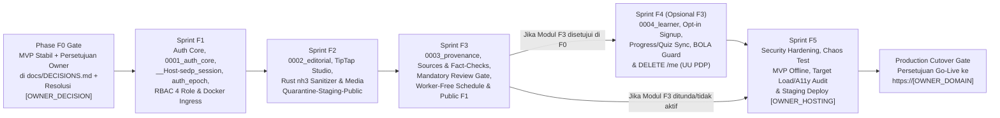

# Rencana Implementasi Bertahap: SEDP Learning Hub (Phase F)

> [!CAUTION]
> **DO NOT DELETE.** Kept by the owner for future use. **NOT PART OF THE MVP**: do not implement or plan MVP work from this file until the owner approves Phase F (see [README.md](./README.md)). If this file conflicts with `docs/prompts/` or `AGENTS.md`, those win.

| Field | Detail |
|---|---|
| **System** | SEDP Learning Hub, Phase F (Platform) |
| **Document Version** | 4.0.0-sedp |
| **Date** | 2026-11-18 |
| **Status** | Deferred draft, not approved |
| **Methodology** | Gate-Driven Incremental Delivery + Target Quality Gates |
| **Modules** | F1 Articles ("Catatan & Studi Kasus"), F2 Provenance (`/sources`, `/fact-checks`), opsional F3 Learner Accounts (`/me*`) |
| **Frontend Stack** | Root Next.js 16.4.x stable (App Router, Turbopack default, `next lint` dihapus -> ESLint CLI), React 19, TypeScript strict, Tailwind CSS 4, shadcn/ui, pnpm 12 (`allowBuilds` di `pnpm-workspace.yaml`), Node 26 Active LTS (Node 24 & 22 Maintenance LTS didukung) |
| **Backend Stack (Default)** | Python 3.12+, FastAPI, Pydantic v2, SQLAlchemy 2.0 async (`asyncpg`), Alembic (`services/api/`), PostgreSQL 16+, Redis 7 single instance, S3-compatible object storage (Cloudflare R2 diusulkan), `infra/docker/` Nginx single-origin (alternatif Next.js Route Handlers + TypeScript ORM pada `[OWNER_DECISION]`) |
| **Domain & Hosting** | `[OWNER_DOMAIN]` / `[OWNER_HOSTING]` |

---

## Riwayat Revisi (Revision History)

| Versi | Tanggal | Penulis / Reviewer | Bagian yang Diubah | Rincian Perubahan (Sebelum vs Sesudah) | Alasan Perubahan |
|---|---|---|---|---|---|
| 1.0.0 | 2026-10-13 | Staff Ahli Divisi MIK | Dokumen Baru | Draf awal roadmap implementasi 6 fase bertahap. | Inisiasi perencanaan fase pengembangan. |
| 1.1.0 | 14 Oktober 2026 | Staff Ahli MIK & Auditor | Revisi Deliverables | Integrasi 3 Redis, ES256, Turnstile, booking multi-slot, evaluasi per booking_id. | Penyelarasan hasil audit teknis v2.0.0. |
| 1.2.0 | 14 Oktober 2026 | Staff Ahli MIK & Implementer | Quality Gates Fase 1 | 7 Quality Gates Fase 1, penundaan storage, grace period refresh, UI placeholder. | Sinkronisasi keputusan implementasi. |
| 1.3.0 | 14 Oktober 2026 | Staff Ahli MIK & Lead QA | Konsistensi Tabel | Standarisasi 12 tabel riil migrasi 003, Tailwind v3.4.x, kriteria pengujian Fase 2-6. | Harmonisasi lintas dokumen. |
| 2.0.0 | 2026-10-23 | Staff Ahli MIK & Antigravity Lead | Seluruh Dokumen | **Sebelum:** Roadmap 6 fase bertahap untuk modul interview & rekrutmen massal. **Sesudah:** Restrukturisasi total menjadi Roadmap Sprint 4 Minggu terukur (1 Bulan) murni Blog CMS modern sekelas WordPress, adopsi TipTap WYSIWYG, integrasi Cloudflare R2, eliminasi Celery, dan quality gates mingguan yang realistis diselesaikan mahasiswa. | Pivot arsitektur WordPress-like Blog CMS, eliminasi modul interview, dan kepastian rilis tepat waktu. |
| 4.0.0-sedp | 2026-11-18 | Phase F Adaptation | Seluruh Dokumen | **Sebelum:** Roadmap 4 minggu HIMA IF CMS (Next.js 15, Tailwind 3.4, Node 22, `/frontend` + `/backend`, role `SUPER_ADMIN` + *direct publishing* `AUTHOR`, domain `himaif.my.id`, migrasi Hostinger ke VPS kampus Telkom University). **Sesudah:** Rencana implementasi *deferred* untuk SEDP Learning Hub Phase F: menambahkan **Phase F0 Gate** (MVP sudah rilis, persetujuan tertulis di `docs/DECISIONS.md`, seluruh `[OWNER_DECISION]` selesai), restrukturisasi menjadi **5 Sprint (F1 s.d. F5)** selaras dengan 4 revisi Alembic (`0001_auth_core` s.d. `0004_learner`), 16 tabel (15 tabel domain inti + tabel bantu `email_verification_tokens` pada [DATABASE_SCHEMA.md](./DATABASE_SCHEMA.md)), 8 enum, 4 role (`OWNER`, `AUTHOR`, `REVIEWER`, `LEARNER`), penghapusan *direct publishing*, sanitasi `nh3`, pipeline media `quarantine/ -> staging/ -> public/` (5 MB, 16 MP, sisi maks `8192` px, no SVG), modul F2 Provenance & F3 Learner Accounts opsional, batas mutlak agar halaman statis/MDX MVP tidak pernah bergantung pada API Phase F, target kualitas numerik eksplisit sebagai target, dan deployment hosting-agnostic ke `[OWNER_HOSTING]` / `[OWNER_DOMAIN]`. | Mengadaptasi roadmap implementasi menjadi rencana Phase F SEDP Learning Hub yang selaras 100% dengan [README.md](./README.md) serta dokumen spesifikasi teknis saudara. |

---

## 1. Gambaran Umum, Batas Integrasi MVP, dan Peta Tahapan

Dokumen ini memetakan jalur eksekusi **Phase F (Platform)** untuk **SEDP Learning Hub** apabila owner memutuskan memperluas situs edukasi *static-first* pasca-MVP dengan tiga kapabilitas tambahan:
1. **F1 Articles ("Catatan & Studi Kasus")**: artikel editorial berbasis database untuk studi kasus sistem kabel laut, catatan gangguan (*cable fault write-ups*), dan catatan lapangan.
2. **F2 Provenance**: register sumber (`sources`, `article_sources`) dan log verifikasi fakta (`fact_checks`) khusus staf yang mencerminkan skema register berkas dari `docs/plans/CONTENT_AND_SOURCES.md`.
3. **F3 Learner Accounts (opsional)**: sinkronisasi progres belajar (`learner_progress`) dan riwayat percobaan kuis (`quiz_attempts`) secara *opt-in*, sementara pembacaan anonim dan penyimpanan progres lokal browser tetap berjalan penuh tanpa akun.

### 1.1 Aturan Batas Integrasi Mutlak (MVP Isolation Boundary)

Aturan berikut mengikat seluruh sprint dari **F0 hingga F5** dan merupakan syarat lulus pada setiap tahap:

1. **Halaman Statis/MDX MVP Tidak Pernah Bergantung pada Phase F API**:
   - Seluruh halaman MVP (beranda, indeks belajar, pembaca pelajaran MDX, simulator teknik bawah laut, glosarium, lini masa, kuis lokal anonim, halaman tentang/sumber/penafian) menyajikan konten murni dari repositori git (`content/`).
   - Rute MVP **dilarang keras** melakukan pemanggilan sinkron maupun wajib ke `/api/v1`, PostgreSQL, atau Redis. Jika layanan backend Phase F dimatikan, seluruh rute MVP harus tetap mengembalikan `HTTP 200 OK` dan `next build` (termasuk `sitemap.ts`) harus tetap sukses.
2. **Kurikulum Tetap di Git**:
   - Pelajaran tidak pernah dipindahkan ke database. Database Phase F hanya merujuk pelajaran dan kuis melalui ID stabil pada frontmatter MDX (`lesson_id`, `quiz_id`).
3. **Degradasi Eksplisit pada Rute Artikel Publik F1**:
   - Halaman publik artikel ("Catatan & Studi Kasus") menggunakan timeout pendek dan wajib menampilkan *explicit error state* (beserta tautan kembali ke kurikulum MDX statis) apabila `/api/v1` gagal merespons. Dilarang menipu pengguna dengan data tiruan (*mock fallback*) atau membiarkan error API menjatuhkan shell navigasi utama situs.
4. **Batas Kepemilikan Rute `/api/v1` dan Isolasi `/studio`**:
   - Pada arsitektur default (Opsi A FastAPI), aplikasi Next.js di root **dilarang** mendefinisikan Route Handler di `src/app/api/v1/**`. Seluruh rute `/api/v1/**` diteruskan Nginx ke `services/api/`. Webhook revalidasi internal Next.js ditempatkan di `src/app/api/internal/revalidate/route.ts` dan diblokir dari internet publik oleh Nginx (`404`).
   - Konsol staf `src/app/(studio)/studio/**` selalu menyertakan `noindex, nofollow` (`X-Robots-Tag` dan metadata Next.js) dan **tidak pernah** ditautkan dari navigasi publik MVP maupun navigasi portal artikel.

### 1.2 Peta Aliran Tahapan Phase F (Dependency Flow)

---

## 2. Phase F0 Gate: Prasyarat dan Keputusan Pembuka

**Tidak ada kode fitur Phase F yang boleh ditulis, di-scaffold, atau dipasang dependensinya sebelum seluruh item pada Gerbang F0 terpenuhi.**

### 2.1 Prasyarat Masuk (Entry Prerequisites)

1. **MVP Static-First Sudah Rilis dan Terverifikasi**:
   - Baseline Phase 0A dan rencana Phase 0B (`docs/plans/INFORMATION_ARCHITECTURE.md`, `docs/plans/CONTENT_AND_SOURCES.md`, `docs/plans/TECHNICAL_ARCHITECTURE.md`, `docs/plans/QUALITY_GATES.md`) telah selesai serta versi MVP anonim berjalan stabil di produksi/staging awal.
2. **Persetujuan Tertulis Owner di `docs/DECISIONS.md`**:
   - Owner mencatat keputusan resmi untuk mengaktifkan Phase F beserta cakupan modul yang disetujui (**F1 Articles**, **F2 Provenance**, dan opsional **F3 Learner Accounts**).
3. **Resolusi Seluruh Item `[OWNER_DECISION]` Terbuka**:
   Seluruh keputusan dari [README.md](./README.md) wajib ditetapkan dan direkam di `docs/DECISIONS.md`:
   - **Keputusan #1 (Ruang Lingkup Modul)**: Menetapkan modul mana yang aktif pada rilis Phase F (`F1`, `F2`, dan apakah `F3 Learner Accounts` diaktifkan pada gelombang ini atau ditunda).
   - **Keputusan #2 (Backend Stack)**: Memilih **Opsi A (Default)** layanan terpisah Python 3.12+ FastAPI (`services/api/`) + Nginx single-origin di `infra/docker/` **atau** **Opsi B (Alternatif)** Next.js-native Route Handlers + TypeScript ORM (satu bahasa tanpa layanan Python; kontrak skema DB, endpoint, RBAC, sanitasi HTML, dan guard media tetap wajib identik).
   - **Keputusan #3 (Domain, Hosting, Storage, Email, & Backup)**: Menetapkan nilai konkret untuk `[OWNER_DOMAIN]`, penyedia dan kapasitas `[OWNER_HOSTING]` (VPS diusulkan), penyedia S3-compatible object storage (Cloudflare R2 diusulkan untuk bucket publik + bucket/prefix privat), penyedia email transaksional untuk verifikasi `LEARNER` (jika F3 aktif), serta lokasi backup terenkripsi PostgreSQL di luar host utama.
   - **Keputusan #4 (Kebijakan Retensi Data UU PDP No. 27/2022)**: Mengonfirmasi masa simpan final (usulan awal pada [DATABASE_SCHEMA.md](./DATABASE_SCHEMA.md) belum mengikat): pembersihan `sessions` kedaluwarsa/dicabut, anonimisasi IP/UA dan penghapusan `auth_audit_logs`, penanganan akun `LEARNER` tidak aktif atau belum terverifikasi email, serta prosedur offboarding akun staf terkait FK `ON DELETE RESTRICT`.
   - **Keputusan #5 (Aturan Override `OWNER` & Wewenang Tombol Publish)**: Menetapkan apakah `OWNER` diperbolehkan melakukan *self-approval override* atas artikelnya sendiri (wajib `is_owner_override = true` + `override_reason` + entri `OWNER_SELF_APPROVAL_OVERRIDE` di `auth_audit_logs`) atau dilarang penuh (`reviewer_id != article_author_id` mutlak), serta menegaskan apakah eksekusi `/publish` dan `/schedule` pada artikel berstatus `APPROVED` eksklusif milik `OWNER` atau dapat didelegasikan ke `REVIEWER` selain penulis.
4. **Verifikasi Gerbang Kontrak & Kesiapan Pra-Sprint F1 (Phase F0 Contract Check)**:
   - Seluruh spesifikasi `docs/future/` mengacu pada [README.md](./README.md) serta [DATABASE_SCHEMA.md](./DATABASE_SCHEMA.md) sebagai satu-satunya *single DDL source of truth*, dengan poin pemeriksaan nyata yang wajib dikonfirmasi di Gerbang F0 sebelum penulisan kode migrasi dan DTO:
     - Mengonfirmasi penetapan seluruh 5 poin `[OWNER_DECISION]` pada `docs/DECISIONS.md` (cakupan modul F1/F2/F3, pilihan stack backend, domain `[OWNER_DOMAIN]`, `[OWNER_HOSTING]`, kebijakan retensi UU PDP, serta aturan override `OWNER`), termasuk mengonfirmasi path rute publik F1 final dari `docs/plans/INFORMATION_ARCHITECTURE.md` (jalur `/artikel` dan `/artikel/[slug]` berstatus proposal hingga disahkan dokumen IA Phase 0B).
     - Memeriksa kesiapan aktivasi modul F3 pada revisi `0001_auth_core`: kolom `users.email_verified_at` (`TIMESTAMPTZ NULL`) dan tabel bantu `email_verification_tokens` sudah tercantum dalam DDL kanonik [DATABASE_SCHEMA.md](./DATABASE_SCHEMA.md); di Gerbang F0 ditetapkan apakah alur pendaftaran/verifikasi email `LEARNER` diaktifkan (`FEATURE_LEARNER_SIGNUP_ENABLED = true`) atau dipertahankan nonaktif sambil menjaga konsistensi migrasi `0001_auth_core`.
     - Memverifikasi format aktual `lesson_id` dan `quiz_id` dari frontmatter MDX kurikulum MVP di `content/` (panjang 1..128 karakter tanpa spasi ujung) untuk diselaraskan dengan validator Pydantic v2 pada `fact_checks`, `learner_progress`, dan `quiz_attempts`.
     - Mengonfirmasi daftar *pinning* versi stabil pustaka dan image container saat Phase F resmi dimulai (rincian pada poin 5 di bawah).
5. **Pinning Versi Dependensi (*Pin Current Stable at Phase F Start*)**:
   - Memverifikasi versi stabil aktual di root app (`Next.js 16.4.x` stable dengan Turbopack default dan ESLint CLI menggantikan `next lint`, `React 19`, `Tailwind CSS 4`, `pnpm 12` dengan `allowBuilds` di `pnpm-workspace.yaml`, `Node 26 Active LTS` atau `Node 24`/`22 Maintenance LTS`).
   - Melakukan *pin* versi stabil aktual saat Phase F dimulai untuk: `TipTap`, Rust `nh3`, `FastAPI`, `Pydantic v2`, `SQLAlchemy 2.0`, `Alembic`, `asyncpg`, `argon2-cffi`, `pillow`, serta tag/digest image container Nginx, PostgreSQL 16+, dan Redis 7.

### 2.2 Kriteria Kelulusan Phase F0 Gate

- [ ] MVP static-first telah dinyatakan stabil dan memenuhi seluruh gate MVP.
- [ ] Dokumen persetujuan Phase F dan seluruh 5 poin `[OWNER_DECISION]` tercatat tertulis di `docs/DECISIONS.md`.
- [ ] Pemeriksaan gerbang kontrak pra-Sprint F1 (poin 2.1.4) terverifikasi: rute publik F1 pada `INFORMATION_ARCHITECTURE.md` dikonfirmasi, format `lesson_id`/`quiz_id` MDX MVP diperiksa, kesiapan `users.email_verified_at` & `email_verification_tokens` untuk F3 ditetapkan, dan versi pustaka siap dipin.
- [ ] `.env.example` diperbarui (tanpa kredensial nyata) untuk mendokumentasikan variabel Phase F, serta `sources-private/` dan `*.pdf` terverifikasi tetap di `.gitignore`.

---

## 3. Rincian Sprint F1 hingga F5 (Deliverables & Acceptance Criteria)

### Sprint F1: Auth Core & DB Foundation

**Tujuan**: Membangun fondasi infrastruktur container single-origin (`infra/docker/`), menginisialisasi layanan backend default `services/api/` (atau jalur TypeScript jika Opsi B dipilih di F0), mengeksekusi migrasi `0001_auth_core`, dan menegakkan autentikasi berbasis cookie `__Host-sedp_session`, Argon2id, `auth_epoch`, anti-CSRF 4 lapis, serta RBAC 4 peran.

- **Deliverables**:
  1. **Orkestrasi & Ingress (`infra/docker/`)**:
     - `infra/docker/docker-compose.yml` (dev lokal) dan `infra/docker/docker-compose.prod.yml` (template target produksi `[OWNER_HOSTING]`) mencakup layanan `nginx`, `web` (root Next.js 16.4.x), `api` (`services/api/`), `postgres` (PostgreSQL 16+), dan `redis` (Redis 7 instance tunggal).
     - `infra/docker/nginx/conf.d/default.conf`: single-origin `https://[OWNER_DOMAIN]` memetakan `/` dan `/_next/static/` ke `nextjs_upstream`, `/api/v1/` ke `api_upstream`, `/studio` dengan header `X-Robots-Tag: noindex, nofollow`, memblokir `/api/internal/` dari publik (`location ^~ /api/internal/ { deny all; return 404; }`), dan mengonfigurasi rate limit awal (termasuk `auth_login_limit` `5r/m` dan `media_presign_limit` `20r/m` / `20 req/menit`).
     - Root `pnpm-workspace.yaml` terkonfigurasi untuk `pnpm 12` termasuk peta `allowBuilds` eksplisit.
  2. **Migrasi Database Alembic `0001_auth_core`**:
     - Membuat fungsi pemicu `fn_set_updated_at()`.
     - Membuat enum `user_role {'OWNER', 'AUTHOR', 'REVIEWER', 'LEARNER'}`.
     - Membuat tabel `users` (UUIDv4 PK, `email`, `username` wajib bagi staf, `password_hash`, `display_name`, `role` default `'LEARNER'`, `must_change_password`, `is_active`, `email_verified_at TIMESTAMPTZ NULL`, `auth_epoch`), `sessions` (`token_hash` SHA-256 64-hex, `auth_epoch`, `ip_address`, `expires_at`, `revoked_at`), tabel bantu `email_verification_tokens` (`id UUID PK`, `user_id` FK `ON DELETE CASCADE`, `token_hash CHAR(64) UNIQUE NOT NULL`, `expires_at`, `consumed_at`, `created_at`), dan `auth_audit_logs` (`user_id`, `actor_id`, `event VARCHAR(64) NOT NULL` dengan constraint `CHECK` huruf kapital `^[A-Z0-9_]+$` bukan PG enum, `metadata` JSONB tanpa PII/token mentah).
  3. **Core Keamanan Auth & Guard RBAC (`services/api/app/core/`)**:
     - `password.py`: Argon2id parameter OWASP ($m = 19456\text{ KiB}$, $t = 2$, $p = 1$, salt 16 byte, hash 32 byte, max password 128 karakter) + `DUMMY_ARGON2_HASH` untuk verifikasi *constant-time*.
     - `auth_cookie.py`: generator session ID CSPRNG 256-bit (`secrets.token_hex(32)`), penerbitan & penghapusan cookie **`__Host-sedp_session`** (`HttpOnly=true`, `Secure=true`, `SameSite=Lax`, `Path=/`, `Domain=None`).
     - `revocation.py` + `session_service.py`: cache sesi Redis (`session:{id}`, `user_epoch:{user_id}`) dengan mekanisme *instant revocation* berbasis kenaikan atomik `users.auth_epoch` (*fail-closed*).
     - `csrf_guard.py`: middleware anti-CSRF 4 lapis untuk semua mutasi (`POST`, `PUT`, `PATCH`, `DELETE`) pada `/api/v1`: validasi `Sec-Fetch-Site` (`same-origin`/`none`), validasi `Origin`/fallback `Referer` terhadap `https://[OWNER_DOMAIN]`, kewajiban header `X-Requested-With`, dan CORS strict tanpa wildcard.
     - `rate_limit.py`: *sliding window* Redis (target awal `POST /auth/login` 5 req/menit per IP + identifier).
     - `rbac.py` / `permissions.py`: guard peran (`OWNER`, `AUTHOR`, `REVIEWER`, `LEARNER`) serta lockout `must_change_password = true` (`403 PASSWORD_CHANGE_REQUIRED` untuk semua endpoint di luar `/auth/me`, `/auth/change-password`, `/auth/logout`).
  4. **Endpoints Backend & Seeder**:
     - Grup `/api/v1/auth`: `POST /login`, `POST /logout`, `GET /me`, `POST /change-password` (min. 12 karakter + kompleksitas, menaikkan `auth_epoch`).
     - Grup `/api/v1/users` (`OWNER`-only): `GET /users`, `POST /users` (membuat `OWNER`/`AUTHOR`/`REVIEWER` dengan `must_change_password = true` dan `email_verified_at = NOW()`), `GET /users/{id}`, `PATCH /users/{id}` (melindungi `OWNER` aktif terakhir dengan `409`, menaikkan `auth_epoch` saat ubah role/nonaktif), `POST /users/{id}/reset-password`.
     - Grup `/api/v1/audit-logs` (`OWNER`-only): `GET /audit-logs`.
     - `services/api/app/db/seed.py`: membuat akun `OWNER` awal dengan `must_change_password = true` (kredensial via env/CLI aman, tanpa hardcode password di git).
  5. **Frontend Auth & Kerangka Studio (`src/app/`)**:
     - `src/lib/api-client.ts`: fetch client ber-base relatif `/api/v1`, `credentials: "include"`, menyertakan `X-Requested-With`.
     - Halaman `/login` (`src/app/(auth)/login/page.tsx`) dan `/change-password` (`src/app/(auth)/change-password/page.tsx`).
     - Shell `src/app/(studio)/studio/layout.tsx` (metadata `robots: { index: false, follow: false }`, menolak `LEARNER` dan pengguna anonim, tidak ditautkan dari navigasi publik), plus halaman `/studio/users` dan `/studio/audit-logs`.
- **Acceptance Criteria Sprint F1**:
  - [ ] `alembic upgrade head` dan `alembic downgrade base` pada revisi `0001_auth_core` berjalan bersih di PostgreSQL 16+ tanpa *orphan type* atau error constraint.
  - [ ] Pengujian CI memverifikasi **tidak ada** berkas di `src/app/api/v1/**`; seluruh `/api/v1/*` dilayani `services/api/`.
  - [ ] `POST /api/v1/auth/login` mengembalikan `Set-Cookie` bernama persis `__Host-sedp_session` dengan flag `HttpOnly`, `Secure`, `SameSite=Lax`, `Path=/`, dan tanpa atribut `Domain`.
  - [ ] Password tersimpan dalam hash Argon2id; login akun tidak dikenal berjalan dengan waktu sebanding (memakai dummy hash) dan terkena rate limit setelah melewati batas target `5 req/menit`.
  - [ ] Akun staf baru (`must_change_password = true`) menerima `403 PASSWORD_CHANGE_REQUIRED` saat mengakses `/api/v1/users` atau `/api/v1/audit-logs` sebelum menyelesaikan `POST /api/v1/auth/change-password`.
  - [ ] Mutasi ke `/api/v1/*` tanpa header `X-Requested-With`, dari `Origin` tidak valid, atau dengan `Sec-Fetch-Site: cross-site` / `same-site` ditolak `403 PERMISSION_DENIED`.
  - [ ] Setelah `OWNER` mengubah role, menonaktifkan user, atau user mengganti password (`auth_epoch` naik), cookie `__Host-sedp_session` lama langsung ditolak `401 AUTHENTICATION_FAILED` pada request berikutnya meskipun cache Redis sebelumnya hangat.
  - [ ] Halaman MVP statis/MDX tetap mengembalikan `HTTP 200 OK` ketika container `api`, `postgres`, dan `redis` dimatikan.

---

### Sprint F2: Editorial TipTap Studio, `nh3` & Media Pipeline

**Tujuan**: Mengaktifkan migrasi `0002_editorial`, membangun editor TipTap terstruktur untuk konten teknik sistem kabel laut, menerapkan sanitasi ganda backend (`ast_validator` + Rust `nh3`), serta membangun pipeline upload media *direct-to-storage* yang kebal terhadap upload `.svg`, file palsu, dan bom dekompresi 16 MP.

- **Deliverables**:
  1. **Migrasi Database Alembic `0002_editorial`**:
     - Enum `article_status {'DRAFT', 'IN_REVIEW', 'APPROVED', 'SCHEDULED', 'PUBLISHED', 'ARCHIVED'}`, `review_decision {'APPROVED', 'CHANGES_REQUESTED'}`, dan `rights_status {'UNKNOWN', 'PENDING', 'CLEARED', 'REJECTED'}`.
     - Tabel `article_categories`, `article_tags`, `article_tag_links`, `media_assets` (dengan `CHECK` mime raster only, `storage_key UNIQUE`, maks `5242880` byte, sisi maks `8192` px dengan total maks `16000000` piksel `BIGINT`, `rejection_reason`, dan kolom `source_id` UUID nullable sebelum `0003_provenance`), `articles` (`content_json` JSONB + `content_html` TEXT, indeks partial `idx_articles_public_feed`, indeks GIN teks penuh `'indonesian'` pada `title` dan `excerpt`), `article_revisions`, `article_reviews` (composite FK `fk_reviews_article_author` + constraint pemisahan tugas), serta trigger `fn_enforce_article_publish_gate()`.
     - Seeder kategori awal `article_categories` (misalnya studi kasus gangguan kabel, catatan lapangan CLS/survei, analisis arsitektur).
  2. **Kompilator AST & Sanitasi Rust `nh3` (`services/api/app/core/sanitizer.py`)**:
     - Validator AST TipTap (`ast_validator.py`): kedalaman node `<= 32`, hanya node/mark yang diizinkan (heading hanya `H2`-`H4`, melarang `H1`), mengekstrak `mediaAssetId`, `sourceId`, `lessonId`, serta memvalidasi pola `img[src]` hanya `^/storage/public/[0-9a-f-]{36}\.webp$`.
     - Kompilator AST deterministik ke HTML semantik (`ast_compiler.py`), diikuti **`nh3.clean()`** dengan allowlist tag/atribut/skema URL (`https`, `http`, `mailto`), `clean_content_tags={"script", "style", "svg", "math"}`, `link_rel="noopener noreferrer"`, dan `filter_safe_attribute` yang menolak URL eksternal maupun `data:` pada ``.
  3. **Pipeline Media Direct-to-Storage S3v4 (`services/api/app/core/media_guard.py`, `services/api/app/api/v1/endpoints/media.py`)**:
     - Alur 3 prefix storage: `quarantine/` -> `staging/` -> `public/`.
     - `POST /api/v1/media/presign-upload`: menolak mutlak `.svg`, `image/svg+xml`, `.pdf`, dan file non-raster (`image/webp`, `image/avif`, `image/png`, `image/jpeg` saja) serta ukuran `> 5 MB`; menerbitkan S3v4 Presigned PUT ke `quarantine/{id}.bin` (TTL 5 menit).
     - `POST /api/v1/media/confirm-upload`: stream maksimal `5.242.880` byte dari `quarantine/`, deteksi *magic bytes* biner (menolak `<svg`, `<?xml`, `<!doctype`, `<html`, `.exe`, PDF), proteksi **anti-decompression bomb** (`PIL.Image.MAX_IMAGE_PIXELS = 16_000_000` dengan `DecompressionBombWarning` diperlakukan sebagai error + batas sisi maks `8192` px / `MAX_EDGE_PX = 8192` + tolak animasi multi-frame + semaphore konkurensi decode), re-encode ke WebP bersih dengan **penghapusan total EXIF/GPS/XMP**, simpan ke `staging/{id}.webp`, hapus objek karantina, dan tulis baris `media_assets` berstatus `PENDING` / `UNKNOWN`.
     - `GET /api/v1/media` (Media Library studio), `GET /api/v1/media/{id}/preview` (presigned GET privat berumur pendek untuk pratinjau aset sebelum `CLEARED`), dan `DELETE /api/v1/media/{id}` (`409` jika dipakai artikel `PUBLISHED`/`SCHEDULED`, anti-IDOR untuk `AUTHOR`).
     - Nginx cache route `/storage/public/`: hanya mem-proxy prefix `/public/` di object storage, `limit_except GET HEAD`, disk cache target `5 GB`, header `X-Content-Type-Options: nosniff` dan `Content-Security-Policy: default-src 'none'; sandbox`.
  4. **TipTap Studio Editor & Artikel CRUD Dasar**:
     - `src/components/editor/`: `subsea-editor.tsx` (TipTap current stable at Phase F start), `editor-toolbar.tsx` (keyboard accessible), `figure-dialog.tsx` (wajib mengisi `alt`, `caption`, `attribution`, dan sumber), `lesson-link-picker.tsx` (membaca manifest `lesson_id`/`quiz_id` lokal dari `content/`), `glossary-picker.tsx`, `engineering-callout.ts`, dan opsional `math-nodes.ts` (KaTeX `trust: false`, `strict: "warn"`).
     - Pencegahan paste/drop gambar `data:image/...` dan sanitasi paste HTML eksternal (`transformPastedHTML`).
     - Endpoints `POST /api/v1/articles` (status awal dipaksa `'DRAFT'`), `PUT /api/v1/articles/{id}` (anti-IDOR `author_id == current_user.id`, menambah `article_revisions`, mereset artikel `APPROVED`/`SCHEDULED` ke `DRAFT`), `DELETE /api/v1/articles/{id}` (`AUTHOR` hanya saat `DRAFT`), `GET /api/v1/articles/{id}/revisions`, `POST /api/v1/articles/{id}/revisions/{rev_id}/rollback` (re-sanitasi `nh3` + revisi baru `N+1` berstatus `DRAFT`), `/categories` (tulis khusus `OWNER`), serta `/tags` (`POST /api/v1/tags` mengizinkan `OWNER`, `AUTHOR`, dan `REVIEWER`).
     - Halaman Studio: `/studio/articles`, `/studio/articles/new`, `/studio/articles/[id]/edit`, `/studio/media`, `/studio/taxonomy`.
- **Acceptance Criteria Sprint F2**:
  - [ ] `alembic upgrade head` dan `alembic downgrade base` hingga `0002_editorial` sukses tanpa error di PostgreSQL 16+.
  - [ ] Uji unit & integrasi membuktikan payload ``, ``, `<svg onload=alert(1)>`, `<a href="javascript:alert(1)">`, dan `data:text/html` dilucuti 100% oleh `nh3` baik melalui `POST /articles`, `PUT /articles/{id}`, maupun rollback revisi; payload `content_json` dengan `H1` atau URL gambar eksternal ditolak `422`.
  - [ ] Uji integrasi KaTeX (jika diaktifkan) membuktikan `trust: false` memblokir `\href{javascript:...}` dan makro injeksi.
  - [ ] Upload `.svg`, `.xml`, `.pdf`, file `.exe`/HTML yang diganti ekstensi `.jpg`, gambar `> 5 MB`, gambar animasi multi-frame, dan gambar bomb dekompresi `> 16 MP` ditolak `413`/`415`/`422`, objek karantina terhapus, dan tidak ada entri masuk ke `/storage/public/`.
  - [ ] File WebP hasil `confirm-upload` terbukti bebas metadata EXIF/GPS saat diinspeksi, dan gambar dengan `rights_status != 'CLEARED'` mengembalikan `404` saat diminta lewat `/storage/public/{id}.webp`.
  - [ ] `AUTHOR` menerima `403 PERMISSION_DENIED` saat memanggil `PUT`/`DELETE` pada artikel atau media milik `AUTHOR` lain (anti-IDOR), dan menerima `403` saat mencoba memodifikasi kategori global.

---

### Sprint F3: Provenance, Sources, Fact-Checks & Review Workflow

**Tujuan**: Mengimplementasikan modul F2 Provenance (`0003_provenance`), memberlakukan gerbang review teknis dan lisensi yang menghapus *direct publishing* oleh `AUTHOR`, mengaktifkan penjadwalan tayang bebas worker (`published_at <= NOW()`), dan merilis portal publik F1 ("Catatan & Studi Kasus") dengan degradasi tahan gagal.

- **Deliverables**:
  1. **Migrasi Database Alembic `0003_provenance`**:
     - Enum `source_type {'OFFICIAL_MODULE', 'VENDOR_SLIDES', 'OWNER_NOTES', 'PUBLIC_PAPER', 'STANDARD', 'NEWS', 'WEBSITE', 'OTHER'}`, `trust_level {'HIGH', 'MEDIUM', 'LOW'}`, dan `fact_check_status {'UNVERIFIED', 'VERIFIED', 'DISPUTED', 'RETRACTED'}`.
     - Tabel `sources` (`code VARCHAR(64) NOT NULL UNIQUE`, `public_reuse_allowed`, `module_code`, `page_range`, `private_storage_ref` dengan constraint `!~* '^https?://'`, serta constraint `public_reuse_allowed = TRUE` hanya bila `rights_status = 'CLEARED'`).
     - Penyambungan *foreign key* `media_assets.source_id -> sources(id)`.
     - Tabel `article_sources` (`citation_note`, `sort_order`) dan `fact_checks` (`claim_text`, `verification_notes`, dengan constraint XOR `num_nonnulls(lesson_id, article_id) = 1`, `VERIFIED` wajib memiliki `source_id`, `checked_by`, `checked_at`, dan `DISPUTED`/`RETRACTED` wajib memiliki `verification_notes`).
  2. **Modul F2 Provenance API & Studio UI (Staff-Only)**:
     - Endpoints `/api/v1/sources` (`POST` menyertakan `code` unik maks 64 karakter) dan `/api/v1/fact-checks` (`OWNER`/`REVIEWER` write, `AUTHOR` read-only metadata untuk sitasi, `LEARNER`/publik ditolak `401`/`403`; `DELETE` hanya `OWNER`).
     - Penegakan aturan konten: tidak ada endpoint yang mengunggah atau menyajikan URL publik untuk PDF mentah, tangkapan layar kuliah, materi NEC bertanda "Internal Use Only", bank soal tertutup, atau data peserta pelatihan.
     - Halaman Studio: `/studio/sources` (register sumber selaras skema berkas `docs/plans/CONTENT_AND_SOURCES.md`), `/studio/fact-checks` (verifikasi klaim per `lesson_id` MDX maupun `article_id` artikel DB), serta `citation-picker.tsx` di editor TipTap.
  3. **Media Clearance, Review Gate & Worker-Free Scheduling**:
     - `PATCH /api/v1/media/{id}/rights`: hanya `REVIEWER` atau `OWNER`; menyetel `rights_status = 'CLEARED'` mewajibkan `source_id` (bila bersumber), `license`, `attribution`, lalu menyalin objek dari `staging/{id}.webp` ke `public/{id}.webp` agar dapat diakses melalui `/storage/public/{id}.webp` (sedangkan `REJECTED` mewajibkan `rejection_reason`). Penurunan status dari `CLEARED` ditolak `409` jika masih dipakai artikel `APPROVED`/`SCHEDULED`/`PUBLISHED`.
     - `POST /api/v1/articles/{id}/submit-review` (`DRAFT -> IN_REVIEW`, memvalidasi kelengkapan judul, isi, kategori, serta tiap `subseaFigure` memiliki `alt`, `caption`, `attribution`, `source`) dan `POST /api/v1/articles/{id}/withdraw-review` (`IN_REVIEW -> DRAFT`).
     - `POST /api/v1/articles/{id}/reviews` (`OWNER` atau `REVIEWER` selain penulis artikel): menerima `decision` (`APPROVED` | `CHANGES_REQUESTED`), `technical_ok`, `rights_ok`, `notes`. Penyetujuan diri sendiri ditolak keras `403`, kecuali override `OWNER` disetujui di Gate F0 (wajib payload API `owner_override: true` yang dipetakan ke `is_owner_override` + `override_reason` + tulis `OWNER_SELF_APPROVAL_OVERRIDE` ke `auth_audit_logs`).
     - `PATCH /api/v1/articles/{id}/publish`, `PATCH /api/v1/articles/{id}/schedule`, `PATCH /api/v1/articles/{id}/archive`: dalam transaksi `SELECT ... FOR UPDATE`, memastikan `status == 'APPROVED'`, review `APPROVED` aktif (`technical_ok=true`, `rights_ok=true`), 100% media & `sources` tertaut berstatus `CLEARED` (`public_reuse_allowed = true` bila ada kutipan/derivatif), dan nol `fact_checks` berstatus `DISPUTED`/`RETRACTED`. `AUTHOR` selalu ditolak `403`.
     - Penjadwalan bebas worker pada query `GET /api/v1/articles` dan `GET /api/v1/articles/{slug_or_id}`: `status = 'PUBLISHED' OR (status = 'SCHEDULED' AND published_at <= NOW())`, ditambah cache Redis TTL pendek (target maks 60 detik).
     - Halaman review Studio `/studio/articles/[id]/review/page.tsx`.
  4. **Portal Publik Artikel F1 & Degradasi Aman**:
     - Rute publik F1 mengikuti `docs/plans/INFORMATION_ARCHITECTURE.md` (`/artikel` dan `/artikel/[slug]` adalah proposal sampai disahkan dokumen IA), ISR `revalidate: 60` + webhook internal `src/app/api/internal/revalidate/route.ts` (`POST /api/internal/revalidate`, dilindungi Bearer/HMAC secret, hanya diakses `sedp_api` via jaringan internal Docker, dan diblokir Nginx dari internet publik lewat `location ^~ /api/internal/ { deny all; return 404; }`; Next.js tetap nol rute di `/api/v1`).
     - Halaman detail artikel merender `content_html`, metadata SEO (`generateMetadata`), JSON-LD `TechArticle` tersanitasi (`<` -> `\u003c`), daftar pustaka terstruktur dari sumber `CLEARED`, tautan balik ke `lesson_id` MDX dan glosarium, serta catatan penafian bahwa situs adalah sumber belajar independen.
     - Pencarian teks penuh PostgreSQL (`to_tsvector('indonesian', ...)`), filter kategori/tag, `loading.tsx`, empty state, dan **explicit error state** saat `/api/v1` tidak terjangkau.
     - `sitemap.ts` (dengan timeout pendek dan fallback aman mengembalikan rute statis MVP saat API mati) serta `robots.ts` (`Disallow: /studio` dan `/api/v1`).
- **Acceptance Criteria Sprint F3**:
  - [ ] `alembic upgrade head` hingga `0003_provenance` sukses dan memblokir penyisipan `private_storage_ref` berawalan `http://`/`https://`, `public_reuse_allowed = TRUE` tanpa `CLEARED`, maupun `fact_checks` dengan kedua `lesson_id` & `article_id` terisi/kosong bersamaan.
  - [ ] Uji integrasi RBAC membuktikan `AUTHOR` menerima `403` pada `/publish`, `/schedule`, `/archive`, `POST /reviews`, `POST /sources`, dan `PATCH /media/{id}/rights`; `REVIEWER` menerima `403` saat me-review artikelnya sendiri; `LEARNER` dan pengguna anonim menerima `401`/`403` pada `/sources` dan `/fact-checks`.
  - [ ] Transisi ke `PUBLISHED` atau `SCHEDULED` ditolak (`409`/`422`) apabila ada 1 gambar masih `PENDING`/`UNKNOWN`/`REJECTED`, ada sumber belum `CLEARED`, `technical_ok` atau `rights_ok` bernilai `false`, atau ada `fact_checks` berstatus `DISPUTED`/`RETRACTED`.
  - [ ] Artikel `SCHEDULED` dengan `published_at` di masa depan mengembalikan `404` pada rute publik, dan otomatis muncul di `GET /api/v1/articles` segera setelah `NOW() >= published_at` tanpa worker Celery.
  - [ ] Mematikan API backend saat mengunjungi `/artikel` atau menjalankan `next build` tidak menyebabkan crash situs maupun gagal build; halaman artikel menampilkan pesan error eksplisit dengan tombol coba lagi dan tautan ke pelajaran MDX statis.

---

### Sprint F4: Optional Learner Accounts & Sync

*(Sprint ini bersifat kondisional: hanya dieksekusi apabila modul **F3 Learner Accounts** disetujui oleh owner pada Phase F0 Gate. Jika F3 tidak disetujui, lompati Sprint F4 langsung ke Sprint F5.)*

**Tujuan**: Mengaktifkan migrasi `0004_learner` dan alur akun pembelajar *opt-in* untuk sinkronisasi progres pelajaran MDX serta riwayat kuis tanpa mengganggu pembaca anonim dan tanpa mengumpulkan data berlebih di luar batas UU PDP (UU No. 27/2022).

- **Deliverables**:
  1. **Migrasi Database Alembic `0004_learner`**:
     - Enum `progress_status {'STARTED', 'COMPLETED'}`.
     - Tabel `learner_progress` (`user_id`, `lesson_id` text kanonik, `status`, `percent_complete` 0..100, `last_section_slug`, `started_at`, `completed_at`, `client_updated_at`, kendala unik `(user_id, lesson_id)`).
     - Tabel `quiz_attempts` (`user_id`, `quiz_id` text kanonik, `lesson_id` opsional, `score`, `max_score`, `passed`, `answers_json`, `duration_seconds`, `attempt_number`, kendala `0 <= score <= max_score`).
  2. **Registrasi & Verifikasi Email Khusus `LEARNER` (`/api/v1/auth`)**:
     - Feature flag `FEATURE_LEARNER_SIGNUP_ENABLED`.
     - `POST /api/v1/auth/register`: mengabaikan input `role` dari klien dan memaksa `role = 'LEARNER'`, `must_change_password = false`, `email_verified_at = NULL`; membuat token verifikasi CSPRNG 256-bit (disimpan sebagai hash SHA-256 pada `email_verification_tokens` dengan masa berlaku sesuai `[OWNER_DECISION]`, usulan 24 jam) dan mengirim tautan verifikasi.
     - `POST /api/v1/auth/verify-email` (single-use pada `email_verification_tokens`, mengisi `consumed_at = NOW()` & `users.email_verified_at = NOW()`, mencatat `EMAIL_VERIFIED`) dan `POST /api/v1/auth/resend-verification` (rate-limited, respons netral anti-enumeration).
     - Penegakan di `POST /api/v1/auth/login`: akun `LEARNER` dengan `email_verified_at IS NULL` ditolak `403 EMAIL_VERIFICATION_REQUIRED` tanpa menerbitkan cookie sesi.
  3. **Self-Service Progress, Quiz Sync & UU PDP Erasure (`/api/v1/me*`)**:
     - `GET /api/v1/me` dan `PATCH /api/v1/me` (strict field filtering: hanya field profil non-sensitif yang diperbolehkan seperti `display_name` & `username`, mengabaikan `role`/`is_active`/`auth_epoch`/`email_verified_at`).
     - `GET /api/v1/me/progress`, `PUT /api/v1/me/progress/{lesson_id}`, dan `POST /api/v1/me/progress/sync`: *idempotent upsert* & merge progres dari `localStorage` browser saat opt-in (`COMPLETED` tidak pernah tertimpa balik menjadi `STARTED`).
     - `GET /api/v1/me/quiz-attempts` dan `POST /api/v1/me/quiz-attempts`: menyimpan riwayat percobaan kuis yang divalidasi terhadap `quiz_id` kanonik.
     - **BOLA/IDOR Guard Mutlak**: Seluruh kueri `/me*` mengikat `WHERE user_id = :current_user_id` dari sesi server, tidak pernah membaca `user_id` dari payload klien.
     - **`DELETE /api/v1/me` (Kepatuhan UU PDP)**: Membutuhkan re-autentikasi kata sandi + `confirm_deletion: true`, menolak `OWNER` aktif terakhir (`409`), menghapus `users`, `sessions`, `email_verification_tokens`, `learner_progress`, `quiz_attempts` secara transaksional, membersihkan PII di `auth_audit_logs`, mencatat peristiwa `ACCOUNT_SELF_DELETED` (`user_id = NULL`), menaikkan `auth_epoch`, mencabut cache Redis + cookie `__Host-sedp_session`, dan mengembalikan `204 No Content`.
     - Tugas pembersihan terjadwal retensi data (akun belum terverifikasi kedaluwarsa, sesi lama, anonimisasi `auth_audit_logs`) sesuai periode `[OWNER_DECISION]`.
  4. **UI Pembelajar Opt-In (`src/app/(learner)/profile/page.tsx`, `src/features/learner/`)**:
     - Pemberitahuan privasi transparan (minimasi data: email, nama tampilan, progres, riwayat kuis; nol tracker pihak ketiga).
     - Sinkronisasi progres lokal secara sukarela ketika pengguna login, sementara pengguna anonim tetap menjalankan pelajaran dan kuis MVP 100% lokal di browser tanpa prompt login yang memaksa.
- **Acceptance Criteria Sprint F4**:
  - [ ] `alembic upgrade head` hingga `0004_learner` sukses; constraint menolak `score < 0`, `score > max_score`, `percent_complete > 100`, dan duplikat `(user_id, lesson_id)`.
  - [ ] Mengirim `"role": "OWNER"` atau `"role": "REVIEWER"` pada `POST /api/v1/auth/register` tetap menghasilkan akun ber-role `LEARNER`.
  - [ ] Akun `LEARNER` sebelum verifikasi email ditolak `403 EMAIL_VERIFICATION_REQUIRED` saat login; token verifikasi kedaluwarsa atau dipakai ulang ditolak.
  - [ ] Akun `LEARNER` ditolak `403 PERMISSION_DENIED` pada seluruh rute `/studio/**`, `/users`, `/articles` (mutasi & draf), `/media`, `/sources`, `/fact-checks`, dan `/audit-logs`.
  - [ ] Pengujian BOLA/IDOR membuktikan User A tidak dapat membaca atau memutasi `learner_progress` maupun `quiz_attempts` milik User B.
  - [ ] `POST /api/v1/me/progress/sync` menjaga `COMPLETED` tetap `COMPLETED` meski payload lokal mengirim `STARTED`.
  - [ ] Setelah `DELETE /api/v1/me`, login ulang gagal `401`, cookie `__Host-sedp_session` lama langsung ditolak `401`, baris progres & kuis hilang dari DB, serta tidak ada email/nama tersisa pada `auth_audit_logs`.

---

### Sprint F5: Security Hardening, Performance Verification & Staging Deploy to `[OWNER_HOSTING]`

**Tujuan**: Mengaudit keamanan menyeluruh, membuktikan ketahanan mutlak MVP saat API offline (*chaos test*), mengukur secara empiris performa serta aksesibilitas terhadap target rancangan, dan mengeksekusi deployment staging tervalidasi ke `[OWNER_HOSTING]`.

- **Deliverables**:
  1. **Suite Pengujian Keamanan & Regresi Lengkap**:
     - Automated Pytest + Playwright test suite mencakup RBAC 4 role, anti-IDOR/BOLA, 4-layer anti-CSRF, atribut `__Host-sedp_session`, *instant revocation* `auth_epoch`, sanitasi `nh3` XSS & KaTeX `trust: false`, larangan `.svg`/polyglot/bom `16 MP`, gerbang review wajib tanpa *direct publishing*, dan penghapusan akun `DELETE /api/v1/me`.
     - Pemindaian dependensi (`pnpm audit`, `pip-audit` / setara pada CI Phase F) serta verifikasi header keamanan HTTP Nginx & FastAPI (`HSTS`, `X-Frame-Options`, `X-Content-Type-Options: nosniff`, `Referrer-Policy`, `Permissions-Policy`, `CSP`, `X-Robots-Tag: noindex, nofollow` pada `/studio`).
  2. **Chaos Testing Independensi MVP & Error Boundaries**:
     - Skenario terotomasi mematikan container `api`, `postgres`, dan `redis` saat menjalankan Playwright E2E penuh terhadap seluruh rute kurikulum MDX MVP, simulator, glosarium, lini masa, kuis lokal, serta memeriksa halaman artikel F1 (harus menampilkan *explicit error state* tanpa unhandled error).
  3. **Verifikasi Empiris Performa, Indeks DB & Aksesibilitas**:
     - Menjalankan `EXPLAIN ANALYZE` pada query `idx_articles_public_feed` dan indeks GIN `'indonesian'` dengan data uji realistis untuk memastikan tidak terjadi sequential scan penuh.
     - Uji beban pada lingkungan staging `[OWNER_HOSTING]` untuk mengukur latensi endpoint publik, rasio hit cache Redis & Nginx `/storage/public/`, serta konsumsi memori container terhadap **target** pada Bagian 4.
     - Audit aksesibilitas otomatis Playwright + axe-core + uji keyboard-only & `prefers-reduced-motion` pada halaman artikel F1 (state normal, empty, dan error), editor Studio, serta halaman profil pembelajar.
     - Audit Core Web Vitals / Lighthouse pada halaman artikel publik di staging `[OWNER_HOSTING]`.
  4. **Staging Deployment di `[OWNER_HOSTING]` (`staging.[OWNER_DOMAIN]`) & Runbook Cutover**:
     - Provisioning Docker Compose produksi pada `[OWNER_HOSTING]` dengan sertifikat TLS ACME/Certbot, rotasi kunci/secret produksi (non-committed), dan konfigurasi bucket publik (hanya raster `CLEARED`) terpisah dari penyimpanan sumber privat (`sources-private/`).
     - Otomasi jadwal backup PostgreSQL terenkripsi ke lokasi off-host (`[OWNER_DECISION]`) beserta uji coba *restore* di staging.
     - Penyusunan runbook *production cutover* bertahap ke `https://[OWNER_DOMAIN]` dan prosedur *rollback* terisolasi yang mengembalikan situs ke mode statis MVP murni tanpa merusak konten MDX di git.
- **Acceptance Criteria Sprint F5**:
  - [ ] Seluruh suite uji keamanan otomatis (RBAC, IDOR, CSRF, cookie, `auth_epoch`, `nh3`, SVG/16 MP guard, review gate) lulus 100% dengan nol kerentanan *critical/high* terbuka.
  - [ ] Chaos test membuktikan 100% rute MVP tetap `HTTP 200 OK` ketika `api`, `postgres`, dan `redis` mati, sedangkan halaman artikel F1 merender *explicit error state* yang aksesibel.
  - [ ] Seluruh metrik kualitas (Bagian 4) telah **diukur secara empiris** di lingkungan staging `[OWNER_HOSTING]` dan memenuhi target yang ditetapkan tanpa angka rekaan.
  - [ ] Uji backup & restore PostgreSQL terenkripsi di staging berhasil memulihkan seluruh 16 tabel (15 tabel domain inti + tabel bantu `email_verification_tokens`) beserta trigger dan index tanpa kehilangan data.
  - [ ] Seluruh alur *end-to-end* di staging (`OWNER` seed + ganti password -> `AUTHOR` buat draf + upload raster + taut `sources` -> `REVIEWER` verifikasi media `CLEARED` & approve review -> `OWNER` publish/schedule -> pembaca publik & opsional `LEARNER` sync + `DELETE /me`) terverifikasi sukses.

---

## 4. Gerbang Kualitas Numerik (Target Rancangan, Bukan Hasil Pengukuran)

> [!NOTE]
> **Seluruh angka pada tabel di bawah ini adalah TARGET kualitas dan kapasitas (*targets*)** untuk diverifikasi saat Phase F diuji pada staging `[OWNER_HOSTING]`. Dokumen ini tidak menyajikan klaim hasil pengukuran, skor Lighthouse aktual, maupun *benchmark* produksi sebelum implementasi Phase F dijalankan.

| Kategori | Metrik / Aturan | Target Rancangan (*Target*) | Batas Lingkup & Keterangan | Metode Verifikasi (Sprint F5) |
|---|---|---|---|---|
| **Isolasi MVP** | Ketersediaan rute statis/MDX saat API Phase F offline | **100% rute MVP mengembalikan `HTTP 200 OK`** | Berlaku untuk seluruh halaman pelajaran MDX, simulator, glosarium, lini masa, dan kuis lokal. | Chaos E2E test (stop `api`, `postgres`, `redis`) |
| **Keamanan Sanitasi & Media** | Pembersihan payload XSS & penolakan SVG / bom dekompresi | **0 payload XSS lolos; 100% `.svg`, `> 5 MB`, dan `> 16 MP` ditolak** | Berlaku di endpoint `/articles`, `/revisions/rollback`, `/media/presign-upload`, `/media/confirm-upload`. | Automated Pytest + security regression suite |
| **Aksesibilitas (WCAG 2.2 AA)** | Pelanggaran *critical/serious* pada UI Phase F | **0 pelanggaran *critical/serious*** | Halaman artikel F1 (normal, empty, error), Studio UI, dialog TipTap, halaman `/profile`, keyboard-only & `prefers-reduced-motion`. | Playwright + `@axe-core/playwright` + audit manual keyboard |
| **Core Web Vitals Halaman Artikel F1** | LCP, CLS, dan skor audit halaman detail artikel publik | **Target LCP `< 2.5 s` (aspirasional `< 1.5 s`), CLS `< 0.1`, target skor Lighthouse Performance `>= 90` & SEO `= 100`** | Diukur pada halaman detail artikel publik staging `[OWNER_HOSTING]` dengan gambar cover berdimensi eksplisit. | Pengukuran Lighthouse & Web Vitals di staging |
| **Cache Media Nginx** | Kapasitas disk cache lokal & kinerja cache hit `/storage/public/` | **Target ukuran cache `5 GB` (`max_size=5g`), cache hit ratio `>= 90%`, target latensi HIT `< 15 ms`** | Kapasitas disk menyesuaikan profil `[OWNER_HOSTING]`; diukur pada request berulang aset WebP `CLEARED`. | Pengujian header `X-Cache-Status: HIT` & profiling Nginx |
| **Database & Pencarian FTS** | Latensi kueri feed & pencarian teks penuh (`indonesian`) | **Target p95 kueri pencarian FTS `< 50 ms`** | Menggunakan `idx_articles_search` (GIN) dan `idx_articles_public_feed` (partial index). | `EXPLAIN ANALYZE` + load test API di staging |
| **Anggaran Memori Redis & Container** | Batas memori awal stack `infra/docker/` | **Target Redis `maxmemory 200mb` (`allkeys-lru`); target batas awal container disesuaikan kapasitas `[OWNER_HOSTING]`** | Template awal `docker-compose.prod.yml` (`web` 512M, `api` 384M, `postgres` 512M, `redis` 256M) ditinjau ulang saat load test. | Monitoring `docker stats` saat load test staging |
| **Rate Limiting Auth & Media** | Proteksi endpoint sensitif | **Target login `5 req/menit` (`auth_login_limit`), register/verify `5 req/menit`, presign media `20 req/menit` (zona Nginx `media_presign_limit = 20r/m`)** | Ambang awal dikonfirmasi pada `[OWNER_DECISION]` dan diuji terhadap simulasi brute-force serta penyalahgunaan kuota upload. | Integration test HTTP `429` + header `Retry-After` |

---

## 5. Daftar Periksa Kesiapan Go-Live Phase F

Sebelum mengarahkan traffic produksi `https://[OWNER_DOMAIN]` ke rilis Phase F:
1. Seluruh checklist **Phase F0 Gate** serta **Acceptance Criteria Sprint F1 s.d. F5** tercentang lulus berdasarkan bukti uji nyata di staging `[OWNER_HOSTING]`.
2. Seluruh materi di `sources-private/` dipastikan tidak ikut terkemas dalam container image `web` atau `api` serta tidak dapat diakses melalui Nginx.
3. Rencana rollback ke versi statis MVP murni siap dieksekusi tanpa kehilangan data atau modifikasi berkas MDX kurikulum di `content/`.
4. Owner memberikan persetujuan tertulis akhir (*Production Cutover Sign-off*) di `docs/DECISIONS.md`.
