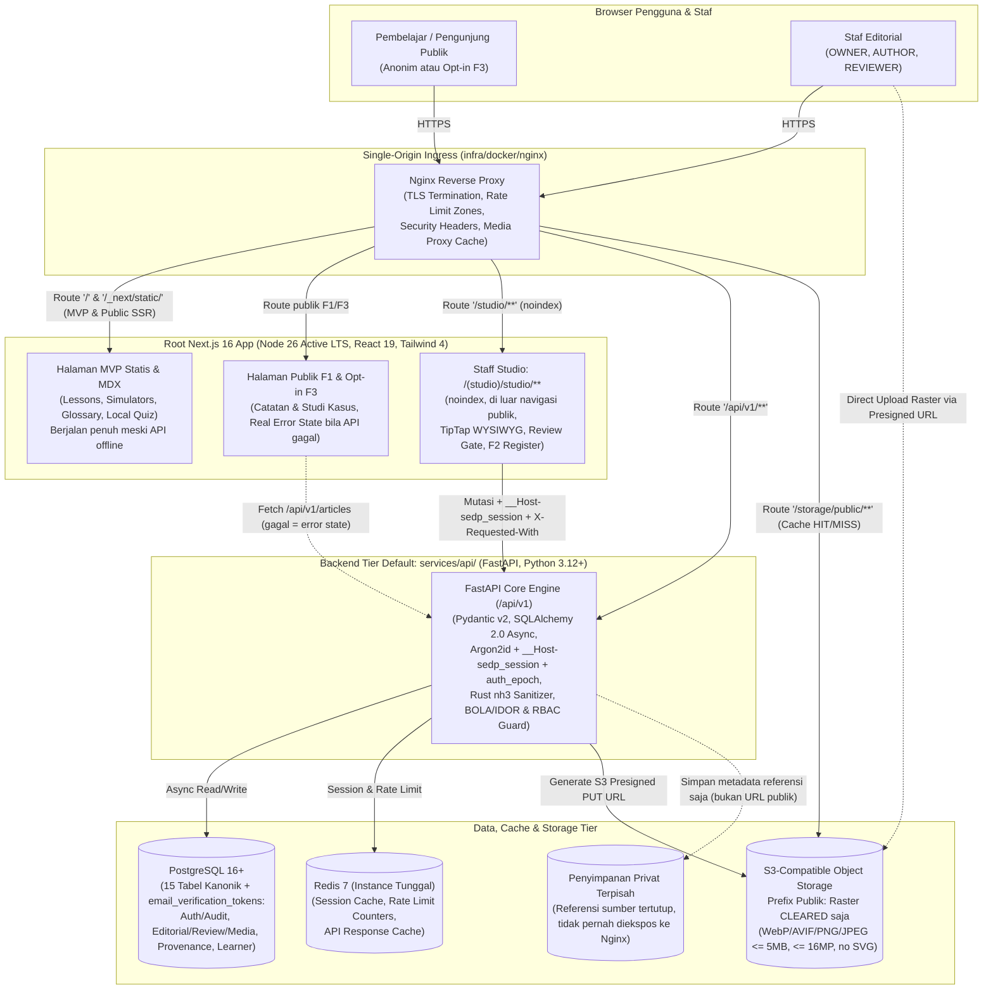

# System Architecture & Technical Blueprint: SEDP Learning Hub (Phase F)

> [!CAUTION]
> **DO NOT DELETE.** Kept by the owner for future use. **NOT PART OF THE MVP**: do not implement or plan MVP work from this file until the owner approves Phase F (see [README.md](./README.md)). If this file conflicts with `docs/prompts/` or `AGENTS.md`, those win.

| Field | Detail |
|---|---|
| **System** | SEDP Learning Hub, Phase F (Platform) |
| **Document Version** | 4.0.0-sedp |
| **Date** | 2026-11-18 |
| **Status** | Deferred draft, not approved |
| **Domain & Hosting** | `[OWNER_DOMAIN]` / `[OWNER_HOSTING]` (`[OWNER_DECISION]` di gerbang Phase F) |
| **Product Boundary** | Situs edukasi publik independen tentang sistem kabel komunikasi laut (kurikulum tetap MDX statis di git; Phase F hanya menambah F1 Articles, F2 Provenance, dan opsional F3 Learner accounts) |

---

## Riwayat Revisi (Revision History)

| Versi | Tanggal | Penulis / Reviewer | Bagian yang Diubah | Rincian Perubahan (Sebelum vs Sesudah) | Alasan Perubahan |
|---|---|---|---|---|---|
| 1.0.0 | 2026-10-13 | Staff Ahli Divisi MIK | Dokumen Baru | Baseline arsitektur teknis sistem dual-engine. | Inisiasi dokumen awal. |
| 2.0.0 | 2026-10-14 | Staff Ahli MIK & Auditor | Concurrency & Redis | Row-locking, 3 Redis terpisah, ES256 JWT, S3 storage. | Penguatan keamanan & locking modul pendaftaran. |
| 2.1.0 | 2026-10-14 | Staff Ahli MIK & Auditor | Driver Storage & Nginx | Pembakuan Cloudflare R2, direktif body 25M, isolasi port Redis 6379. | Eliminasi ambiguitas payload & port. |
| 3.0.0 | 2026-10-23 | Staff Ahli MIK & Antigravity Lead | Seluruh Dokumen | **Sebelum:** Dual-engine (CMS & Recruitment), Celery Worker + Beat, segregasi 3 instance Redis, dan locking pendaftaran.<br>**Sesudah:** Single-engine murni Blog CMS sekelas WordPress, eliminasi Celery Worker & Beat, penyatuan 1 instance Redis (cache & rate limit), Nginx Single-Origin R2 Proxy Cache 5GB, cetak biru deployment bertahap (VPS Hostinger $\to$ VPS Kampus Telkom University dengan 301 Permanent Redirect), proteksi cookie `__Host-` & anti-CSRF eTLD+1. | Pivot keputusan organisasi: membatalkan modul interview/rekrutmen dan menyederhanakan arsitektur agar dapat tuntas 100% dalam 1 bulan tanpa BaaS. |
| 4.0.0-sedp | 2026-11-18 | Phase F Adaptation | Seluruh Dokumen | **Sebelum:** Cetak biru HIMA IF CMS (Next.js 15, Tailwind 3.4, Node 22, `/frontend` + `/backend`, role `SUPER_ADMIN` + *direct publishing* `AUTHOR`, domain `himaif.my.id` -> `himaif.telkomuniversity.ac.id`, migrasi Hostinger ke VPS kampus).<br>**Sesudah:** Spesifikasi ekstensi platform *deferred* untuk SEDP Learning Hub Phase F: aplikasi Next.js 16.4.x (React 19, Tailwind 4, pnpm 12, Node 26 Active LTS) di root repo + `services/api/` (FastAPI) + `infra/docker/`, isolasi penuh agar halaman statis/MDX MVP tidak pernah bergantung pada backend API, modul F1 Articles ("Catatan & Studi Kasus") dengan gerbang review wajib tanpa *direct publishing*, modul F2 Provenance, modul F3 Learner accounts opsional, 4 role kanonik (`OWNER`, `AUTHOR`, `REVIEWER`, `LEARNER`), cookie `__Host-sedp_session`, rollout bertahap hosting-agnostic pada `[OWNER_HOSTING]` / `[OWNER_DOMAIN]`, serta catatan opsi alternatif Next.js-native Route Handlers (`[OWNER_DECISION]`). | Mengadaptasi rancangan HIMA IF CMS menjadi spesifikasi Phase F (Platform) yang selaras dengan kontrak bersama di [README.md](./README.md) dan batasan produk SEDP Learning Hub. |

---

## 1. Executive Summary & Architectural Goals

**SEDP Learning Hub** adalah aplikasi web edukasi publik yang independen berbahasa Indonesia (dengan istilah teknik bahasa Inggris yang baku) mengenai sistem kabel komunikasi laut (*subsea cable systems*). Pada tahap **MVP (Phase 0 sampai peluncuran awal)**, SEDP Learning Hub berjalan sebagai situs *static-first* anonim tanpa login, tanpa database, dan tanpa ketergantungan backend: seluruh pelajaran (*lessons*) ditulis dalam format MDX di git (`content/`), dilengkapi simulasi interaktif, glosarium, lini masa, serta kuis orisinal di sisi klien.

Dokumen ini mendefinisikan arsitektur teknis **Phase F (Platform)** yang ditunda (*deferred*) sampai owner menyetujui aktivasi pasca-MVP:
1. **F1 Articles ("Catatan & Studi Kasus")**: Artikel editorial berbasis database (studi kasus, catatan gangguan kabel, dan catatan lapangan) yang melalui tinjauan teknis dan tinjauan hak cipta sebelum terbit.
2. **F2 Provenance**: Daftar sumber (`sources`, `article_sources`) dan log cek fakta (`fact_checks`) berbasis database (khusus staf di studio) yang mencerminkan skema berbasis berkas dari `docs/plans/CONTENT_AND_SOURCES.md` (hasil perencanaan Phase 0B).
3. **F3 Learner accounts (opsional)**: Akun pembelajar (*opt-in*) untuk sinkronisasi progres belajar (`learner_progress`) dan riwayat percobaan kuis (`quiz_attempts`), sementara mode baca anonim dan progres lokal peramban tetap berfungsi penuh tanpa akun.

### Prinsip Utama Arsitektur Phase F:
1. **Independensi Mutlak Halaman MVP (Zero API Dependency for MVP)**: Seluruh rute kurikulum MDX MVP (`lesson_id`, `quiz_id`), simulator, glosarium, dan progres lokal peramban **tidak pernah bergantung pada layanan FastAPI, PostgreSQL, maupun Redis**. Jika layanan backend mati atau belum diaktifkan, seluruh pengalaman belajar MVP tetap beroperasi normal. Halaman artikel dinamis Phase F wajib menampilkan *real error state* yang informatif saat API gagal (tidak menyamarkan galat dengan data tiruan).
2. **Kurikulum Kanonik Tetap di Git**: Pelajaran (*lessons*) tetap dikelola sebagai berkas MDX di repositori git (`content/`). Database Phase F hanya merujuk pelajaran dan kuis melalui ID konten stabil (`lesson_id`, `quiz_id` dari *frontmatter* MDX), bukan menggantikan kurikulum MDX dengan database.
3. **Zero BaaS & Portabilitas Infrastruktur**: Seluruh komponen backend Phase F dapat dijalankan mandiri (*self-hosted*) di atas `[OWNER_HOSTING]` menggunakan container Docker (`infra/docker/`), PostgreSQL 16+, Redis 7 instance tunggal, dan *object storage* kompatibel S3 (Cloudflare R2 diusulkan, ditetapkan melalui `[OWNER_DECISION]`).
4. **Single-Origin Ingress (Root App + `services/api/`)**: Reverse proxy Nginx pada `infra/docker/` menyatukan aplikasi Next.js 16 di root repo (rute `/`, `/_next/`, rute MVP, dan `/studio/**`) serta layanan FastAPI di `services/api/` (rute `/api/v1/**`) di bawah satu origin `https://[OWNER_DOMAIN]`. Pada arsitektur default ini, aplikasi Next.js **tidak boleh** mendefinisikan Route Handler di bawah `/api/v1` (kecuali bila `[OWNER_DECISION]` di gerbang Phase F memilih alternatif Next.js-native Route Handlers).
5. **Provenance-First & Penghapusan Direct Publishing**: Tidak ada *direct publishing* oleh penulis. Publikasi artikel F1 mewajibkan review berstatus `APPROVED` dari peninjau selain penulis, `technical_ok = true`, `rights_ok = true`, serta seluruh `media_assets` dan `sources` terkait berstatus `rights_status = CLEARED`. Dokumen mentah sumber (PDF tertutup, tangkapan layar kuliah, materi NEC bertanda "Internal Use Only", bank soal tertutup, atau data peserta) dilarang keras diunggah ke storage publik maupun disajikan lewat URL publik.
6. **Efisiensi Operasional & Privacy-by-Design**: Penjadwalan tayang tetap tanpa background worker (*Celery-free*) via query SQL (`published_at <= NOW()`). Tidak ada tracker pihak ketiga; data pembelajar diminimalkan (email, nama tampilan, progres, riwayat kuis) dengan penghapusan mandiri `DELETE /api/v1/me` dan orientasi kepatuhan terhadap UU PDP Indonesia (UU No. 27/2022). Periode retensi data ditetapkan melalui `[OWNER_DECISION]`.

---

## 2. High-Level Component Architecture

Diagram berikut memperlihatkan pemisahan batas (*boundary*) antara rute MVP statis/MDX dan layanan platform Phase F di balik satu origin Nginx:



---

## 3. Technology Stack & Technical Rationale

| Layer / Komponen | Teknologi Terpilih | Versi / Kebijakan Pinning | Alasan Pemilihan & Manfaat Teknis |
|---|---|---|---|
| **Frontend Framework** | Next.js (App Router) + React + TypeScript | Next.js `16.4.x` stable (Turbopack default, `next lint` dihapus -> gunakan ESLint CLI), React `19`, TypeScript strict | Mendukung rute statis/MDX MVP tanpa backend sekaligus rendering halaman F1 dan antarmuka `/studio/**` dalam satu aplikasi root. |
| **Runtime & Package Manager** | Node.js + pnpm | Node.js `26 Active LTS` (Node `24` & `22` Maintenance LTS didukung), `pnpm 12` (`allowBuilds` di `pnpm-workspace.yaml`) | Keselarasan dengan baseline Phase 0A; kontrol *dependency build scripts* melalui `allowBuilds` meningkatkan keamanan rantai pasok. |
| **UI & Styling** | Tailwind CSS + shadcn/ui | Tailwind CSS `4`, shadcn/ui (pin saat setup/Phase F) | Komponen aksesibel (target WCAG 2.2 AA), token desain CSS-first untuk tema *Immersive Ocean*, dan zero-runtime CSS overhead. |
| **Rich Text Editor & HTML Sanitizer** | TipTap + Rust `nh3` | Pin current stable saat Phase F dimulai | TipTap menghasilkan AST kanonik (`articles.content_json` JSONB). Di sisi server, `nh3` menyaring HTML dengan allowlist ketat menjadi `articles.content_html` untuk memitigasi Stored XSS. |
| **Backend Framework (Default)** | Python + FastAPI + Pydantic v2 | Python `3.12+`; FastAPI & Pydantic v2 pin current stable saat Phase F dimulai | Validasi skema ketat, dukungan ASGI asinkron penuh, dokumentasi OpenAPI otomatis, dan ekosistem pemrosesan gambar biner yang matang (Pillow/magic-bytes). |
| **Database ORM & Migration** | SQLAlchemy Async + Alembic | SQLAlchemy `2.0` async (`asyncpg`) + Alembic (pin saat Phase F) | Kontrol transaksi eksplisit, proteksi SQL injection berparameter, dan 4 revisi migrasi terstruktur (`0001_auth_core` s.d. `0004_learner`). |
| **Relational Database** | PostgreSQL | `16+` | Dukungan native `UUID`, `JSONB`, constraint integritas relasional antar `articles`, `article_reviews`, `sources`, dan indeks `GIN` teks penuh bahasa Indonesia. |
| **Cache & Rate Limiting** | Redis (Instance Tunggal) | `7` (target alokasi memori awal misalnya `200 MB`, `allkeys-lru`, dapat disesuaikan di `[OWNER_HOSTING]`) | Menyimpan indeks sesi aktif untuk validasi cepat (`auth_epoch`), *atomic counters* rate limiting login/upload, dan cache respons publik artikel/taksonomi. |
| **Object Storage** | S3-Compatible Object Storage | API S3 SigV4 (Cloudflare R2 diusulkan, `[OWNER_DECISION]`) | Upload langsung (*direct-to-storage*) via *presigned URL* tanpa membebani CPU/memori server aplikasi; memisahkan bucket publik raster `CLEARED` dari arsip privat. |
| **Ingress & Containerization** | Nginx + Docker Compose | Image stabil terpin digest/minor saat Phase F dimulai (`infra/docker/`) | Terminasi TLS terpusat, penyatuan origin `/` dan `/api/v1`, *disk proxy cache* untuk `/storage/public/`, serta portabilitas lintas penyedia hosting. |

### 3.1 Alternatif Arsitektur Terbuka (`[OWNER_DECISION]` di Gerbang Phase F)

Sesuai kontrak bersama pada [README.md](./README.md), dokumen ini memakai **FastAPI (`services/api/`) sebagai stack backend default**, tetapi tetap membuka satu alternatif resmi untuk diputuskan owner sebelum implementasi Phase F dimulai:

| Dimensi Evaluasi | Opsi A (Default): FastAPI (`services/api/`) + Nginx | Opsi B (Alternatif): Next.js-Native Route Handlers + TypeScript ORM |
|---|---|---|
| **Bahasa & Runtime** | Dual runtime: TypeScript (Next.js) + Python 3.12+ (FastAPI). | Single runtime: 100% TypeScript pada aplikasi Next.js. |
| **Eksekusi API `/api/v1`** | Nginx meneruskan `/api/v1/**` ke container FastAPI; Next.js dilarang mendefinisikan handler `/api/v1`. | Route Handlers Next.js (mis. `src/app/api/v1/...`) dengan ORM TypeScript (Drizzle/Prisma) + PostgreSQL + Redis. |
| **Sanitasi HTML & Media** | Rust `nh3` (Python binding) + inspeksi piksel/magic-bytes matang di Python. | Perlu sanitizer HTML ber-allowlist ketat yang terverifikasi di ekosistem Node/WASM serta library validasi raster (`sharp`/validasi header biner) yang di-approve via `allowBuilds`. |
| **Isolasi MVP vs Platform** | Proses API terpisah total secara OS/container; lonjakan beban API tidak memengaruhi memori server halaman statis/MDX. | Berbagi proses Node.js dengan frontend kecuali dipisahkan lewat konfigurasi deployment. |
| **Kapan Memilih** | Jika tim menginginkan pemisahan layanan yang tegas, OpenAPI bawaan FastAPI, dan pemrosesan gambar/sanitasi `nh3` di Python. | Jika owner memprioritaskan satu bahasa pemrograman, satu build pipeline, dan pengurangan jumlah container. |

Keputusan antara **Opsi A** dan **Opsi B** wajib dicatat di `docs/DECISIONS.md` saat gerbang persetujuan Phase F dibuka.

---

## 4. Single-Origin Ingress & Nginx Routing Blueprint

Seluruh sistem Phase F (pada arsitektur default FastAPI) beroperasi di bawah satu origin tunggal `https://[OWNER_DOMAIN]`. Pemisahan rute dilakukan murni pada lapisan Nginx agar:
- Browser tidak menghadapi masalah CORS atau *preflight* berlebih pada sesi `__Host-sedp_session`.
- Halaman statis/MDX MVP di rute `/` (seperti halaman pelajaran, simulator, dan glosarium) langsung dilayani oleh Next.js tanpa menyentuh `api_upstream`.
- Rute `/api/v1/` hanya diteruskan ke FastAPI (`services/api/`).
- Rute internal Next.js (`/api/internal/**`, seperti `src/app/api/internal/revalidate/route.ts`) diblokir total pada ingress eksternal Nginx (`location ^~ /api/internal/ { deny all; return 404; }`) sehingga tidak pernah terekspos ke publik. Container `sedp_api` memanggil `http://sedp_web:3000/api/internal/revalidate` secara langsung melalui jaringan internal Docker (`sedp-internal`). Aplikasi Next.js tetap mendefinisikan nol rute di bawah `/api/v1`.
- Rute `/storage/public/` hanya melakukan proxy read-only ke origin media publik yang berisi aset raster berstatus `CLEARED` (bukan bucket sumber privat).

Berikut contoh konfigurasi referensi Nginx di `infra/docker/nginx/conf.d/default.conf` (ganti placeholder `[OWNER_DOMAIN]` dan `[OWNER_PUBLIC_MEDIA_ORIGIN]` saat provisioning):

```nginx
# infra/docker/nginx/conf.d/default.conf

# 1. Local Disk Proxy Cache Zone untuk Object Storage Publik (ukuran disesuaikan kapasitas [OWNER_HOSTING])
proxy_cache_path /var/cache/nginx/media_assets
    levels=1:2
    keys_zone=media_cache:20m
    max_size=5g
    inactive=30d
    use_temp_path=off;

# 2. Rate Limiting Zones berbasis IP klien sebenarnya
limit_req_zone $binary_remote_addr zone=api_general_limit:10m rate=20r/s;
limit_req_zone $binary_remote_addr zone=auth_login_limit:10m rate=5r/m;
limit_req_zone $binary_remote_addr zone=media_presign_limit:10m rate=20r/m;

upstream nextjs_upstream {
    server web:3000;
    keepalive 32;
}

upstream api_upstream {
    server api:8000;
    keepalive 32;
}

# HTTP: ACME Webroot & Redirect permanen ke HTTPS
server {
    listen 80;
    listen [::]:80;
    server_name [OWNER_DOMAIN];

    location /.well-known/acme-challenge/ {
        root /var/www/certbot;
        try_files $uri =404;
    }

    location / {
        return 301 https://$host$request_uri;
    }
}

# HTTPS: Single-Origin Ingress Utama
server {
    listen 443 ssl;
    listen [::]:443 ssl;
    http2 on;
    server_name [OWNER_DOMAIN];

    # Sertifikat TLS (dikelola ACME/Certbot atau TLS termination di [OWNER_HOSTING])
    ssl_certificate /etc/letsencrypt/live/[OWNER_DOMAIN]/fullchain.pem;
    ssl_certificate_key /etc/letsencrypt/live/[OWNER_DOMAIN]/privkey.pem;
    ssl_protocols TLSv1.2 TLSv1.3;
    ssl_ciphers HIGH:!aNULL:!MD5;
    ssl_prefer_server_ciphers on;

    # Trusted Proxy (sesuaikan hanya dengan subnet reverse proxy / CDN milik [OWNER_HOSTING])
    # set_real_ip_from 10.0.0.0/8;
    # set_real_ip_from 172.16.0.0/12;
    # real_ip_header X-Forwarded-For;
    # real_ip_recursive on;

    # HTTPS & Security Headers
    add_header Strict-Transport-Security "max-age=31536000; includeSubDomains" always;
    add_header X-Frame-Options "SAMEORIGIN" always;
    add_header X-Content-Type-Options "nosniff" always;
    add_header Referrer-Policy "strict-origin-when-cross-origin" always;
    add_header Permissions-Policy "camera=(), microphone=(), geolocation=()" always;
    # Catatan: Content-Security-Policy (CSP) diselaraskan dengan nonce/hash Next.js 16 & KaTeX/TipTap sebelum go-live.

    # Batas payload request ke API/Web (upload biner media <= 5MB dilakukan langsung via presigned URL ke object storage)
    client_max_body_size 10M;

    # Route 1a: Rate limit ketat pada endpoint login untuk mitigasi brute force
    location = /api/v1/auth/login {
        limit_req zone=auth_login_limit burst=3 nodelay;
        limit_req_status 429;
        proxy_pass http://api_upstream;
        proxy_http_version 1.1;
        proxy_set_header Host $host;
        proxy_set_header X-Real-IP $remote_addr;
        proxy_set_header X-Forwarded-For $proxy_add_x_forwarded_for;
        proxy_set_header X-Forwarded-Proto $scheme;
    }

    # Route 1b: Rate limit khusus permintaan presigned upload URL (target 20 req/menit)
    location = /api/v1/media/presign-upload {
        limit_req zone=media_presign_limit burst=5 nodelay;
        limit_req_status 429;
        proxy_pass http://api_upstream;
        proxy_http_version 1.1;
        proxy_set_header Host $host;
        proxy_set_header X-Real-IP $remote_addr;
        proxy_set_header X-Forwarded-For $proxy_add_x_forwarded_for;
        proxy_set_header X-Forwarded-Proto $scheme;
    }

    # Route 1c: Seluruh Backend REST API FastAPI (/api/v1/**)
    # Catatan: Next.js app di root tidak boleh mendefinisikan handler di bawah /api/v1.
    location /api/v1/ {
        limit_req zone=api_general_limit burst=30 nodelay;
        limit_req_status 429;
        proxy_pass http://api_upstream;
        proxy_http_version 1.1;
        proxy_set_header Host $host;
        proxy_set_header X-Real-IP $remote_addr;
        proxy_set_header X-Forwarded-For $proxy_add_x_forwarded_for;
        proxy_set_header X-Forwarded-Proto $scheme;
    }

    # Route 1d: Blokir total rute internal Next.js (/api/internal/**) dari akses eksternal.
    # sedp_api memanggil http://sedp_web:3000/api/internal/revalidate langsung di jaringan internal Docker;
    # Next.js tetap mendefinisikan nol rute di bawah /api/v1.
    location ^~ /api/internal/ { deny all; return 404; }

    # Route 2: Proxy Cache Media Publik dari Object Storage (HANYA aset raster CLEARED; /storage/public/{id}.webp)
    # Sumber privat (sources-private / PDF / materi mentah) berada di bucket terpisah dan TIDAK PERNAH diproxy di sini.
    location /storage/public/ {
        limit_except GET HEAD {
            deny all;
        }

        proxy_pass https://[OWNER_PUBLIC_MEDIA_ORIGIN]/;
        proxy_set_header Host [OWNER_PUBLIC_MEDIA_ORIGIN];
        proxy_ssl_server_name on;

        proxy_cache media_cache;
        proxy_cache_valid 200 302 30d;
        proxy_cache_valid 404 1m;
        proxy_cache_use_stale error timeout updating http_500 http_502 http_503 http_504;
        proxy_cache_lock on;

        add_header X-Cache-Status $upstream_cache_status;
        add_header Cache-Control "public, max-age=31536000, immutable";
        add_header X-Content-Type-Options "nosniff" always;
        proxy_hide_header Set-Cookie;
        proxy_ignore_headers Set-Cookie;
    }

    # Route 3: Next.js Immutable Static Assets
    location /_next/static/ {
        proxy_pass http://nextjs_upstream;
        proxy_http_version 1.1;
        proxy_set_header Host $host;
        add_header Cache-Control "public, max-age=31536000, immutable";
    }

    # Route 4: Staff Studio (/studio/**) dengan penguatan header noindex
    location /studio {
        proxy_pass http://nextjs_upstream;
        proxy_http_version 1.1;
        proxy_set_header Host $host;
        proxy_set_header X-Real-IP $remote_addr;
        proxy_set_header X-Forwarded-For $proxy_add_x_forwarded_for;
        proxy_set_header X-Forwarded-Proto $scheme;
        add_header X-Robots-Tag "noindex, nofollow" always;
    }

    # Route 5: Aplikasi Next.js 16 Utama (Halaman Statis/MDX MVP + Halaman Publik F1/F3)
    # Halaman MVP di rute ini tidak memerlukan api_upstream agar tetap hidup saat API offline.
    location / {
        proxy_pass http://nextjs_upstream;
        proxy_http_version 1.1;
        proxy_set_header Host $host;
        proxy_set_header X-Real-IP $remote_addr;
        proxy_set_header X-Forwarded-For $proxy_add_x_forwarded_for;
        proxy_set_header X-Forwarded-Proto $scheme;
    }
}
```

### Catatan Ketahanan MVP terhadap Ketersediaan API
- Rute pelajaran MDX MVP, simulator interaktif, glosarium, dan kuis lokal disajikan oleh `nextjs_upstream` (baik sebagai aset SSG/statis maupun server render murni berbasis berkas `content/` di git).
- Rute-rute tersebut **dilarang** melakukan pemanggilan sinkron ke `api_upstream` saat build ataupun render halaman MVP. Dengan demikian, meski container `api`, `postgres`, atau `redis` dimatikan untuk pemeliharaan, seluruh halaman MVP tetap mengembalikan `HTTP 200 OK`.
- Sebaliknya, rute publik F1 (artikel database) memanggil `/api/v1/articles` dan harus merender *real error state* jika `api_upstream` gagal merespons.

---

## 5. Strategi Deployment Bertahap (Hosting-Agnostic Staged Rollout)

Rollout Phase F dirancang agnostik terhadap penyedia hosting (`[OWNER_HOSTING]`) dan tidak mengasumsikan migrasi ke server kampus atau penyedia tertentu:

```text
[Gerbang Pra-Kondisi: Keputusan Owner di docs/DECISIONS.md]
- MVP static-first telah stabil dan terverifikasi.
- Owner menyetujui ruang lingkup modul (F1, F2, F3), pilihan stack (FastAPI vs Next.js-native),
  domain ([OWNER_DOMAIN]), hosting ([OWNER_HOSTING]), periode retensi, dan aturan override OWNER.
                                │
                                ▼
[Tahap 1: Deployment Lingkungan Staging (staging.[OWNER_DOMAIN] / env privat [OWNER_HOSTING])]
- Provisioning stack via infra/docker/docker-compose.prod.yml (Nginx, Web, API, PostgreSQL 16+, Redis 7).
- Eksekusi migrasi Alembic berurutan: 0001_auth_core -> 0002_editorial -> 0003_provenance -> 0004_learner (bila F3 aktif).
- Seed akun OWNER awal dengan flag must_change_password = true.
- Konfigurasi bucket publik object storage (hanya raster CLEARED) dan penyimpanan privat terpisah.
- Verifikasi uji penerimaan:
  1) Matikan container api -> pastikan seluruh halaman MVP statis/MDX tetap 200 OK,
     sementara halaman F1 menampilkan error state nyata.
  2) Uji alur review wajib: AUTHOR tidak bisa publish langsung; publikasi butuh APPROVED oleh REVIEWER
     berbeda + technical_ok=true + rights_ok=true + semua aset/sumber CLEARED.
  3) Uji penolakan .svg, bom dekompresi > 16 MP, dan sanitasi XSS via Rust nh3.
                                │
                                ▼  (Lolos Seluruh Quality Gate Staging)
[Tahap 2: Production Cutover (https://[OWNER_DOMAIN])]
- Ambil snapshot backup konfigurasi MVP dan verifikasi DNS TTL sebelum jendela cutover.
- Aktifkan sertifikat TLS pada [OWNER_HOSTING] dan nyalakan ingress Nginx single-origin.
- Jalankan smoke test pasca-cutover pada rute MVP, /api/v1/articles, __Host-sedp_session,
  header X-Robots-Tag: noindex pada /studio/**, serta proxy cache /storage/public/.
- Aktifkan jadwal backup terenkripsi PostgreSQL ke lokasi di luar host utama ([OWNER_DECISION]).
                                │
                                ▼
[Tahap 3: Operasional & Rollback Terisolasi]
- Jika modul Phase F mengalami insiden, halaman MVP tetap aman berjalan tanpa backend.
- Rollback darurat dapat menonaktifkan UI Phase F atau memutar ulang routing ke build statis MVP
  tanpa memengaruhi konten pelajaran MDX di git.
- Portabilitas lintas hosting terjaga karena aset media memakai path relatif '/storage/public/{id}.webp'
  di object storage dan seluruh layanan berjalan dalam container standar.
```

---

## 6. Parameter Keamanan, Otorisasi & Provenance Kunci

1. **Host-Only Session Cookie (`__Host-sedp_session`)**:
   - Atribut `Domain` **wajib dikosongkan (`None`)**. Prefix `__Host-` dikombinasikan dengan `HttpOnly=true`, `Secure=true`, `SameSite=Lax`, dan `Path=/`.
   - Mencegah pencurian atau penimpaan cookie (*cookie tossing*) apabila `[OWNER_DOMAIN]` kelak berada di bawah domain yang memiliki subdomain sibling lain.
2. **Defense-in-Depth Anti-CSRF**:
   - Validasi header `Sec-Fetch-Site` (tolak `cross-site` dan `same-site` non-origin pada request mutasi `POST`, `PUT`, `PATCH`, `DELETE`), whitelist origin ketat pada `https://[OWNER_DOMAIN]`, dan kewajiban custom header (`X-Requested-With`) untuk request mutasi dari klien web.
3. **Hashing Password Argon2id & Instant Revocation (`users.auth_epoch`)**:
   - Password di-hash dengan Argon2id parameter standar OWASP (target baseline: memory cost $m = 19456\text{ KiB}$, time cost $t = 2$, parallelism $p = 1$, garam acak CSPRNG 16 byte; tinjau ulang kecukupan parameter terhadap hardware `[OWNER_HOSTING]` saat Phase F).
   - ID sesi menggunakan token acak kriptografis 256-bit (CSPRNG) yang disimpan di tabel `sessions` dan di-cache di Redis.
   - Saat ganti password, perubahan `user_role`, atau penonaktifan akun, backend menaikkan `users.auth_epoch`, menghapus baris di `sessions`, dan menghapus entri sesi terkait di Redis sehingga sesi lama langsung tertolak seketika (*fail-closed*).
4. **RBAC 4 Peran & Anti-IDOR / Anti-BOLA Guard**:
   - `OWNER`: kendali penuh sistem (`users`, taksonomi, audit log, kurasi, persetujuan akhir). *Self-approval override* oleh `OWNER` atas artikelnya sendiri **hanya** dimungkinkan apabila diizinkan lewat `[OWNER_DECISION]` dan wajib tercatat dalam log audit.
   - `AUTHOR`: membuat/mengubah draf miliknya sendiri (`author_id == current_user.id`), mengunggah media berprovenance, dan mengirim ke antrean review (`IN_REVIEW`). **Tidak dapat menerbitkan langsung.**
   - `REVIEWER`: melakukan tinjauan teknis dan hak cipta (`article_reviews` dengan `review_decision`, `technical_ok`, `rights_ok`), mengelola `sources` dan `fact_checks`. **Tidak dapat menyetujui karyanya sendiri.**
   - `LEARNER` (opsional F3): hanya mengakses dan memutasi data miliknya (`/me`, `/me/progress`, `/me/quiz-attempts`, `DELETE /api/v1/me`) yang dipaksa dengan klausa kepemilikan `user_id == current_user.id` di level query database. Tidak memiliki akses ke `/studio/**`, `/sources`, atau `/fact-checks`.
5. **Sanitasi HTML (`nh3`) & Aturan Ketat Media / Sumber**:
   - Input TipTap disimpan dalam bentuk kanonik `articles.content_json` (JSONB); setiap mutasi konten dikompilasi dan disanitasi di server menggunakan allowlist Rust `nh3` sebelum disimpan ke `articles.content_html`.
   - Upload media melalui presigned URL dibatasi **hanya format raster** (WebP, AVIF, PNG, JPEG), ukuran maksimum **5 MB**, dan resolusi maksimum **16 MP** (validasi dimensi piksel dan *magic bytes* untuk memitigasi *decompression bomb*; unggahan raster tervalidasi di-re-encode menjadi WebP di `/storage/public/{id}.webp`). **Upload berkas `.svg` dilarang mutlak** untuk mencegah Stored XSS. (Diagram SVG terkurasi milik situs tetap aman karena ditulis dan direview langsung sebagai komponen kode di dalam repositori git, bukan hasil upload).
   - Setiap baris `media_assets` dan `sources` menyimpan metadata provenance (`source_id`, `license`, `attribution`, `rights_status`). Hanya aset dan sumber dengan `rights_status = CLEARED` yang boleh tampil di halaman publik; referensi privat di `sources` (dengan `public_reuse_allowed`, `module_code`, `page_range`) tidak pernah menautkan URL publik ke berkas sumber mentah.
6. **Penjadwalan Tayang Tanpa Background Worker**:
   - Query publik artikel F1 menggunakan kondisi deterministik:
     `WHERE status = 'PUBLISHED' OR (status = 'SCHEDULED' AND published_at <= NOW())`
     (tetap mewajibkan terpenuhinya prasyarat review dan status `CLEARED` saat transisi ke `APPROVED` / `SCHEDULED` / `PUBLISHED`).

---

## 7. Target Operasional & Kriteria Penerimaan Arsitektur (Phase F Gate)

> [!NOTE]
> Angka kapasitas, latensi, dan anggaran sumber daya di bawah ini adalah **target desain awal**, bukan hasil pengukuran (*benchmark*) produksi. Seluruh target wajib divalidasi melalui *load testing* dan observabilitas pada lingkungan staging `[OWNER_HOSTING]` sebelum cutover.

- **Target Anggaran Memori & Cache**: Target awal konfigurasi Redis dibatasi misalnya `maxmemory 200mb` (`allkeys-lru`) dan disk proxy-cache Nginx dibatasi `max_size=5g` (disesuaikan kapasitas nyata `[OWNER_HOSTING]`).
- **Target Ketahanan & Kualitas Layanan**:
  1. **Zero Regression pada MVP**: Uji otomatis membuktikan seluruh rute MDX/simulasi/glosarium MVP tetap mengembalikan `HTTP 200 OK` ketika container `api` dan `postgres` dimatikan.
  2. **Isolasi API & Cookie**: Aplikasi Next.js tidak memiliki handler `/api/v1`, rute internal `/api/internal/**` diblokir Nginx pada ingress eksternal (`404`), dan login mengembalikan `__Host-sedp_session` dengan `HttpOnly`, `Secure`, `SameSite=Lax`, `Path=/`, dan tanpa `Domain`.
  3. **Penegakan Review & Provenance Gate**: Permintaan `PUBLISH` / `SCHEDULE` langsung oleh `AUTHOR` tanpa `article_reviews` berstatus `APPROVED` (`technical_ok=true`, `rights_ok=true`, peninjau != penulis) atau dengan `media_assets`/`sources` belum `CLEARED` ditolak `HTTP 403/422`.
  4. **Media & XSS Hardening**: Upload `.svg`, file non-raster, file > 5 MB, atau gambar > 16 MP ditolak; payload `<script>` / event handler berbahaya dilucuti oleh `nh3`.
  5. **Privasi & UU PDP Readiness Target**: Tidak ada request ke tracker pihak ketiga; endpoint `DELETE /api/v1/me` menghapus akun serta data terkait pembelajar sesuai kebijakan retensi `[OWNER_DECISION]`.
