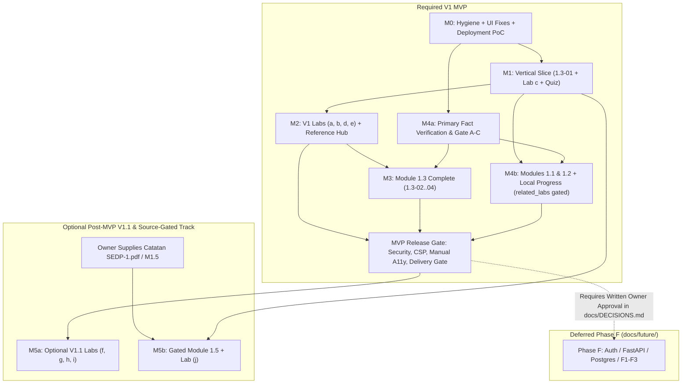

# MVP Implementation Plan & Roadmap: SEDP Learning Hub

- **Status:** Phase 0B Planning Artifact (Not Implemented)
- **Date:** 2026-11-18
- **Scope:** Anonymous, static-first Indonesian educational MVP. **Separate from deferred Phase F** ([docs/future/IMPLEMENTATION_PLAN.md](../future/IMPLEMENTATION_PLAN.md)), which remains unapproved and excluded.

---

## 1. Ordered MVP Milestones & Vertical Slice Strategy

Build incrementally, proving **every architectural, design, rights, and testing pipeline on one real vertical slice (`Milestone 1`)** before scaling curriculum or simulator volume:

| Milestone                                                           | Scope & Deliverables                                                                                                                                                                                                                                                                                                                                                                                                                                                                                                                                                                                                                                                                                                                                                                                                                                                                                                                                                                                                                                                                                                                                                                                                                                                                                                                                                                                                                                                                                                                                                                                   | Depends On                               | Falsifiable Exit / Acceptance Criteria                                                                                                                                                                                                  |
| ------------------------------------------------------------------- | ------------------------------------------------------------------------------------------------------------------------------------------------------------------------------------------------------------------------------------------------------------------------------------------------------------------------------------------------------------------------------------------------------------------------------------------------------------------------------------------------------------------------------------------------------------------------------------------------------------------------------------------------------------------------------------------------------------------------------------------------------------------------------------------------------------------------------------------------------------------------------------------------------------------------------------------------------------------------------------------------------------------------------------------------------------------------------------------------------------------------------------------------------------------------------------------------------------------------------------------------------------------------------------------------------------------------------------------------------------------------------------------------------------------------------------------------------------------------------------------------------------------------------------------------------------------------------------------------------ | ---------------------------------------- | --------------------------------------------------------------------------------------------------------------------------------------------------------------------------------------------------------------------------------------- |
| **M0: Pre-Phase-1 Hygiene, Primitive Remediation & Deployment PoC** | 1. Relocate M1.1, M1.2, M1.3 PDFs from root to `sources-private/`; **relocate/quarantine `NEC Advances...pdf` outside the AI-accessible workspace preserving the owner's personal archive copy**. 2. Install MVP core libs (`@mdx-js/mdx`, `gray-matter`, `zod`, `remark-math`, `rehype-katex`, `katex`, `recharts@^3`, `react-is@^19`, `motion`, `@testing-library/jest-dom`, `@axe-core/playwright`) and move `shadcn` from `dependencies` to `devDependencies` (verifying `globals.css:3` `@import "shadcn/tailwind.css"` resolves in CI). 3. Remediate all Phase 0A defects (`globals.css` `.abyss-bay` variant, `aria-disabled` cursor specificity, `.skip-link:focus`, `scroll-padding-top`; `button.tsx` `min-h-[44px] min-w-[44px]`, remove sub-44px `xs`/`sm`/`icon-xs`/`icon-sm`/`icon-lg`, `border-input` on `outline`, opaque `hover:bg-primary`, `disabled:cursor-not-allowed`, solid focus outline; `ThemeToggle` + `layout.tsx` persistence/`suppressHydrationWarning`/stable `aria-pressed`; `playwright.config.ts` `hasTouch` project & non-stale build serve). 4. Add CI scripts (`verify:content`, `verify:assets`, `pnpm audit --audit-level=high`, tracked-PDF guard, Vitest token-contrast test). 5. Execute small **M0 Deployment Proof-of-Concept** (1 MDX+KaTeX route, React 19 hydration, pre-paint `sedp.theme` reload persistence, 1 working button, enforced Playwright HTTP CSP + `frame-ancestors 'none'` testing Option B `output: "export"` script hashes vs fallback Option A dynamic `proxy.ts` nonces) and lock owner decision in `docs/DECISIONS.md`. | Phase 0B Owner Approval                  | `pnpm typecheck`, `pnpm lint`, `pnpm test`, `pnpm verify:content`, `pnpm verify:assets`, `pnpm audit --audit-level=high`, `pnpm build`, M0 Deployment PoC, and `pnpm test:e2e` pass with zero `.pdf` in root/`public/`.                 |
| **M1: End-to-End Vertical Slice (`1.3-01`)**                        | 1. Ship app shell (Header, Mobile Drawer, Footer + Non-Affiliation Disclaimer linking strictly to shipped M1 routes `R-24`, Dual-Sequence Curriculum Index `/kurikulum`). 2. Author public `CLEARED` `content/sources.json` (with non-null `YYYY-MM-DD` `checked_at` & Gate A-C metadata), `content/assets-manifest.json`, `content/fact-checks.json` seed, `content/glossary.json` seed (`8` core terms), and `1.3-01-arsitektur-ujung-ke-ujung.mdx` (omitting unverified `fc-armour-depths` numeric brackets & `fc-mkcs-434`). 3. Ship `/lab` hub + accessible `.abyss-bay` **Lab `(c)` End-to-End System Explorer** (`/lab/eksplorer-sistem`: `CLS/BMH/SLTE/PFE/Repeater/BU`, Repeatered vs Repeaterless toggle, custom SVG + HTML table + single tab-order mobile stepper). 4. Ship `/latihan` + original 5-question quiz `quiz-1.3-01-arch` (`/latihan/quiz-1.3-01-arch`), `/referensi` + `/referensi/glosarium` (`8` terms), honest `/kurikulum/1-4-bisnis-konektivitas` & `/kurikulum/1-5-siklus-survei-laut` status pages, plus `/tentang`, `/tentang/sumber` (`CLEARED` public registry only), and `/tentang/verifikasi-fakta`.                                                                                                                                                                                                                                                                                                                                                                                                                                                      | M0                                       | Full vertical slice passes `verify:content`, `verify:assets`, Vitest, Playwright + `@axe-core/playwright` (`Light`/`Dark`/`320px`/`200%` zoom/CSP), **Manual Accessibility Acceptance Matrix**, and `/antislop` Delivery Gate (`R-35`). |
| **M2: Remaining V1 Simulators (a, b, d, e) & Reference Hub**        | 1. Implement pure TS physics engines (`src/features/simulators/engine/`) for **(a) Optical Capacity**, **(b) Attenuation & Optical Budget**, **(d) Route Fault & Redundancy**, **(e) Historical Timeline**. 2. Build `.abyss-bay` client stages with `Recharts v3` + scoped `LazyMotion` + HTML table fallbacks + validation/error states and register live routes so conditional `related_labs` activate (`R-24`). 3. Ship `/referensi/rumus` & `/referensi/linimasa` (plus full `gls-*` glossary) and activate their links in Footer & `/referensi` (`R-24`).                                                                                                                                                                                                                                                                                                                                                                                                                                                                                                                                                                                                                                                                                                                                                                                                                                                                                                                                                                                                                                  | M1                                       | All engineering test vectors from `SIMULATION_SPECS.md` pass in Vitest; all 5 V1 labs pass Playwright mobile keyboard, reduced-motion, Light/Dark, axe, and Manual A11y checks.                                                         |
| **M3: Module `1.3` Completion (`1.3-02`..`1.3-04`)**                | Author clean-room MDX lessons, custom SVGs (cable cross-section, EDFA schematic, PFE opposite polarity, COTDR sawtooth trace, open cable G.977.1), glossary expansion, and original quizzes `quiz-1.3-02-wet`, `quiz-1.3-03-dry`, and `quiz-1.3-04-integrasi` (retaining `fc-mkcs-434` in `1.3-02` only if verified in `M4a`).                                                                                                                                                                                                                                                                                                                                                                                                                                                                                                                                                                                                                                                                                                                                                                                                                                                                                                                                                                                                                                                                                                                                                                                                                                                                         | M2                                       | All 4 Module `1.3` lessons & quizzes pass `verify:content`, unit tests, and E2E link/a11y checks.                                                                                                                                       |
| **M4a: Primary Fact Verification & Public Source Clearance**        | Independently open, inspect, and record `YYYY-MM-DD` `checked_at` dates in `content/sources.json` & `content/fact-checks.json` for all `10` M1.1/M1.2 items (`fc-traffic-share`, `fc-tg-counts`, `fc-palapa-ring`, `fc-fault-causes`, `fc-apjii-denom`, `fc-geo-latency`, `fc-ri-sg-2026`, `fc-insica-2026`, `fc-tat8-rate`, `fc-modern-cables-rfs`) plus `fc-mkcs-434` (`1.3-02`) and `fc-armour-depths` (`1.3-01`/`M3`).                                                                                                                                                                                                                                                                                                                                                                                                                                                                                                                                                                                                                                                                                                                                                                                                                                                                                                                                                                                                                                                                                                                                                                             | M0 _(parallelizable with M1/M2)_         | Every verified citation holds non-null `checked_at`, explicit Gate A-C status, and zero internal deck leaks; disputed/unverified items stay explicitly withheld or flagged.                                                             |
| **M4b: Modules `1.1` & `1.2` Authoring & Optional Local Progress**  | 1. Author `1.1-01`..`1.1-03` & `1.2-01`..`1.2-04` + original quizzes (excluding `M1.2 p.34/46` SubCom restricted slides & all TeleGeography screenshots; starts immediately after M1 proves pipeline + M4a verifies facts, **not blocked by M2 simulators**; `related_labs` render strictly via `isLabShipped()` until M2 labs go live per `R-24`). 2. Enable owner-approved local anonymous progress mode (`sedp.progress.v1`) with privacy notice & reset.                                                                                                                                                                                                                                                                                                                                                                                                                                                                                                                                                                                                                                                                                                                                                                                                                                                                                                                                                                                                                                                                                                                                        | M1, M4a                                  | All `1.1` and `1.2` lessons achieve `rights_status: CLEARED`, zero dead `/lab/*` links, and pass full QA & `/antislop` Delivery Gate.                                                                                                   |
| **MVP Release Gate: Required V1 Public Release Hardening**          | Final end-to-end release verification of Required V1 MVP (`M0-M4b`): security headers, Option A/B CSP parity, zero third-party network beacons, complete `R-40` DOM checks, Manual Accessibility Acceptance Matrix sign-off, and full `/antislop` Delivery Gate.                                                                                                                                                                                                                                                                                                                                                                                                                                                                                                                                                                                                                                                                                                                                                                                                                                                                                                                                                                                                                                                                                                                                                                                                                                                                                                                                       | M2, M3, M4b                              | Required V1 MVP is deploy-ready with 100% CI, Manual A11y, Rights Gate A-C, and zero Phase F/V1.1 dependencies.                                                                                                                         |
| **M5a: Optional Post-MVP V1.1 Simulators (f, g, h, i)**             | Implement optional advanced engineering labs **(f) PFE Shunt Fault Locator**, **(g) Coherent Modulation & Shannon**, **(h) WSS/ASE Dummy Light**, and **(i) COTDR Echo Timeline** staggered strictly after Required V1 MVP Release Gate passes.                                                                                                                                                                                                                                                                                                                                                                                                                                                                                                                                                                                                                                                                                                                                                                                                                                                                                                                                                                                                                                                                                                                                                                                                                                                                                                                                                        | MVP Release Gate                         | Exact V1.1 unit vectors (incl. PFE sequential protocol & span boundary, Shannon non-feasibility framing, 0% WSS guard) and E2E/Manual A11y checks pass cleanly.                                                                         |
| **M5b: Source-Gated Module `1.5` & Lab `(j)`**                      | Audit `Catatan SEDP-1.pdf` (`MISSING_IN_AGENT_WORKSPACE / OWNER_CAN_SUPPLY`) and official Module `1.5` sources once placed in `sources-private/` -> author `1.5-01`/`1.5-02` and **(j) Marine Survey** (or keep honestly gated if absent).                                                                                                                                                                                                                                                                                                                                                                                                                                                                                                                                                                                                                                                                                                                                                                                                                                                                                                                                                                                                                                                                                                                                                                                                                                                                                                                                                             | M1, Owner Supply of Day 3 / M1.5 Sources | Unlocked `1.5` lessons & Lab `(j)` pass Gate A-C clearance, `verify:content`, and Manual A11y checks.                                                                                                                                   |

---

## 2. Dependency Graph `[DERIVED]`

---

## 3. Master Risk Register `[DERIVED across all 6 Specialist Reports]`

| ID     | Risk                                                                                    | Likelihood         | Impact       | Mitigation & Owner                                                                                                                                                                                                                                                                                                                                                                |
| ------ | --------------------------------------------------------------------------------------- | ------------------ | ------------ | --------------------------------------------------------------------------------------------------------------------------------------------------------------------------------------------------------------------------------------------------------------------------------------------------------------------------------------------------------------------------------- |
| **R1** | **NEC `Internal Use Only` or SubCom `[Restricted]` / OSM BDO Leakage**                  | Medium             | **Critical** | **Relocate/quarantine NEC PDF outside AI-accessible workspace preserving owner's archive copy**; never feed NEC PDF or M1.2 p.34/46 into AI or MDX; CI `verify:content` + `verify:assets` hard-block restricted strings and root/`public/` PDFs. _(Legal + Curriculum)_                                                                                                           |
| **R2** | **Closed-Course Assessment & Slide Asset Copyright Infringement**                       | Medium             | High         | Clean-room authoring in original Indonesian; custom React SVG diagrams only; zero TeleGeography screenshots, trainer bios, or vendor photos; mandatory Gate A-C checks (`media_redistribution_allowed: true` for `public/` assets). _(Legal + Content)_                                                                                                                           |
| **R3** | **Engineering Model Oversimplification / Math Bugs**                                    | Medium             | High         | Pure TS simulator kernels verified against Python test vectors (`Lab a` directionality, `M1.3 p.50` 630V/450km + sequential double-ended PFE, Shannon non-feasibility framing, COTDR slack); mandatory approximation disclaimers in UI. _(Subsea Eng + QA)_                                                                                                                       |
| **R4** | **Phase 0A UI Primitive Defects & Mobile/Chart A11y Failures**                          | High _(pre-fix)_   | High         | Fix `button.tsx` (`44px`, `outline` `border-input`, hover contrast, `disabled`, solid focus ring) and `globals.css` (`.abyss-bay` dark variant, `aria-disabled` cursor, `.skip-link:focus`) in M0; enforce `@axe-core/playwright` + Manual A11y Matrix + `200%` text zoom. _(UX + QA)_                                                                                            |
| **R5** | **Implied Official Affiliation (`SEDP` Name/Branding Risk)**                            | Medium             | High         | Confirm final brand name with owner; render `"Catatan Belajar Independen"` beside header title, in `<meta>` tags, footer, and `/tentang#penafian`; zero corporate logos (`R-23`). _(Legal + Product)_                                                                                                                                                                             |
| **R6** | **React 19 / Turbopack Build & CSP Hydration Friction (`MDX`, `KaTeX`, `Recharts v3`)** | Medium             | Medium       | Prove `@mdx-js/mdx@3` + `katex` CSS/fonts + React hydration + Option B vs Option A CSP enforcement in **M0 Deployment PoC** before scaling; avoid `@next/mdx` webpack loader peer traps. _(Full-Stack)_                                                                                                                                                                           |
| **R7** | **Missing Sources (`Catatan SEDP-1.pdf`, `1.4`, `1.5`) Blocking Scope**                 | High _(confirmed)_ | Medium       | Distinguish `MISSING_IN_AGENT_WORKSPACE (OWNER_CAN_SUPPLY)` (`Catatan SEDP-1.pdf` Day 3 notes) from `MISSING_FROM_OWNER` (`1.4`); keep `1.4` `UNAVAILABLE` and `1.5`/Lab `(j)` honestly gated until supplied. _(Curriculum + Lead)_                                                                                                                                               |
| **R8** | **Fact-Check Drift on Flagged Claims & Deck Contradictions**                            | High               | Medium       | Publish `/tentang/verifikasi-fakta` starting all 12 flagged claims (`fc-traffic-share`, `fc-tg-counts`, `fc-palapa-ring`, `fc-fault-causes`, `fc-armour-depths`, `fc-apjii-denom`, `fc-geo-latency`, `fc-ri-sg-2026`, `fc-insica-2026`, `fc-tat8-rate`, `fc-modern-cables-rfs`, `fc-mkcs-434`) as `UNVERIFIED`/`DISPUTED` until M1/M4a primary verification. _(Curriculum + Eng)_ |

---

## 4. Definition of Done (MVP vs Optional V1.1 Boundary)

**Required V1 MVP is complete only when:**

1. Milestones **`M0` through `M4b`** and the **`MVP Release Gate`** pass all automated CI checks (`pnpm lint`, `pnpm format:check` on repo code/content/plans, `pnpm typecheck`, `pnpm verify:content`, `pnpm verify:assets`, `pnpm audit --audit-level=high`, `pnpm test`, `pnpm build`, `pnpm test:e2e` with `@axe-core/playwright`) AND the **Manual Accessibility Acceptance Matrix** (`QUALITY_GATES.md` §1B).
2. Every published lesson, glossary term, diagram, source record, and quiz passes Gate A-C (`rights_status: "CLEARED"`, `public_reuse_allowed: true`, non-null `YYYY-MM-DD` `checked_at`, and `media_redistribution_allowed: true` for any `public/` file) with zero private filenames or restricted strings.
3. No unverified `1.4` or unsourced `1.5` material is fabricated.
4. Both Pelagic Light and Abyssal Dark modes + `.abyss-bay` bays pass token contrast checks and the full `/antislop` Delivery Gate + 5 skill checklists with recorded `R-35` click-through evidence.
5. Zero Phase F backend/auth/DB/CMS artifacts or `/api/v1` handlers exist in the MVP app.

**Optional Post-MVP V1.1 Expansion (`M5a` Labs `f-i`, plus source-gated `M5b` Module `1.5` & Lab `j`):** Executed only after Required V1 MVP ships cleanly (and, for `M5b`, after owner supplies Day 3 / M1.5 sources), passing the same CI, mathematical test-vector, Gate A-C, and Manual Accessibility gates without delaying V1 MVP delivery.
