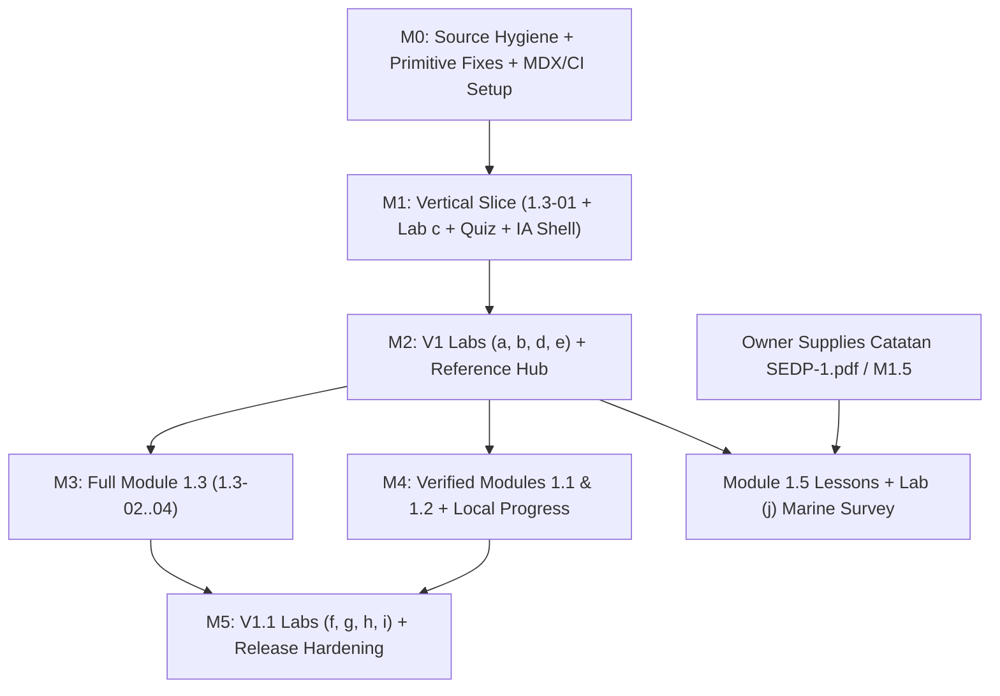

# MVP Implementation Plan & Roadmap: SEDP Learning Hub

- **Status:** Phase 0B Planning Artifact (Not Implemented)
- **Date:** 2026-11-18
- **Scope:** Anonymous, static-first Indonesian educational MVP. **Separate from deferred Phase F** ([docs/future/IMPLEMENTATION_PLAN.md](../future/IMPLEMENTATION_PLAN.md)), which remains unapproved and excluded.

---

## 1. Ordered MVP Milestones & Vertical Slice Strategy

Build incrementally, proving **every architectural, design, rights, and testing pipeline on one real vertical slice (`Milestone 1`)** before scaling curriculum or simulator volume:

| Milestone                                                          | Scope & Deliverables                                                                                                                                                                                                                                                                                                                                                                                                                                                                                                                                                                                                                                                                                                                                                                                                                                                                                                                                                                                                                                                             | Depends On                                  | Falsifiable Exit / Acceptance Criteria                                                                                                                                                                                    |
| ------------------------------------------------------------------ | -------------------------------------------------------------------------------------------------------------------------------------------------------------------------------------------------------------------------------------------------------------------------------------------------------------------------------------------------------------------------------------------------------------------------------------------------------------------------------------------------------------------------------------------------------------------------------------------------------------------------------------------------------------------------------------------------------------------------------------------------------------------------------------------------------------------------------------------------------------------------------------------------------------------------------------------------------------------------------------------------------------------------------------------------------------------------------- | ------------------------------------------- | ------------------------------------------------------------------------------------------------------------------------------------------------------------------------------------------------------------------------- |
| **M0: Pre-Phase-1 Hygiene & Primitive Remediation**                | 1. Move M1.1, M1.2, M1.3 PDFs from root to `sources-private/`; quarantine/remove `NEC Advances...pdf` outside workspace. 2. Install MVP core libs (`@mdx-js/mdx`, `gray-matter`, `zod`, `remark-math`, `rehype-katex`, `katex`, `recharts@^3`, `react-is@^19`, `motion`, `@testing-library/jest-dom`, `@axe-core/playwright`) and move `shadcn` from `dependencies` to `devDependencies`. 3. Remediate Phase 0A UI gaps (`globals.css` `.abyss-bay` variant, `button.tsx` `min-h-[44px] min-w-[44px]`/`disabled:cursor-not-allowed`/solid focus ring, persistent `ThemeToggle`, CSP/security headers pairing per deployment choice in `next.config.ts`). 4. Add `scripts/verify-content.ts` & `verify-assets` CI checks.                                                                                                                                                                                                                                                                                                                                                | Phase 0B Owner Approval                     | `pnpm typecheck`, `pnpm lint`, `pnpm test`, `pnpm verify:content`, `pnpm verify:assets`, `pnpm build`, and `pnpm test:e2e` pass with zero `.pdf` in root/`public/`.                                                       |
| **M1: End-to-End Vertical Slice (`1.3-01`)**                       | 1. Ship app shell (Header, Mobile Drawer, Footer + Non-Affiliation Disclaimer linking strictly to shipped M1 routes `R-24`, Dual-Sequence Curriculum Index `/kurikulum`). 2. Author public `CLEARED` `content/sources.json`, `content/fact-checks.json` seed, `content/glossary.json` seed (`8` core terms), and `1.3-01-arsitektur-ujung-ke-ujung.mdx` (excluding unverified `fc-mkcs-434`). 3. Ship `/lab` hub + accessible `.abyss-bay` **Lab `(c)` End-to-End System Explorer** (`/lab/eksplorer-sistem`: `CLS/BMH/SLTE/PFE/Repeater/BU`, Repeatered vs Repeaterless toggle, custom SVG + HTML table + keyboard/mobile stepper). 4. Ship `/latihan` + original 5-question quiz `quiz-1.3-01-arch` (`/latihan/quiz-1.3-01-arch`), `/referensi` + `/referensi/glosarium` (`8` terms, deferring `/rumus` & `/linimasa` links until M2), honest `/kurikulum/1-4-bisnis-konektivitas` & `/kurikulum/1-5-siklus-survei-laut` status pages, plus `/tentang`, `/tentang/sumber` (`CLEARED` public registry + missing-source summary only), and `/tentang/verifikasi-fakta`. | M0                                          | Full vertical slice renders via `next build` + `next start`, passes 100% of unit & Playwright E2E + `@axe-core/playwright` Light/Dark/3-state/200%-zoom tests, and passes the complete `antislop` Delivery Gate (`R-35`). |
| **M2: Remaining V1 Simulators (a, b, d, e) & Reference Hub**       | 1. Implement pure TS physics engines (`tests/unit/simulators/`) for **(a) Optical Capacity**, **(b) Attenuation & Optical Budget (repeaterless & repeatered OSNR)**, **(d) Route Fault & Redundancy**, **(e) Historical Timeline**. 2. Build `.abyss-bay` client stages with `Recharts v3` + `LazyMotion` + HTML table fallbacks + validation/error states and enable their `/lab` links. 3. Ship `/referensi/rumus` & `/referensi/linimasa` (plus full `gls-*` glossary) and activate their links in Footer & `/referensi` (`R-24`).                                                                                                                                                                                                                                                                                                                                                                                                                                                                                                                                      | M1                                          | All engineering test vectors from `SIMULATION_SPECS.md` pass in Vitest; all 5 V1 labs pass Playwright mobile keyboard, reduced-motion, Light/Dark, and axe scans.                                                         |
| **M3: Module `1.3` Completion (`1.3-02`..`1.3-04`)**               | Author clean-room MDX lessons, custom SVGs (cable cross-section, EDFA schematic, PFE opposite polarity, COTDR sawtooth trace, open cable G.977.1), glossary expansion, and original quizzes `quiz-1.3-02-wet`, `quiz-1.3-03-dry`, and `quiz-1.3-04-integrasi` (retaining `fc-mkcs-434` in `1.3-02` only if publicly verified).                                                                                                                                                                                                                                                                                                                                                                                                                                                                                                                                                                                                                                                                                                                                                   | M2                                          | All 4 Module `1.3` lessons & quizzes pass `verify:content`, unit tests, and E2E link/a11y checks.                                                                                                                         |
| **M4: Modules `1.1` & `1.2` Authoring & Public Fact Verification** | 1. Verify flagged external/dated claims (`fc-ri-sg-2026`, `fc-insica-2026`, `fc-tat8-rate`, `fc-tg-counts`, `fc-apjii-denom`, `fc-mkcs-434`). 2. Author `1.1-01`..`1.1-03` & `1.2-01`..`1.2-04` + original quizzes (excluding `M1.2 p.34/46` SubCom restricted slides & all TeleGeography screenshots). 3. Enable optional local anonymous progress (`sedp.progress.v1`) with privacy notice & reset.                                                                                                                                                                                                                                                                                                                                                                                                                                                                                                                                                                                                                                                                      | M2, M4 Fact-Checks                          | All `1.1` and `1.2` lessons achieve `rights_status: CLEARED` and pass full QA & `/antislop` Delivery Gate.                                                                                                                |
| **M5: V1.1 Advanced Labs (f, g, h, i) & Gated M1.5 / Lab (j)**     | 1. Implement **(f) PFE Shunt Fault Locator** (with dead-zone & double-ended solver), **(g) Coherent Modulation & Shannon**, **(h) WSS/ASE Dummy Light**, **(i) COTDR Echo Timeline**. 2. Audit `Catatan SEDP-1.pdf` / Module `1.5` deck once provided by owner -> unlock `1.5-01`/`1.5-02` and **(j) Marine Survey** (or keep gated if still missing).                                                                                                                                                                                                                                                                                                                                                                                                                                                                                                                                                                                                                                                                                                                        | M3, M4; (`1.5`/`j` depend on owner sources) | Exact V1.1 unit test vectors pass; full-site pre-release Delivery Gate + security header + zero-third-party-network verification pass.                                                                                    |

---

## 2. Dependency Graph `[DERIVED]`

---

## 3. Master Risk Register `[DERIVED across all 6 Specialist Reports]`

| ID     | Risk                                                                    | Likelihood         | Impact       | Mitigation & Owner                                                                                                                                                                                                                     |
| ------ | ----------------------------------------------------------------------- | ------------------ | ------------ | -------------------------------------------------------------------------------------------------------------------------------------------------------------------------------------------------------------------------------------- |
| **R1** | **NEC `Internal Use Only` or SubCom `[Restricted]` / OSM BDO Leakage**  | Medium             | **Critical** | Quarantine/delete NEC PDF from workspace immediately; never feed NEC PDF or M1.2 p.34/46 into AI or MDX; CI `verify:content` + `verify:assets` hard-block restricted strings and root/`public/` PDFs. _(Legal + Curriculum)_           |
| **R2** | **Closed-Course Assessment & Slide Asset Copyright Infringement**       | Medium             | High         | Clean-room authoring in original Indonesian; custom React SVG diagrams only; zero TeleGeography screenshots, trainer bios, or vendor photos; mandatory `rights_status = CLEARED` build gate. _(Legal + Content)_                       |
| **R3** | **Engineering Model Oversimplification / Math Bugs**                    | Medium             | High         | Pure TS simulator kernels verified against Python test vectors (`M1.3 p.50` 630V/450km, `PFE` dead-zone, OSNR `12.5 GHz / R_s` scaling, COTDR EFL slack); mandatory approximation disclaimers in UI. _(Subsea Eng + QA)_               |
| **R4** | **Phase 0A UI Primitive Defects & Mobile/Chart A11y Failures**          | High _(pre-fix)_   | High         | Fix `button.tsx` (`44px`, `disabled`, solid focus ring) and `.abyss-bay` dark variant in M0; ship tabular HTML parity + `-`/`+` steppers on every simulator; run `@axe-core/playwright` + `200%` zoom + `320px` CI checks. _(UX + QA)_ |
| **R5** | **Implied Official Affiliation (`SEDP` Name/Branding Risk)**            | Medium             | High         | Confirm final brand name with owner; render `"Catatan Belajar Independen"` beside header title, in `<meta>` tags, footer, and `/tentang#penafian`; zero corporate logos (`R-23`). _(Legal + Product)_                                  |
| **R6** | **React 19 / Turbopack Build Friction (`MDX`, `KaTeX`, `Recharts v3`)** | Medium             | Medium       | Prove `@mdx-js/mdx@3` + `katex` CSS/fonts + `recharts@^3` + `react-is@^19` inside M0/M1 before scaling; avoid `@next/mdx` webpack loader peer traps. _(Full-Stack)_                                                                    |
| **R7** | **Missing Sources (`Catatan SEDP-1.pdf`, `1.4`, `1.5`) Blocking Scope** | High _(confirmed)_ | Medium       | Keep `1.4` honestly `Belum Tersedia`, gate `1.5` & Lab `(j)` on source arrival, and ship high-value M1.1-M1.3 + V1 labs first. _(Curriculum + Lead)_                                                                                   |
| **R8** | **Fact-Check Drift on Dated 2025/2026 Claims & Deck Contradictions**    | High               | Medium       | Publish `/tentang/verifikasi-fakta` transparently tracking `fc-ri-sg-2026`, `fc-insica-2026`, `fc-tat8-rate`, `fc-tg-counts`, and `fc-fault-causes` with explicit denominator/date tags. _(Curriculum + Eng)_                          |

---

## 4. Definition of Done (MVP Release)

MVP is complete only when:

1. Milestones M0 through M4 (plus M5 V1.1 scope approved by owner) pass all automated CI gates (`lint`, `format:check`, `typecheck`, `verify:content`, `verify:assets`, `audit`, `test`, `build`, `test:e2e` with `@axe-core/playwright`).
2. Every published lesson, glossary term, diagram, and quiz carries `rights_status: "CLEARED"` and verifiable non-restricted citations.
3. No unverified `1.4` or missing `1.5` material is fabricated.
4. Both Pelagic Light and Abyssal Dark modes + `.abyss-bay` bays pass `contrast-check.py` and full `/antislop` Delivery Gate + 5 skill checklists with recorded `R-35` click-through evidence.
5. Zero Phase F backend/auth/DB/CMS artifacts or `/api/v1` handlers exist in the MVP app.
