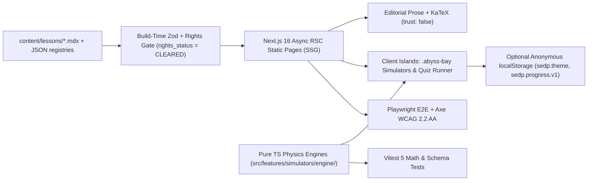

# Technical Architecture: SEDP Learning Hub

- **Status:** Phase 0B Planning Artifact (Not Implemented)
- **Date:** 2026-11-18
- **Phase Boundary:** Anonymous, static-first Next.js 16 MVP. Deferred Phase F ([docs/future/README.md](../future/README.md)) is **excluded** from runtime dependencies, routes, and storage.

---

## 1. Verified Stack & Package Compatibility Matrix (`2026-11-18`)

| Layer                 | Choice                                                    | Verified Version / Peer Facts (`npm view` / `ENVIRONMENT_REPORT.md`)                                                                                              | React 19 + Next 16 Turbopack Notes                                                                                                                                                                                                                                                                                                                                  |
| --------------------- | --------------------------------------------------------- | ----------------------------------------------------------------------------------------------------------------------------------------------------------------- | ------------------------------------------------------------------------------------------------------------------------------------------------------------------------------------------------------------------------------------------------------------------------------------------------------------------------------------------------------------------- |
| **Core Runtime**      | Next.js + React + TS                                      | `next@16.4.6` (App Router, Turbopack default), `react@19.3.0`, `react-dom@19.3.0`, `typescript@^5` (`5.9.3`), `tailwindcss@4.3.3`, `@tailwindcss/turbopack@4.3.3` | Already installed & verified in Phase 0A. `next lint` removed -> `eslint@^9` (`9.39.5`) + `eslint-config-next@16.4.6`.                                                                                                                                                                                                                                              |
| **UI Primitives**     | `shadcn/ui` (`base-nova`)                                 | `shadcn@4.23.0`, `@base-ui/react@1.9.0`, `class-variance-authority@0.7.1`, `cn@0.5.2`, `tw-animate-css@1.4.0`, `lucide-react@1.74.0`                              | **Remediation required:** Fix `button.tsx` (`<44px` sizes, `disabled:pointer-events-none`, `ring/50`) and `globals.css` (`@custom-variant dark` must include `.abyss-bay`). Move `shadcn` CLI out of runtime `dependencies` if unused at runtime (check `shadcn/tailwind.css` import first).                                                                        |
| **MDX Content**       | `@mdx-js/mdx` (`v3`) + `gray-matter` + `zod` `[PROPOSED]` | `@mdx-js/mdx@3.1.1` (`react >=16`), `gray-matter@4.0.3`, `zod@4.6.7`                                                                                              | Compile `content/lessons/*.mdx` at build time inside async Server Components (`compile`/`evaluate` or `next-mdx-remote-client` `v2.x`). Avoids `@next/mdx` (`@mdx-js/loader` webpack peer) and `next-mdx-remote@6` React 19 edge cases while keeping `content/` decoupled from `src/app/`.                                                                          |
| **Math Rendering**    | `remark-math` + `rehype-katex` + `katex`                  | `remark-math@6.0.0`, `rehype-katex@7.0.1`, `katex@0.19.1`                                                                                                         | Self-host `katex/dist/katex.min.css` & WOFF2 fonts via `pnpm` (zero CDN). Configure `trust: false`, `strict: true`, `output: "htmlAndMathml"`. Verify CSS import order against `next.config.ts` `@tailwindcss/turbopack` rule during Vertical Slice.                                                                                                                |
| **Diagrams & Charts** | Custom React `<svg>` + `recharts` (`v3`)                  | `recharts@3.11.0` (`react ^19.0.0`, `react-is ^19.0.0`), `react-is@19.3.1`                                                                                        | Use **custom accessible React SVGs** for schematic explorers (Lab `c`) instead of `@xyflow/react@13.0.2` unless complex multi-BU pan/zoom is needed later. Wrap `Recharts` strictly in `"use client"` with explicit fixed dimensions / `initialDimension` (`0x0` SSR guard) + synchronized HTML `<table>`. Install `react-is@^19` explicitly under pnpm strictness. |
| **Motion**            | `motion` (`motion/react`)                                 | `motion@14.14.0` (`react ^18.0.0 or ^19.0.0`)                                                                                                                     | Import `LazyMotion` (`domAnimation`) + `MotionConfig reducedMotion="user"` **strictly inside interactive simulator client islands**, never in root `layout.tsx`.                                                                                                                                                                                                    |
| **Testing & A11y**    | Vitest 5 + Playwright + `@axe-core/playwright`            | `vitest@5.1.0`, `vite@8.3.8`, `@vitejs/plugin-react@6.3.0`, `jsdom@31.0.1`, `@testing-library/react@16.3.3`, `@playwright/test@1.65.1`                            | Add `@testing-library/jest-dom` + `tests/unit/setup.ts` (`ResizeObserver`, `matchMedia`) and `@axe-core/playwright` in Phase 1. Keep Node `>=22.12.0` (`22.16.0` local warning on `jsdom@31` documented in `DECISIONS.md`; CI runs Node `26`).                                                                                                                      |

---

## 2. Project Directory Architecture `[PROPOSED]`

Extends the verified Phase 0A tree cleanly while maintaining strict isolation from `docs/future/` and `sources-private/`:

```text
.
├── content/
│   ├── modules.json                    # Module metadata (canonicalOrder + deliveryOrder)
│   ├── sources.json                    # Audited source register (rights_status, trust_level)
│   ├── fact-checks.json                # Contradictions & verification log (XOR lesson_id/article_id)
│   ├── glossary.json                   # Bilingual terms, aliases, lessons, CLEARED provenance
│   ├── timeline.json                   # Historical milestones for /referensi/linimasa & Lab (e)
│   ├── lessons/                        # MDX files keyed by stable lesson_id (e.g. 1.3-01-*.mdx)
│   └── quizzes/                        # Clean-room original JSON quiz banks (e.g. quiz-1.3-01-arch.json)
├── docs/
│   ├── DECISIONS.md
│   ├── ENVIRONMENT_REPORT.md
│   ├── future/                         # Deferred Phase F (DO NOT DELETE / NOT PART OF MVP)
│   ├── plans/                          # Phase 0B specifications
│   └── prompts/
├── public/
│   └── assets/                         # Reviewed CLEARED raster/SVG assets only (ZERO PDFs)
├── scripts/
│   └── verify-content.ts               # Build/CI Zod schema, rights_status=CLEARED, U+2014, & /api/v1 guard
├── sources-private/                    # Local-only git-ignored source PDFs (no NEC Internal Use Only!)
├── src/
│   ├── app/
│   │   ├── globals.css                 # --sedp-* tokens, .dark + .abyss-bay, pointer/focus/reduced-motion
│   │   ├── layout.tsx                  # Self-hosted fonts, pre-paint theme init, global Header & Footer
│   │   ├── page.tsx                    # Home (/)
│   │   ├── kurikulum/
│   │   │   ├── page.tsx                # Dual sequence index (?urut=modul|hari)
│   │   │   └── [moduleSlug]/
│   │   │       ├── page.tsx            # Module view + honest 1.4 Unavailable page
│   │   │       └── [lessonSlug]/page.tsx # 5-stage MDX Lesson Reader (Async RSC)
│   │   ├── lab/
│   │   │   ├── page.tsx                # V1 Labs + V1.1 roadmap
│   │   │   └── [simSlug]/page.tsx      # .abyss-bay simulator workbench
│   │   ├── latihan/
│   │   │   ├── page.tsx                # Practice index + local progress reset
│   │   │   └── [quizId]/page.tsx       # Original quiz runner
│   │   ├── referensi/
│   │   │   ├── page.tsx
│   │   │   ├── glosarium/page.tsx
│   │   │   ├── rumus/page.tsx
│   │   │   └── linimasa/page.tsx
│   │   └── tentang/
│   │       ├── page.tsx                # Mission, #penafian, #privasi, #metodologi
│   │       ├── sumber/page.tsx         # Public Source Library
│   │       └── verifikasi-fakta/page.tsx # Fact-Check Log
│   ├── components/
│   │   ├── layout/                     # Header, MobileNavDrawer, Footer, SequenceToggle
│   │   ├── mdx/                        # Custom MDX callouts, GlossaryInline, KaTeX wrapper, QuizEmbed
│   │   ├── theme-toggle.tsx            # Persistent Pelagic/Abyssal toggle
│   │   └── ui/                         # Remediated shadcn primitives (44px target, solid focus, disabled cursor)
│   ├── features/
│   │   ├── curriculum/                 # Dual-order resolver, MDX reading helpers
│   │   ├── practice/                   # Quiz scorer + localStorage progress store
│   │   ├── reference/                  # Glossary search/alias matcher
│   │   └── simulators/                 # Pure TS math engines + accessible SVG/Recharts client shells
│   │       ├── engine/                 # Zero-React pure functions tested in Vitest
│   │       └── components/             # "use client" .abyss-bay stages + HTML table fallbacks
│   └── lib/
│       ├── content/                    # Zod schemas, static content loaders, provenance assertions
│       └── storage/                    # Safe try/catch + Zod localStorage wrapper (zero PII)
└── tests/
    ├── unit/                           # Vitest 5: simulator math, Zod content/rights, client UI state
    └── e2e/                            # Playwright: async RSC pages, axe WCAG, 3-state responsive, 200% zoom
```

---

## 3. Data Models, MDX Pipeline & Dependency Flow



### MDX Compilation & Security Pipeline `[PROPOSED]`

1. **Static Load & Validation (`src/lib/content/loader.ts`):** Read files strictly from `content/` via Node `fs` at build/SSG time. Parse frontmatter with `gray-matter` and validate via `zod` (rejecting duplicate `lesson_id`/`quiz_id`, invalid Phase F enum values, missing `source_refs`, or non-`CLEARED` public content).
2. **AST Compilation & Math Hardening:** Compile trusted Git-committed MDX using `@mdx-js/mdx` (`evaluate` / RSC) with `remark-math` + `rehype-katex` (`trust: false`, `strict: true`, `output: "htmlAndMathml"`), plus a custom rehype safety check rejecting `<script>`, `<iframe>`, inline `on*` handlers, and `javascript:`/`data:text/html` links; enforce `rel="noopener noreferrer"` on external links. Never compile runtime user strings.
3. **Anonymous Local State (`src/lib/storage/progress.ts`):**
   - Keys: `sedp.theme` (`"light" | "dark"`) and `sedp.progress.v1` (`{ version: 1, lessons: Record<string, "STARTED" | "COMPLETED">, quizzes: Record<string, { score: number; total: number; updatedAt: string }> }`).
   - Wrapped in `try/catch` + Zod validation; degrades silently to in-memory session state if `localStorage` is disabled; zero PII; one-click `resetLocalProgress()` clears `sedp.progress.v1`.

---

## 4. Security, CSP, Static Deployment & Phase F Compatibility

### Security Headers & Viable CSP Strategy (`next.config.ts` + Host Parity) `[PROPOSED]`

Because Next.js App Router emits inline RSC payload scripts (`self.__next_f.push(...)`) during hydration alongside any pre-paint theme script, a bare static hash for the theme script alone would break hydration under strict CSP. Choose one verified deployment pairing:

- **Option A (Recommended Default: Zero-Secret Next.js Node Host with Request-Scoped CSP Nonce):** Serve static/SSG pages behind a thin Next.js server request handler issuing per-request cryptographic nonces (`script-src 'self' 'nonce-<req>' 'strict-dynamic'`), allowing both Next.js hydration payloads and the theme initializer without `'unsafe-inline'` scripts. Keep CSP `frame-ancestors 'none'` together with defense-in-depth headers in `next.config.ts`:
  `X-Frame-Options: DENY`, `X-Content-Type-Options: nosniff`, `Referrer-Policy: strict-origin-when-cross-origin`, `Permissions-Policy: camera=(), microphone=(), geolocation=()`.
- **Option B (Alternative: Pure Static Export `output: "export"` on Static CDN):** Move pre-paint theme detection out of inline HTML into external synchronous `/theme-init.js` (`'self'`), AND run a deterministic `postbuild` script that hashes emitted Next.js inline hydration scripts per HTML route into host CSP config (including `frame-ancestors 'none'`, evaluated in Playwright against the real served bundle).
- **Baseline Invariants (Both Options):** Zero `'unsafe-eval'`, `style-src 'self' 'unsafe-inline'` (minimal tolerance for Tailwind/KaTeX/Recharts inline styles, or scoped nonces in Option A), `img-src 'self' data:`, `font-src 'self'`, `connect-src 'self'`, `object-src 'none'`, `base-uri 'self'`, `form-action 'self'`, zero third-party CDNs or analytics beacons.

### Deployment Model Trade-off `[PROPOSED]`

- **Trade-off Summary:** Every MVP page, MDX lesson, glossary entry, and simulator executes cleanly with zero runtime database/API calls (`generateStaticParams` across all lessons, modules, labs, and quizzes). **Option A** (Node Next.js host on zero-DB runtime) provides effortless per-request CSP nonces and dynamic `headers()`; **Option B** (`output: "export"`) eliminates Node runtime in production but requires host-level security headers and post-build hash maintenance for Next.js inline payload scripts. Requires explicit owner decision before M0 lock.
- **Phase F Compatibility (`docs/future/README.md`):**
  - Zero Next.js route handlers under `/api/v1/**`.
  - Canonical `lesson_id`, `quiz_id`, `source_id`, and `progress_status` (`STARTED | COMPLETED`) match `docs/future/DATABASE_SCHEMA.md` directly.
  - Zero MVP pages depend on any backend API; Phase F F1 articles / F2 DB provenance / F3 opt-in sync remain cleanly additive if ever approved in `docs/DECISIONS.md`.

### Alternatives & Trade-offs

- **`@mdx-js/mdx` (`3.1.1`) vs `@next/mdx` (`16.4.6`):** `@mdx-js/mdx` keeps content inside `content/` with typed indexes for dual module/day navigation and avoids `@mdx-js/loader`'s webpack peer assumption under Next 16 Turbopack.
- **Custom React SVGs vs `@xyflow/react` (`13.0.2`):** Custom SVGs for Lab `(c)` and vertical slice eliminate drag-only WCAG 2.5.7 risks and keep lesson bundle overhead low; `@xyflow/react` remains an optional future addition only if a multi-BU topology proves too dynamic for SVG.
