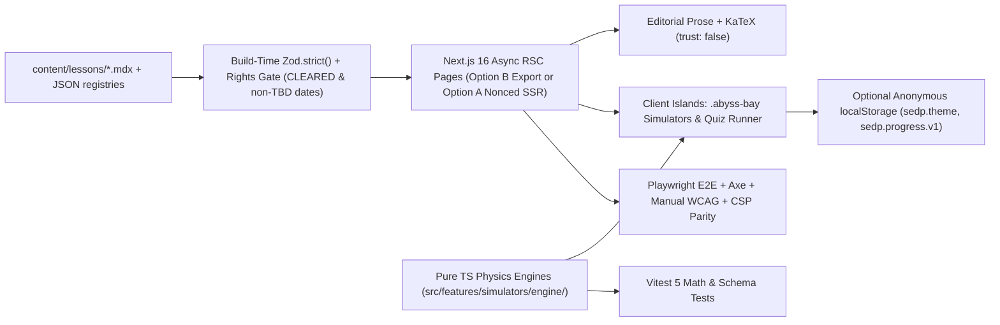

# Technical Architecture: SEDP Learning Hub

- **Status:** Phase 0B Planning Artifact (Not Implemented)
- **Date:** 2026-11-18
- **Phase Boundary:** Anonymous, zero-API Next.js 16 MVP (**static-first deployment is an unverified hypothesis**, pending a post-approval M0 deployment proof-of-concept and explicit owner lock between Option B and Option A). Deferred Phase F ([docs/future/README.md](../future/README.md)) is **excluded** from runtime dependencies, routes, and storage.

---

## 1. Verified Stack & Package Compatibility Matrix (`2026-11-18`)

| Layer                 | Choice                                                    | Verified Version / Peer Facts (`npm view` / `ENVIRONMENT_REPORT.md`)                                                                                              | React 19 + Next 16 Turbopack Notes                                                                                                                                                                                                                                                                                                                                                                                                                                                                                                                                                                                                |
| --------------------- | --------------------------------------------------------- | ----------------------------------------------------------------------------------------------------------------------------------------------------------------- | --------------------------------------------------------------------------------------------------------------------------------------------------------------------------------------------------------------------------------------------------------------------------------------------------------------------------------------------------------------------------------------------------------------------------------------------------------------------------------------------------------------------------------------------------------------------------------------------------------------------------------- |
| **Core Runtime**      | Next.js + React + TS                                      | `next@16.4.6` (App Router, Turbopack default), `react@19.3.0`, `react-dom@19.3.0`, `typescript@^5` (`5.9.3`), `tailwindcss@4.3.3`, `@tailwindcss/turbopack@4.3.3` | Already installed & verified in Phase 0A. `next lint` removed -> `eslint@^9` (`9.39.5`) + `eslint-config-next@16.4.6`. Note: `src/app/layout.tsx` `next/font/google` self-hosts fonts at runtime (`'self'`) but requires outbound HTTPS at `next build` time; evaluate `next/font/local` checked-in SIL-OFL WOFF2 in M0 if 100% offline builds are required.                                                                                                                                                                                                                                                                      |
| **UI Primitives**     | `shadcn/ui` (`base-nova`)                                 | `shadcn@4.23.0`, `@base-ui/react@1.9.0`, `class-variance-authority@0.7.1`, `cn@0.5.2`, `tw-animate-css@1.4.0`, `lucide-react@1.74.0`                              | **M0 Remediation required:** Fix `button.tsx` (`h-6..h-9` `<44px`, `icon-xs`/`icon-lg`, `outline` `border-border` `<3:1`, `hover:bg-primary/80` white-text risk, `disabled:pointer-events-none`, `ring/50`), `globals.css` (`@custom-variant dark` must include `.abyss-bay`, `aria-disabled` cursor specificity, `.skip-link:focus`, `scroll-padding-top`), `theme-toggle.tsx` + `layout.tsx` (`sedp.theme` persistence, `suppressHydrationWarning`, stable `aria-pressed` label), and move `shadcn` CLI out of runtime `dependencies` (confirming `globals.css:3` `@import "shadcn/tailwind.css"` still resolves in CI builds). |
| **MDX Content**       | `@mdx-js/mdx` (`v3`) + `gray-matter` + `zod` `[PROPOSED]` | `@mdx-js/mdx@3.1.1` (`react >=16`), `gray-matter@4.0.3`, `zod@4.6.7`                                                                                              | Compile `content/lessons/*.mdx` at build time inside async Server Components (`compile`/`evaluate` or `next-mdx-remote-client` `v2.x`). Avoids `@next/mdx` (`@mdx-js/loader` webpack peer) and `next-mdx-remote@6` React 19 edge cases while keeping `content/` decoupled from `src/app/`.                                                                                                                                                                                                                                                                                                                                        |
| **Math Rendering**    | `remark-math` + `rehype-katex` + `katex`                  | `remark-math@6.0.0`, `rehype-katex@7.0.1`, `katex@0.19.1`                                                                                                         | Self-host `katex/dist/katex.min.css` & WOFF2 fonts via `pnpm` (zero CDN). Configure `trust: false`, `strict: true`, `output: "htmlAndMathml"`. Verify CSS import order against `next.config.ts` `@tailwindcss/turbopack` rule during Vertical Slice.                                                                                                                                                                                                                                                                                                                                                                              |
| **Diagrams & Charts** | Custom React `<svg>` + `recharts` (`v3`)                  | `recharts@3.11.0` (`react ^19.0.0`, `react-is ^19.0.0`), `react-is@19.3.1`                                                                                        | Use **custom accessible React SVGs** for schematic explorers (Lab `c`) instead of `@xyflow/react@13.0.2` unless complex multi-BU pan/zoom is needed later. Wrap `Recharts` strictly in `"use client"` with explicit fixed dimensions / `initialDimension` (`0x0` SSR guard) + synchronized HTML `<table>`. Install `react-is@^19` explicitly under pnpm strictness.                                                                                                                                                                                                                                                               |
| **Motion**            | `motion` (`motion/react`)                                 | `motion@14.14.0` (`react ^18.0.0 or ^19.0.0`)                                                                                                                     | Import `LazyMotion` (`domAnimation`) + `MotionConfig reducedMotion="user"` **strictly inside interactive simulator client islands**, never in root `layout.tsx`.                                                                                                                                                                                                                                                                                                                                                                                                                                                                  |
| **Testing & A11y**    | Vitest 5 + Playwright + `@axe-core/playwright`            | `vitest@5.1.0`, `vite@8.3.8`, `@vitejs/plugin-react@6.3.0`, `jsdom@31.0.1`, `@testing-library/react@16.3.3`, `@playwright/test@1.65.1`                            | Add `@testing-library/jest-dom` + `tests/unit/setup.ts` (`ResizeObserver`, `matchMedia`) and `@axe-core/playwright` in Phase 1. Keep Node `>=22.12.0` (`22.16.0` local warning on `jsdom@31` documented in `DECISIONS.md`; CI runs Node `26`).                                                                                                                                                                                                                                                                                                                                                                                    |

---

## 2. Project Directory Architecture `[PROPOSED]`

Extends the verified Phase 0A tree cleanly while maintaining strict isolation from `docs/future/` and `sources-private/`:

```text
.
├── content/
│   ├── modules.json                    # Module metadata (canonicalOrder + deliveryOrder)
│   ├── sources.json                    # Strict public source registry (CLEARED + reuse_scope, never internal audit fields)
│   ├── assets-manifest.json            # Provenance allowlist for public/assets/ (media_redistribution_allowed: true only)
│   ├── fact-checks.json                # Contradictions & verification log (lesson_id required in MVP; Phase F XOR-ready)
│   ├── glossary.json                   # Bilingual terms, aliases, lessons, CLEARED provenance
│   ├── timeline.json                   # Historical milestones for /referensi/linimasa & Lab (e)
│   ├── lessons/                        # MDX files keyed by stable lesson_id (e.g. 1.3-01-*.mdx)
│   └── quizzes/                        # Clean-room original JSON quiz banks (e.g. quiz-1.3-01-arch.json)
├── docs/
│   ├── DECISIONS.md
│   ├── ENVIRONMENT_REPORT.md
│   ├── future/                         # Deferred Phase F (DO NOT DELETE / NOT PART OF MVP)
│   ├── plans/                          # Phase 0B specifications
│   └── prompts/
├── public/
│   └── assets/                         # Reviewed CLEARED raster/SVG assets only (ZERO PDFs)
├── scripts/
│   └── verify-content.ts               # Build/CI Zod schema, rights_status=CLEARED, U+2014, & /api/v1 guard
├── sources-private/                    # Local-only git-ignored source PDFs (no NEC Internal Use Only!)
├── src/
│   ├── app/
│   │   ├── globals.css                 # --sedp-* tokens, .dark + .abyss-bay, pointer/focus/reduced-motion
│   │   ├── layout.tsx                  # Pre-paint theme init, global Header & Footer (next/font/google needs build-time HTTPS; or next/font/local)
│   │   ├── page.tsx                    # Home (/)
│   │   ├── kurikulum/
│   │   │   ├── page.tsx                # Dual sequence index (?urut=modul|hari)
│   │   │   └── [moduleSlug]/
│   │   │       ├── page.tsx            # Module view + honest 1.4 Unavailable page
│   │   │       └── [lessonSlug]/page.tsx # 5-stage MDX Lesson Reader (Async RSC)
│   │   ├── lab/
│   │   │   ├── page.tsx                # V1 Labs + V1.1 roadmap
│   │   │   └── [simSlug]/page.tsx      # .abyss-bay simulator workbench
│   │   ├── latihan/
│   │   │   ├── page.tsx                # Practice index + local progress reset
│   │   │   └── [quizId]/page.tsx       # Original quiz runner
│   │   ├── referensi/
│   │   │   ├── page.tsx
│   │   │   ├── glosarium/page.tsx
│   │   │   ├── rumus/page.tsx
│   │   │   └── linimasa/page.tsx
│   │   └── tentang/
│   │       ├── page.tsx                # Mission, #penafian, #privasi, #metodologi
│   │       ├── sumber/page.tsx         # Public Source Library
│   │       └── verifikasi-fakta/page.tsx # Fact-Check Log
│   ├── components/
│   │   ├── layout/                     # Header, MobileNavDrawer, Footer, SequenceToggle
│   │   ├── mdx/                        # Custom MDX callouts, GlossaryInline, KaTeX wrapper, QuizEmbed
│   │   ├── theme-toggle.tsx            # Persistent Pelagic/Abyssal toggle
│   │   └── ui/                         # Remediated shadcn primitives (44px target, solid focus, disabled cursor)
│   ├── features/
│   │   ├── curriculum/                 # Dual-order resolver, MDX reading helpers
│   │   ├── practice/                   # Quiz scorer + localStorage progress store
│   │   ├── reference/                  # Glossary search/alias matcher
│   │   └── simulators/                 # Pure TS math engines + accessible SVG/Recharts client shells
│   │       ├── engine/                 # Zero-React pure functions tested in Vitest
│   │       └── components/             # "use client" .abyss-bay stages + HTML table fallbacks
│   └── lib/
│       ├── content/                    # Zod schemas, static content loaders, provenance assertions
│       └── storage/                    # Safe try/catch + Zod localStorage wrapper (zero PII)
└── tests/
    ├── unit/                           # Vitest 5: simulator math, Zod content/rights, client UI state
    └── e2e/                            # Playwright: async RSC pages, axe WCAG, 3-state responsive, 200% zoom
```

---

## 3. Data Models, MDX Pipeline & Dependency Flow



### MDX Compilation & Security Pipeline `[PROPOSED]`

1. **Static Load & Strict Validation (`src/lib/content/loader.ts`):** Read files strictly from `content/` via Node `fs` (deterministically at build time under Option B `output: "export"`, or module/build-cached reads if Option A dynamic SSR is adopted). Parse frontmatter with `gray-matter` and validate via Zod `.strict()` schemas (rejecting duplicate `lesson_id`/`quiz_id`, invalid Phase F enum values, unknown private audit fields such as `filename`, `TBD`/placeholder strings in `checked_at`/`scope`, `article_id` references in MVP, unverified `rights_status !== "CLEARED"`, or `public_reuse_allowed !== true`).
2. **AST Compilation & Math Hardening:** Compile trusted Git-committed MDX using `@mdx-js/mdx` (`evaluate` / RSC) with `remark-math` + `rehype-katex` (`trust: false`, `strict: true`, `output: "htmlAndMathml"`), plus a custom rehype safety check rejecting `<script>`, `<iframe>`, inline `on*` handlers, and `javascript:`/`data:text/html` links; enforce `rel="noopener noreferrer"` on external links. Never compile runtime user strings.
3. **Anonymous Local State (`src/lib/storage/progress.ts`) `[UNAPPROVED: recommended opt-out/resettable default]`:**
   - Keys: `sedp.theme` (`"light" | "dark"`) and `sedp.progress.v1` (`{ version: 1, lessons: Record<string, "STARTED" | "COMPLETED">, quizzes: Record<string, { score: number; total: number; updatedAt: string }> }`).
   - Wrapped in `try/catch` + Zod validation; degrades silently to in-memory session state if `localStorage` is disabled; zero PII; one-click `resetLocalProgress()` clears `sedp.progress.v1`. Pending owner confirmation whether progress saves automatically on interaction (with privacy notice + reset) or requires explicit opt-in click.

---

## 4. Security, CSP, Deployment Hypothesis & Phase F Compatibility

### Static-First Hypothesis Pending M0 Deployment PoC `[PROPOSED / UNAPPROVED]`

Static-first deployment is treated as an **unverified architectural hypothesis**, not a settled decision. Next.js 16 App Router emits inline RSC payload scripts (`self.__next_f.push(...)`) during hydration alongside any pre-paint theme script, so per-request CSP nonces and prebuilt static HTML have fundamentally different runtime requirements:

- **Option B (Hypothesis to Test First in M0: Pure Static Export `output: "export"` + Hashed Inline Scripts + Host Headers):**
  - Pre-renders zero-server HTML (`output: "export"` into `out/`), keeping a tiny deterministic **inline** pre-paint `sedp.theme` `<script>` in `<head>` (avoiding any render-blocking external `<script src>` network request under `R-40`), plus a deterministic `postbuild` script that computes SHA-256 hashes of the theme initializer and emitted Next.js inline `self.__next_f.push(...)` hydration scripts per route for static host HTTP response header configuration (`Content-Security-Policy` including `frame-ancestors 'none'`, `X-Frame-Options: DENY`, `X-Content-Type-Options: nosniff`, `Referrer-Policy`, `Permissions-Policy`).
  - **Constraint:** `next.config.ts` `headers()` is ignored under `output: "export"`; `[OWNER_HOSTING]` must natively support custom HTTP response headers (browsers ignore `frame-ancestors` in `<meta>` tags), clean route resolution (`trailingSlash` / `.html` + `404.html`), and CSP header byte sizes for per-route script hashes.
- **Option A (Fallback / Alternative: Dynamic Request-Time Next.js Node Host with Per-Request CSP Nonces):**
  - Runs a Node.js Next.js server (`next start`, Node `>=22.12.0` / target `26`) where `proxy.ts` generates a fresh cryptographic nonce per request and sets the response CSP (`'nonce-<req>' 'strict-dynamic'` plus `frame-ancestors 'none'`), and `RootLayout` reads `x-nonce` via `await headers()`. Reading per-request headers forces **dynamic request-time HTML rendering** (not prebuilt SSG HTML, unless a separate dynamic reverse proxy injects/rewrites `nonce="..."` into prebuilt HTML on every request), and nonced HTML responses **must** set `Cache-Control: private, no-store` so proxies never cache or leak one request's nonce to another visitor. Non-nonce baseline defense headers (`X-Frame-Options: DENY`, `X-Content-Type-Options: nosniff`, `Referrer-Policy`, `Permissions-Policy`) may live in `next.config.ts` `headers()`.
- **Baseline CSP Invariants (Both Options):**
  - `default-src 'self'; script-src 'self' ... (per-request 'nonce-<req>' 'strict-dynamic' in Option A OR verified SHA-256 inline script hashes in Option B, zero 'unsafe-inline', zero 'unsafe-eval'); style-src 'self' 'unsafe-inline' (required because KaTeX HTML+MathML and Recharts set inline HTML style="" attributes, which CSS nonces cannot authorize); img-src 'self' data:; font-src 'self'; connect-src 'self'; frame-src 'none'; object-src 'none'; worker-src 'none'; base-uri 'self'; form-action 'self'; frame-ancestors 'none' (HTTP header only);` with zero third-party CDNs, fonts, or analytics beacons.

### Mandatory M0 Deployment Proof-of-Concept Gate `[PROPOSED: Execute Only After Phase 0B Approval]`

Before locking Option B vs Option A or building full M1 curriculum, M0 executes a minimal deployment PoC covering:

1. One compiled `@mdx-js/mdx` test route with self-hosted `katex` CSS/fonts.
2. React 19 client island hydration (`"use client"`).
3. Pre-paint `sedp.theme` persistence across hard reload with zero light/dark FOUC.
4. One interactive remediated button/control.
5. Real enforced HTTP `Content-Security-Policy` + `frame-ancestors 'none'` header verification in Playwright (served against `out/` via a header-injecting local static server for Option B) with `0` console errors, `0` `securitypolicyviolation` events, and measured CSP header byte size. If host header limits or Next.js hydration hashes prove brittle under Option B, switch explicitly to Option A (dynamic `proxy.ts` nonces) and record the owner decision in `docs/DECISIONS.md`.

### Operational Cost, Caching, Offline & Host Support Comparison `[UNAPPROVED]`

| Dimension                | Option B (`output: "export"` Hypothesis)                                                                                                                                                                                                         | Option A (Dynamic `proxy.ts` Nonce SSR)                                                                        |
| ------------------------ | ------------------------------------------------------------------------------------------------------------------------------------------------------------------------------------------------------------------------------------------------ | -------------------------------------------------------------------------------------------------------------- |
| **Server Cost & Domain** | Zero production Node runtime on `[OWNER_DOMAIN]` / `[OWNER_HOSTING]` static storage                                                                                                                                                              | Requires Node.js runtime (`>=22.12.0` / CI `26`) executing SSR per HTML request                                |
| **Caching Model**        | HTML: `public, max-age=0, must-revalidate`; `_next/static/*`: `public, max-age=31536000, immutable` (atomic deploy with headers)                                                                                                                 | HTML: strictly **`private, no-store`** (per-request nonce safety); `_next/static/*`: `immutable`               |
| **Host Requirements**    | Static host supporting custom HTTP CSP/`frame-ancestors` headers, clean URLs, and header size budget                                                                                                                                             | Managed Node host supporting Next.js `proxy.ts` custom response headers                                        |
| **Offline Behavior**     | Build-time network needed only if `next/font/google` remains (`next/font/local` enables 100% offline build). Runtime has zero Service Worker (`worker-src 'none'`): in-tab labs/quizzes work once loaded; inter-route links need `'self'` fetch. | Same build-time font note and runtime in-tab behavior; dynamic routes require live server per HTML navigation. |

- **Phase F Compatibility (`docs/future/README.md`):**
  - Zero Next.js route handlers under `/api/v1/**`.
  - Canonical `lesson_id`, `quiz_id`, `source_id`, and `progress_status` (`STARTED | COMPLETED`) match `docs/future/DATABASE_SCHEMA.md` directly.
  - Zero MVP pages depend on any backend API; Phase F F1 articles / F2 DB provenance / F3 opt-in sync remain cleanly additive if ever approved in `docs/DECISIONS.md`.

### Alternatives & Trade-offs

- **`@mdx-js/mdx` (`3.1.1`) vs `@next/mdx` (`16.4.6`):** `@mdx-js/mdx` keeps content inside `content/` with typed indexes for dual module/day navigation and avoids `@mdx-js/loader`'s webpack peer assumption under Next 16 Turbopack.
- **Custom React SVGs vs `@xyflow/react` (`13.0.2`):** Custom SVGs for Lab `(c)` and vertical slice eliminate drag-only WCAG 2.5.7 risks and keep lesson bundle overhead low; `@xyflow/react` remains an optional future addition only if a multi-BU topology proves too dynamic for SVG.
